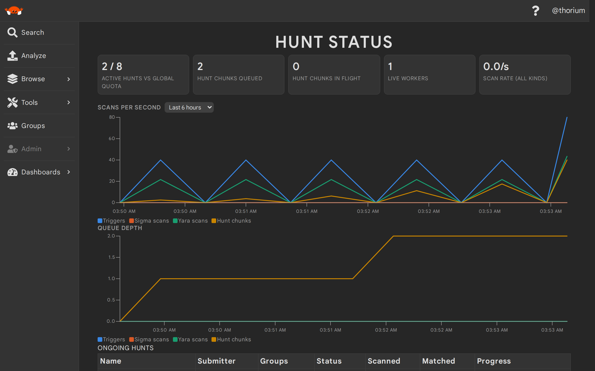
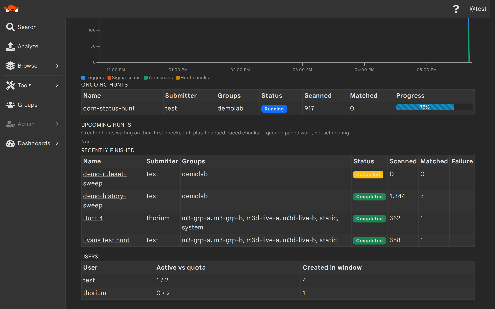

# The Hunt Status Page

The **Hunt Status** page (`Admin → Hunt Status`, `/hunt-status`) is the admin ops surface for rule scanning: what is
hunting right now and what is queued next, who is using hunts and how close they are to their quotas, and how fast
the system is scanning — live and over time. Everything on it is served by admin-only routes (the
[Admin Event Routes](./rule_scanning_ops.md#admin-event-routes)); non-admins get a 401 from every one of them and
are redirected off the page.

## The tiles and charts

The tile row shows active hunts against the global quota (`thorium.hunts.max_active_global`), the paced hunt-chunk
backlog (queued and in flight), the live event-handler worker count, and the current scan rate derived from
consecutive live readings. The two charts plot scans per second by event kind and queue depth over a selectable
1 hour / 6 hour / 24 hour / 7 day range.

The charts read the persisted scan-stats time series: every worker publishes cumulative counters on its 5 second
stats tick, and every `thorium.events.stats_snapshot_secs` (default 30 s) one API-assembled snapshot row lands in
the TTL'd `scan_stats` table — so history survives page reloads, worker restarts, and API rolls, back to
`thorium.events.stats_retention` (default 30 days). Reading the charts honestly:

- **A dip to zero is a worker restart**, not negative throughput: counters are cumulative since process start, so a
  restart resets them and the rate math clamps the one negative delta to zero.
- **Gaps are honest.** A window with no snapshot (zero event-handler replicas, an API outage) renders as a break in
  the line, never an interpolation. A "collecting…" chart means no snapshots exist in the selected range yet.
- **A queue depth that never reaches zero mid-hunt is the pacing working**: every checkpoint win schedules the next
  chunk `inter_chunk_pacing_secs` in the future, and future-scored chunks count as queued.
- **A zero-workers banner** means nothing is scanning and no new snapshots are being written; the page keeps
  polling and recovers on its own when a replica comes back.

## The census tables

- **Ongoing** — every `Running` hunt with its submitter, groups, counters, and the same lane-weighted progress bar
  the hunt details page shows (colored to match the hunt's status); names link to the hunt.
- **Upcoming** — `Created` hunts waiting on their first checkpoint, plus the paced chunk backlog. This is *queued
  paced work, never scheduling*: hunts still start at creation, and recurring/scheduled hunts do not exist.
- **Recently finished** — terminal hunts (`Completed`/`Cancelled`/`Failed`, with failure text) created inside the
  window (default 7 days, cap 30). Recency is by *created* time, not termination time.
- **Users** — per-user active hunts against `thorium.hunts.max_active_per_user` (rows at quota are highlighted) and
  how many hunts each user created inside the window.

The census is computed at read time from entities and tags — nothing per-user is ever persisted — and it counts
through the same `HuntActive` tag walk the create-time quota check uses, so the page and the quota enforcement
always agree. The persisted scan-stats rows carry only anonymous aggregates (counters and gauges keyed by event
kind plus a worker count — never usernames, hunt names or ids, group names, or worker ids), pinned by a schema test.

## Operating notes

- The page polls the census and live stats every 10 seconds while the tab is visible (hidden tabs pause and
  refresh on return, and a slow response never stacks requests). The charts refresh when the range changes and
  then at their information rate — every `max(60 s, range/1000)`, since the server downsamples each range to
  roughly 1,000 points and refreshing faster adds no new data.
- Per-worker counters live in TTL'd Redis keys (`{ns}:event-handler:stats:<KIND>:<WORKER>`) that expire on the
  `worker_expiry_secs` clock — a dead worker leaves the stats view exactly when the reaper would declare it dead,
  while an idle worker keeps publishing unchanged counters and stays visible at a zero rate.
- Snapshot rows are written by whichever event-handler replica's heartbeat fires in each quantized window; replicas
  racing a window collapse onto one row (last write wins) and a short window-keyed gate just avoids duplicate work.
  Zero replicas means no rows — an honest gap, not an error.
- `GET /api/system/stats` (the stats page every user can see) is deliberately untouched by all of this; a schema
  regression test pins that no scan-stats or census field ever joins it.
