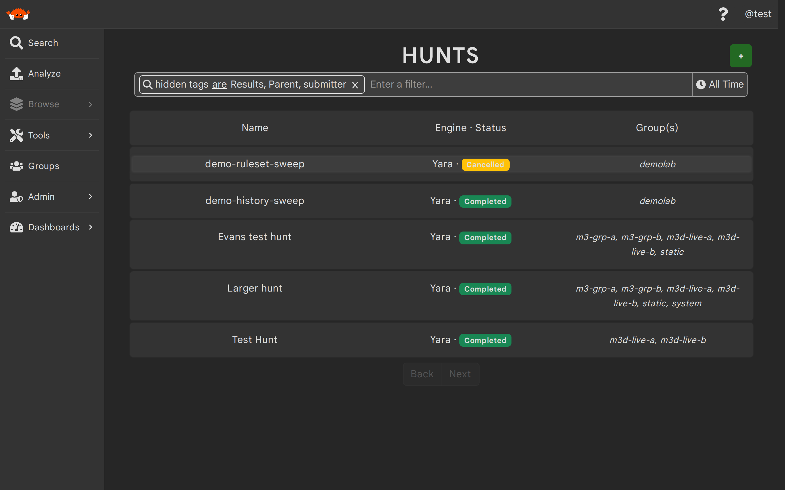
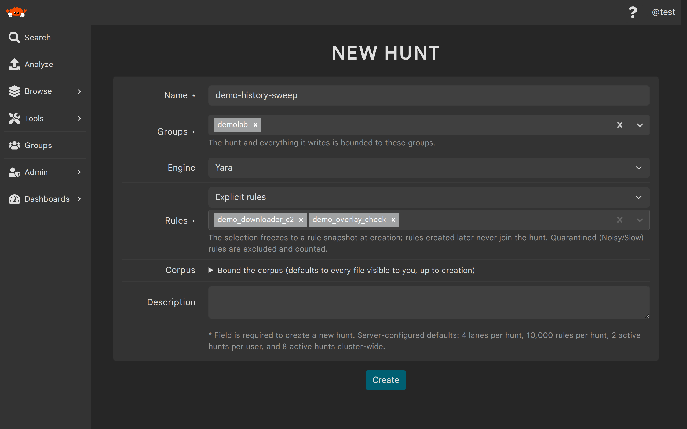
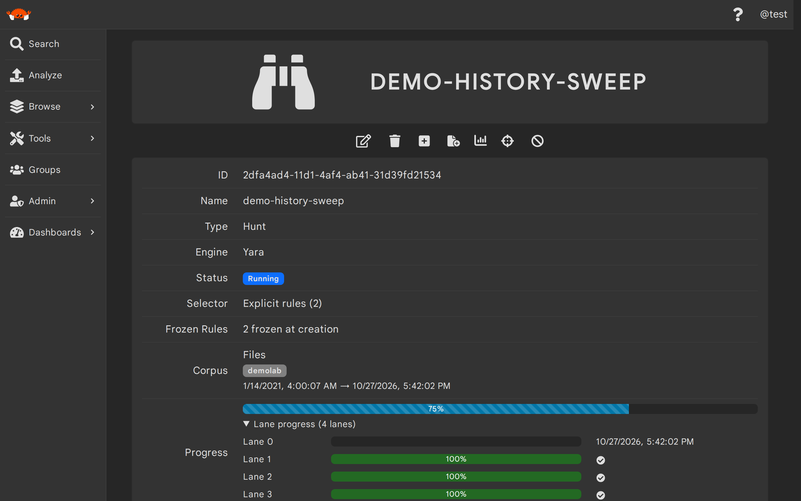
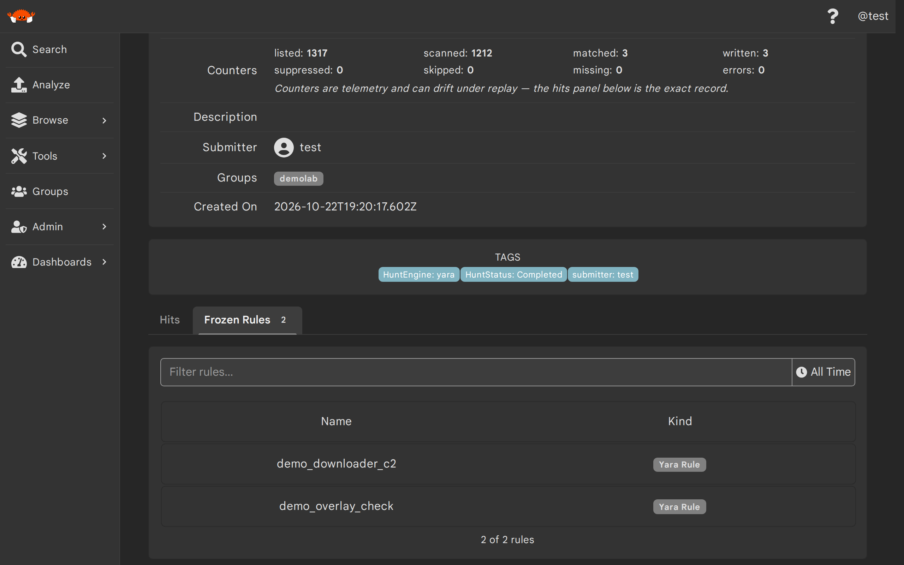
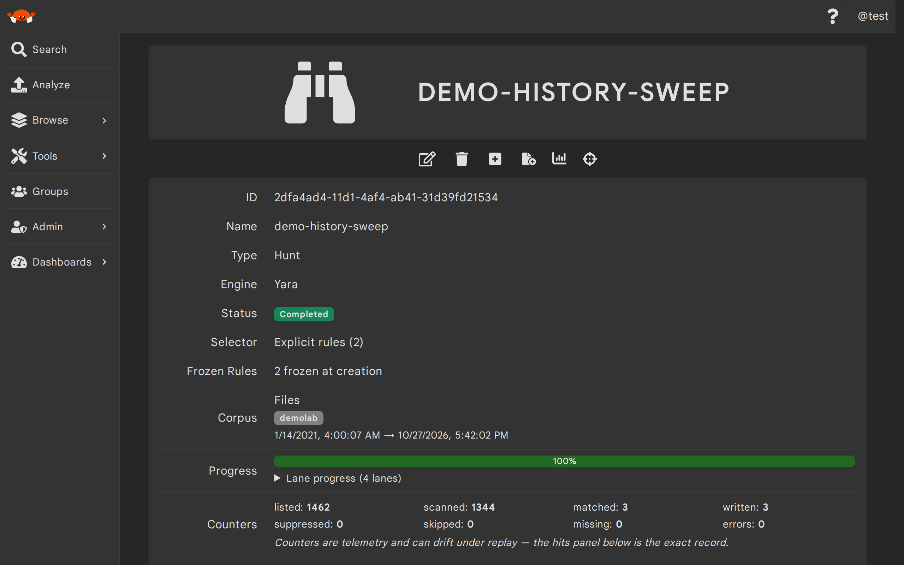
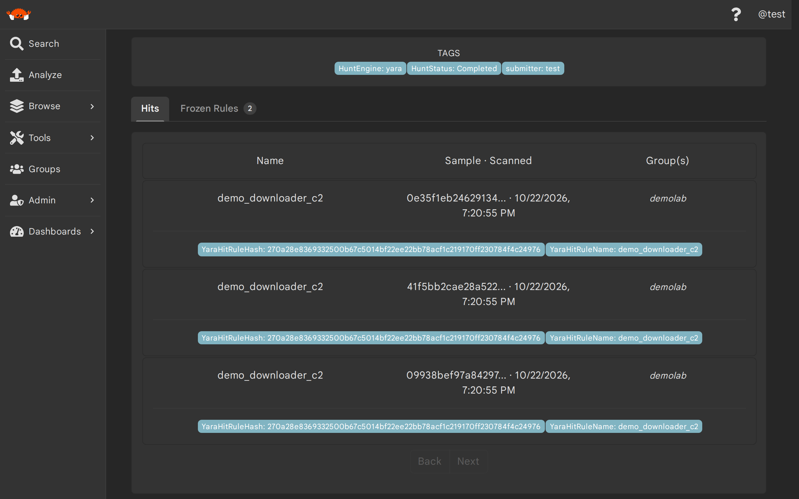
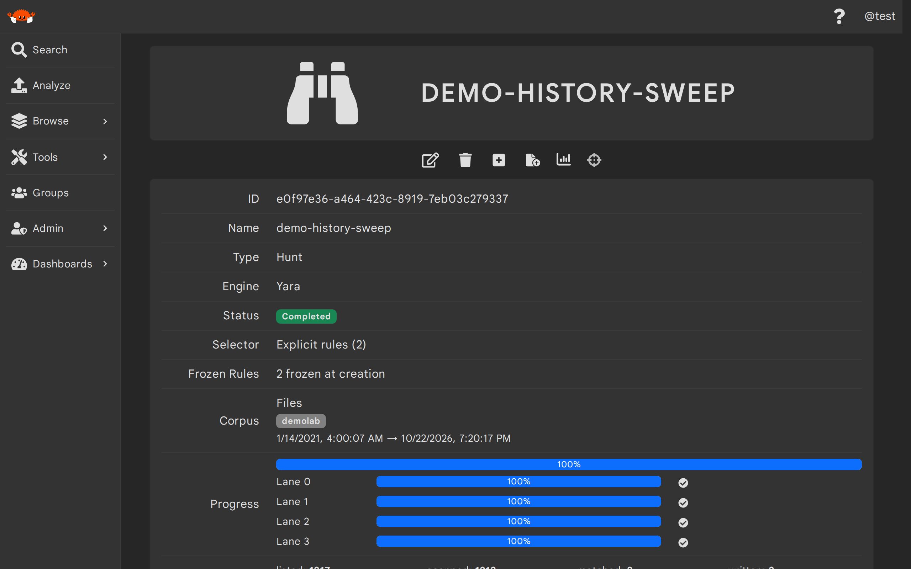
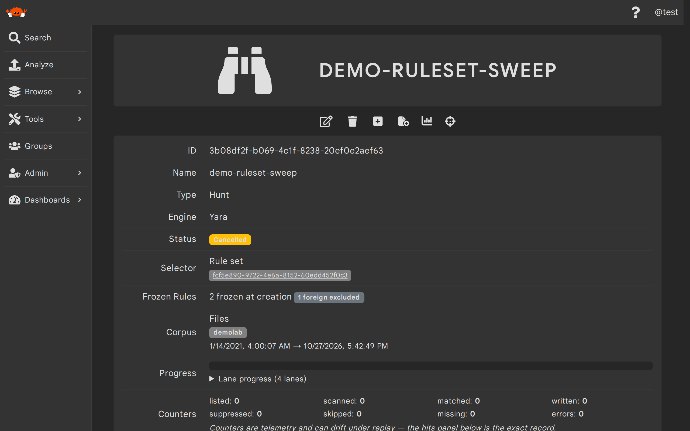

# Hunts

Thorium scans every newly uploaded file against your [YARA rules](./yara_rules.md) automatically, but that
live scanning only covers files uploaded *after* a rule exists. A `hunt` closes that gap: it scans the
historical files you already have against a snapshot of rules that is **frozen** when the hunt is created.
Rules created or edited later never join a running hunt — to apply them to history, launch a new hunt.

When you launch a hunt, Thorium freezes the rules your selector resolves to, splits the corpus's time window
into parallel `lanes`, and walks each lane from newest to oldest at a steady pace so hunts cannot overwhelm
the rest of the cluster. Any user can launch a hunt in groups they can edit; you do not need to be an admin.
Today hunts only support the YARA engine and only scan files.

> If you're a Thorium admin looking for how rule scanning and hunts work under the hood, see
> [Rule Scanning](../architecture/rule-scanning.md). For tuning hunt limits and troubleshooting, see
> [Operate Rule Scanning and Hunts](../admins/rule_scanning_ops.md).

A hunt moves through the following statuses:

| Status | Definition |
| ---- | ---- |
| Created | The hunt has been created but has not reported any progress yet. |
| Running | The hunt has started scanning and at least one lane still has work. |
| Completed | Every lane walked its entire slice of the corpus. This status is terminal. |
| Cancelled | The submitter or an admin cancelled the hunt. This status is terminal. |
| Failed | Thorium stopped the hunt because it could no longer make progress (for example, its frozen snapshot no longer loads any usable rules). This status is terminal. |

Thorium mirrors this lifecycle into tags on the hunt entity: `HuntStatus` carries the current status,
`HuntEngine` carries the engine (`yara`), and `HuntActive=true` is present only while a hunt is `Created` or
`Running`. The hunts browse page already shows the engine and status on every row (so these chips stay
hidden there), but the tags remain filterable through the browse omnibar — for example a `HuntActive` tag
clause narrows the list to just your active YARA hunts.

<p align="center">
    
</p>

## Launching a Hunt (Web UI)
---

To launch a hunt in the Web UI, navigate to the Hunts browse page under `Browse`, click the `+` button, and
fill out the hunt creation form:

<p align="center">
    
</p>

| Field | Description | Format/Accepted Values | Required |
| ---- | ---- | ---- | ---- |
| Name | The name of this hunt | String | yes |
| Groups | The groups this hunt, and everything it writes, is bounded to | One or more groups you can edit | yes |
| Engine | The rule engine this hunt scans with | `Yara` (the only engine currently) | yes |
| Rules | The selector that picks the rules to freeze | `Explicit rules`, `Rules by tag`, `All visible rules`, or `A rule set`<sup>1</sup> | yes |
| Corpus | Bounds on which files this hunt scans | Corpus groups<sup>2</sup>, an oldest/newest date window, and tag filters<sup>3</sup> | no<sup>4</sup> |
| Description | A description for this hunt | String | no |

1. Rule sets may mix engines; members that don't match the hunt's engine are excluded from the frozen snapshot and counted on the hunt's details page. See [Rule Sets](./rule_sets.md).
2. Corpus groups must be a subset of the hunt's groups, so the corpus group picker only offers valid options.
3. Every tag filter must match for a file to be scanned (strict AND); flip the case-insensitive switch to match tag values regardless of case.
4. If you leave the corpus section untouched, the hunt scans every file visible to you, up to the moment of creation.

> The create form's footer lists your server's configured defaults: 4 lanes per hunt, 10,000 rules per hunt,
> 2 active hunts per user, and 8 active hunts cluster-wide. Rules that Thorium has quarantined as noisy or
> slow are excluded from the frozen snapshot and counted, so a hunt may freeze fewer rules than you selected
> (see [YARA Rules](./yara_rules.md) for how quarantine works).

Clicking `Create` launches the hunt and takes you to its details page. If creation fails — for example when
you already have too many active hunts — the API's exact error message is shown in a banner.

## Launching a Hunt (Thorctl)
---

Use `thorctl hunts create` with a name, one or more groups, and exactly one rule selector. There are four
selector forms.

> Every `<RULE>`, `<RULESET>`, and `<HUNT>` argument on this page takes the entity's ID or its exact name.
> When several entities you can see share a name, Thorctl errors and lists the candidates' IDs so you can
> re-run with the one you meant.

Freeze an explicit list of rules:

```bash
$ thorctl hunts create --name <NAME> --groups <GROUP> --rules <RULE>,<RULE>
```

Freeze every rule carrying a specific tag:

```bash
$ thorctl hunts create --name <NAME> --groups <GROUP> --tag <KEY>=<VALUE>
```

Freeze all of the rules visible to you:

```bash
$ thorctl hunts create --name <NAME> --groups <GROUP> --all
```

Freeze the members of a rule set:

```bash
$ thorctl hunts create --name <NAME> --groups <GROUP> --ruleset <RULESET>
```

By default the hunt scans every file visible to you, up to the moment of creation. To bound the corpus, add
any of `--corpus-groups`, `--corpus-start` (the newest file to scan), `--corpus-end` (the oldest), and
`--corpus-tags <KEY>=<VALUE>` (repeatable; every tag must match). The two date flags take UTC datetimes in
the form `2026-10-20T14:30:00` (no zone suffix). Add `--tags-case-insensitive` to match corpus tag values
regardless of case:

```bash
$ thorctl hunts create --name <NAME> --groups <GROUP> --all \
    --corpus-groups <GROUP> --corpus-end <YYYY-MM-DDTHH:MM:SS> --corpus-tags family=emotet
```

On success Thorctl prints the new hunt's ID along with how many rules were frozen and how many were
excluded, plus a hint to follow its progress with `thorctl hunts status <HUNT> --watch`.

## Watching Progress (Web UI)
---

A hunt's details page shows its engine, its status badge, and its machine-managed metadata, and refreshes
itself every 10 seconds while the hunt is active:

<p align="center">
    
</p>

- **Frozen Rules** shows how many rules were frozen at creation, plus badges counting any
  `quarantined excluded` and `foreign excluded` rules.
- **Selector** shows how the rules were chosen and links to the rule set when one was used.
- **Corpus** shows the groups, time window, and tag filters bounding the scan.
- **Progress** draws an overall bar colored by the hunt's status — blue while active, green when completed,
  amber when cancelled, crimson when failed. The per-lane bars (`Lane 0` through `Lane 3` by default) sit
  behind the expandable `Lane progress` section beneath it, which starts collapsed. Lane progress is
  time-based: each bar shows how far through its slice of the corpus's time window that lane has advanced,
  newest to oldest — not a count of files. A check mark appears and the lane's bar turns green once it has
  exhausted its window.
- **Counters** is a grid of scan telemetry: files `listed` and `scanned`, scans that `matched`, hits
  `written` or `suppressed` by group visibility, files `skipped` (oversize) or `missing` (deleted before
  they could be scanned), and `errors` with an expandable sample of error messages.

> Counters are telemetry and can drift under replay — the Hits tab below them is the exact record.

Once every lane is exhausted the hunt flips to `Completed` and the page stops refreshing. A `Failed` hunt
instead shows a banner with the failure reason.

The findings section at the bottom of the page opens on the hunt's **Hits** tab (see the next section);
the **Frozen Rules** tab beside it — its badge counts the frozen snapshot — swaps the panels in place to
list the snapshot itself: every rule the hunt scans with, linked to its details page, with a filter bar
(name, engine, page size, and a creation-date time range) and paging for large snapshots. Rules that were
deleted after the freeze (or that your groups cannot see) list as id-only rows marked `(deleted or hidden)`
— the snapshot is immutable, so the hunt keeps scanning with the text it froze even when the rule entity is
gone. Badges on each row show the rule's *current* quarantine status and exemption, not its state at freeze
time:

<p align="center">
    
</p>

<p align="center">
    
</p>

## Watching Progress (Thorctl)
---

Use `thorctl hunts status` to print a hunt's status, per-lane progress bars, and counters:

```bash
$ thorctl hunts status <HUNT>
```

Add `--watch` to keep polling until the hunt reaches a terminal status (use `--refresh <SECONDS>` to change
the 2 second polling interval). When watching, Thorctl exits with a non-zero code if the hunt ends in
`Failed`:

```bash
$ thorctl hunts status <HUNT> --watch
```

The following clip launches a hunt with an explicit rule selector and watches it run to completion:

```bash
$ thorctl hunts create --name <NAME> --groups <GROUP> --rules <RULE>
$ thorctl hunts status <HUNT> --watch
```

<div class="asciinema-clip" style="max-width: 800px; margin: 0 auto;" data-cast="../static_resources/casts/hunt-run.cast"></div>

## Viewing Hunt Findings (Web UI)
---

Hunt findings are regular YARA rule hits. When a hunt matches a file that live scanning already matched, the
hunt converges on the existing hit instead of writing a duplicate. Hits written for a hunt additionally gain
a `HuntId` tag holding the hunt's ID and a `HuntHit` association linking the hunt to the hit, so a hunt's
findings stay separable from live scanning's even though both land in the same place.

The hunt's details page lists its findings directly: the **Hits** tab at the bottom of the page shows the
hits as they land, with paging for large result sets:

<p align="center">
    
</p>

Each row names the rule that matched, the SHA256 of the file it matched, and when it was scanned. Rows link
to each hit's details page, which in turn links to the rule and the file and lists the matched strings. For
the full browse experience (omnibar tag filtering and a time range picker), click the crosshairs
(`View hunt hits`) button in the toolbar at the top of the page — next to the dashboard button — to open
the YARA rule hits browse page pre-filtered to that hunt's `HuntId` tag:

<p align="center">
    
</p>

## Viewing Hunt Findings (Thorctl)
---

Use `thorctl hunts hits` to print a table of the hits a hunt wrote — the matching rule, the sample's
SHA256, and when it was scanned. The first 50 hits are shown by default; raise `--limit` or pass
`--no-limit` to list more. Hits outlive their hunt, so a deleted hunt's hits stay listable by its ID
(a name can only resolve while the hunt exists):

```bash
$ thorctl hunts hits <HUNT>
```

The following clip lists the findings of a completed hunt, then launches a rule set hunt, cancels it, and
deletes the cancelled hunt:

<div class="asciinema-clip" style="max-width: 800px; margin: 0 auto;" data-cast="../static_resources/casts/hunt-hits.cast"></div>

## Listing Frozen Rules (Thorctl)
---

Use `thorctl hunts rules` to list the frozen snapshot a hunt scans with. Each row shows the rule's name,
engine, current quarantine status (`-` when it has none, `Exempt` when an admin exempted it), ID, and
creation time; rules deleted after the freeze or outside your groups show `(deleted or hidden)` with just
their ID. The usual list flags apply (`--limit`/`--no-limit`, `--page-size`, `--cursor`, `--json`,
`--condensed`, `--output`):

```bash
$ thorctl hunts rules <HUNT>
```

The following clip lists a group's hunts and then the frozen rules of one of them:

<div class="asciinema-clip" style="max-width: 800px; margin: 0 auto;" data-cast="../static_resources/casts/hunt-rules.cast"></div>

## Cancelling a Hunt (Web UI)
---

To stop a hunt before it completes, click the ban (`Cancel hunt`) button on its details page. A confirmation
modal asks:

> Do you really want to cancel this hunt? Running chunks stop within one chunk and the hunt cannot be
> resumed.

Only the hunt's submitter or an admin can cancel a hunt. Cancellation is irreversible — a cancelled hunt can
never be resumed, so to scan that history again you must launch a new hunt. Hits the hunt already wrote are
kept. The cancel button disappears once a hunt reaches a terminal status.

<p align="center">
    
</p>

## Cancelling a Hunt (Thorctl)
---

Use `thorctl hunts cancel`:

```bash
$ thorctl hunts cancel <HUNT>
```

You will be asked to confirm before the hunt is cancelled; pass `--skip-confirm` (`-y`) to skip the prompt,
which is required when running without a terminal. Cancelling an already-cancelled hunt succeeds without
doing anything, while cancelling a `Completed` or `Failed` hunt is an error.

## API Routes
---

| Method | Route | Description |
|--------|-------|-------------|
| `POST` | `/api/entities/hunt/` | Create a hunt |
| `POST` | `/api/entities/hunt/<ID>/cancel` | Cancel a hunt (submitter or admin only) |
| `GET` | `/api/entities/hunt/<ID>/rules` | List a hunt's frozen rules (cursor paged; deleted rules list id-only) |
| `GET` | `/api/entities/<ID>` | Get a hunt, including its status, lanes, and counters |
| `GET` | `/api/entities/?kinds[]=Hunt` | List hunts; add `tags[HuntActive][]=true` to list only active hunts |
| `GET` | `/api/entities/?kinds[]=YaraRuleHit&tags[HuntId][]=<ID>` | List the hits a hunt wrote |
| `PATCH` | `/api/entities/<ID>` | Update a hunt's name, description, or groups |
| `DELETE` | `/api/entities/<ID>` | Delete a hunt |

Hunts are created with a JSON body. The engine value is lowercase (`"yara"`), and both `corpus` and
`description` may be omitted:

```json
{
  "name": "<NAME>",
  "groups": ["<GROUP>"],
  "engine": "yara",
  "selector": {"Rules": ["<RULE_ID>"]},
  "corpus": {
    "Files": {
      "groups": ["<GROUP>"],
      "start": "<NEWEST_RFC3339_TIMESTAMP>",
      "end": "<OLDEST_RFC3339_TIMESTAMP>",
      "tags": {"family": ["emotet"]},
      "tags_case_insensitive": false
    }
  },
  "description": "<DESCRIPTION>"
}
```

The `selector` field takes one of four shapes:

| Selector | Shape |
|----------|-------|
| Explicit rules | `{"Rules": ["<RULE_ID>", "<RULE_ID>"]}` |
| Rules by tag | `{"Tag": {"key": "<KEY>", "value": "<VALUE>"}}` |
| All visible rules | `"All"` |
| A rule set | `{"RuleSet": "<RULESET_ID>"}` |

### FAQ

##### Why did my hunt freeze fewer rules than I selected?

Rules that Thorium quarantined as noisy or slow are excluded from the snapshot and counted on the details
page as `quarantined excluded`, and rule set members that don't match the hunt's engine are excluded as
`foreign excluded`. The snapshot is also frozen at the instant of creation, so rules created after that
never join — launch a new hunt to include them. List exactly what froze with `thorctl hunts rules <HUNT>` or
the hunt page's **Frozen Rules** tab; if a quarantined rule must be huntable, an admin can exempt it from
quarantine (which also re-admits it) and you can launch a new hunt.

##### Why don't the counters match the hits I see?

Counters are telemetry: they can drift when work is retried, and a `matched` scan may converge onto a hit
that live scanning already wrote. The Hits tab on the hunt's details page — backed by the hunt's `HuntId`
tag, like the pre-filtered hits browse the page's crosshairs button opens and `thorctl hunts hits` — is the
exact record of a hunt's findings.

##### My hunt has been sitting in Created with no progress. What now?

In rare cases a hunt can be stranded at creation and never start. There is no way to kick a stranded hunt,
so cancel it and create it again.

##### Can I hunt with Sigma rules or over repositories?

Not yet. Hunts currently only support the YARA engine, and only over files — a `Repos` corpus is rejected
at creation.

##### Can I change a hunt after launching it?

Only its name, description, and groups. Everything else — the frozen rules, corpus, status, lanes, and
counters — is machine-managed and read-only. To hunt with different rules or a different corpus, launch a
new hunt.
