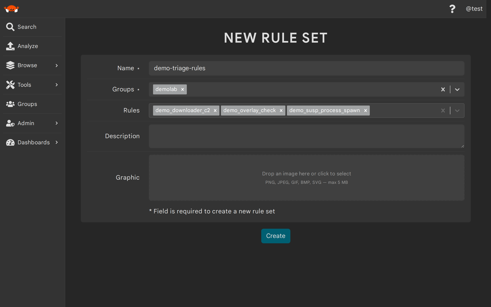
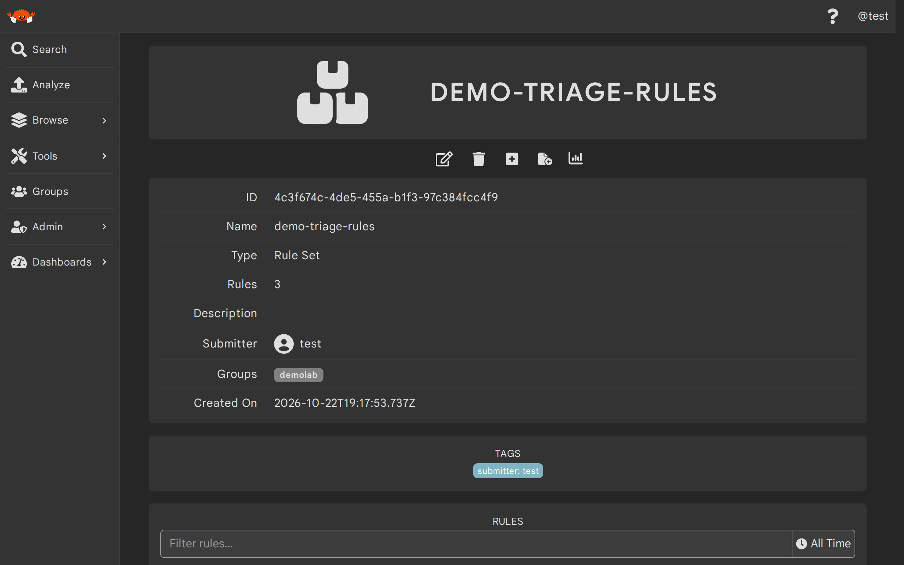

# Rule Sets

A rule set is a named collection of detection rules. A single rule set can mix rules from different
engines, so [YARA rules](./yara_rules.md) and [Sigma rules](./sigma_rules.md) can live side by side in
the same set. Rule sets are capped at 1,000 member rules by default (a Thorium admin can change this
limit).

Rule sets exist mainly to feed [hunts](./hunts.md): instead of listing rules one by one or hunting
with every rule you can see, you curate a set once and select it when launching a hunt. Rule sets do
not change automatic scanning — your YARA rules already scan new uploads whether or not they are in a
rule set.

> If you're a Thorium admin looking for how rule scanning works under the hood or how to tune its
> limits, see [Rule Scanning](../architecture/rule-scanning.md) and
> [Operate Rule Scanning and Hunts](../admins/rule_scanning_ops.md).

## Creating Rule Sets (Web UI)
---

To create a rule set in the Web UI, open `Rule Sets` in the sidebar's browse section and click the `+`
button. Give the rule set a name, select the groups it should be in, and pick its member rules. The
rules picker lists your Sigma and YARA rules by name, and you can mix both engines in one set. After
you click create, you land on the new rule set's details page.

<p align="center">
    
</p>

## Creating Rule Sets (Thorctl)
---

Use `thorctl rulesets create` (or `thorctl ruleset create`) with a name, one or more groups, and the
member rules to start with:

```bash
$ thorctl rulesets create --name <NAME> --groups <GROUP> --rules <RULE>,<RULE>
```

The `--rules` (`-r`) flag takes a comma separated list of rules — each an ID or an exact name — of
either engine. The `--groups` (`-g`) flag is also comma separated. You can optionally set a
description with `--description` (`-d`) and apply tags with `--tags` (`-T`) in the format `KEY=VALUE`.

> Rule and rule set arguments take IDs or exact names interchangeably. When several entities you can
> see share a name, Thorctl errors and lists the candidates' IDs so you can re-run with the one you
> meant.

## Managing Members (Web UI)
---

Open a rule set from the `Rule Sets` browse page to view it. The metadata card shows a count of its
member rules, and the `Rules` section below lists the members themselves. You can filter that list by
rule name or kind, narrow it to rules created in a time range with the picker at the end of the filter
bar, and page through it with the `Back`/`Next` buttons; each member links to its own details page.

To change membership, click the edit (pencil) icon. The rules row becomes a chip picker: remove a
member with its chip's remove control, or type to search your rules by name and add them. Click the
save icon to commit your changes.

<p align="center">
    
</p>

## Managing Members (Thorctl)
---

Use `thorctl rulesets update` with `--add-rules` and/or `--remove-rules` to change a rule set's
membership. Both flags take comma separated rule IDs or names. The following clip creates a rule set,
adds a rule to it, removes another, and lists the group's rule sets:

<div class="asciinema-clip" style="max-width: 800px; margin: 0 auto;" data-cast="../static_resources/casts/ruleset-manage.cast"></div>

```bash
$ thorctl rulesets create --name <NAME> --groups <GROUP> --rules <RULE>,<RULE>
$ thorctl rulesets update <RULESET> --add-rules <RULE>
$ thorctl rulesets update <RULESET> --remove-rules <RULE>
$ thorctl rulesets list --groups <GROUP>
```

> Membership changes are validated like creation: every member must be an existing YARA or Sigma rule,
> and the surviving membership must stay under the rule set cap.

## Inspecting and Deleting Rule Sets (Thorctl)
---

Use `thorctl rulesets get` to see a rule set's full details, including its hydrated member list, and
`thorctl rulesets delete` to retire sets you no longer hunt with. You will be asked to confirm before
anything is deleted; `--skip-confirm` (`-y`) skips the prompt. Deleting a rule set never deletes its
member rules — and never changes hunts already created from it, since those froze their own snapshot:

<div class="asciinema-clip" style="max-width: 800px; margin: 0 auto;" data-cast="../static_resources/casts/ruleset-inspect.cast"></div>

```bash
$ thorctl rulesets get <RULESET>
$ thorctl rulesets delete <RULESET>
```

## Using Rule Sets in Hunts
---

Rule sets are one of the rule selectors you can launch a [hunt](./hunts.md) with: choose `A rule set`
when creating a hunt in the Web UI, or pass `--ruleset <RULESET>` (`-R`) to `thorctl hunts create`.

Hunts freeze rule membership at creation. When a hunt is created it resolves your rule set into a
concrete list of rule IDs and scans with exactly that snapshot, so rules added to the set later never
join an existing hunt — not even one that is still running. Editing or even deleting the rule set never
changes a hunt that was created from it. To hunt with updated membership, launch a new hunt.

Because a hunt runs a single engine, members of another engine are excluded from the snapshot and
counted: a YARA hunt launched from a mixed rule set skips the set's Sigma members and reports them as a
`foreign excluded` count on the hunt details page.

## API Routes
---

Rule sets use the generic entities routes with the kind `RuleSet`:

| Method | Route | Description |
|--------|-------|-------------|
| `POST` | `/api/entities/` | Create a rule set (multipart form) |
| `GET` | `/api/entities/` | List entities; filter rule sets with `kinds[]=RuleSet` |
| `GET` | `/api/entities/details/` | List entities with their full details |
| `GET` | `/api/entities/<ID>` | Get a rule set, including its member rules |
| `PATCH` | `/api/entities/<ID>` | Update a rule set (multipart form) |
| `DELETE` | `/api/entities/<ID>` | Delete a rule set |

> The list routes require the trailing slash — `GET /api/entities` without it is a 404.

Creating a rule set is a multipart form with the following fields:

| Field | Description | Format/Accepted Values | Required |
|-------|-------------|------------------------|----------|
| `kind` | The kind of entity to create | `RuleSet` | yes |
| `name` | The name of the rule set | A string | yes |
| `groups[]` | A group to create the rule set in (repeat per group) | A group you can edit<sup>1</sup> | yes |
| `metadata[ruleset_rules][]` | A member rule's ID (repeat per member) | The ID of an existing YARA or Sigma rule<sup>2</sup> | no |
| `description` | A description for the rule set | A string | no |
| `tags[<KEY>][]` | A tag value to apply under `<KEY>` (repeat per value) | Any string | no |

1. You must have an edit role in every requested group, and at least one group is required.
2. Pointing a member at any other kind of entity is rejected, and a missing ID returns a 404 naming it.

Updates go through the same `PATCH` route with add/remove keys: repeat `metadata[add_ruleset_rules][]`
for each rule to add and `metadata[remove_ruleset_rules][]` for each rule to remove.
