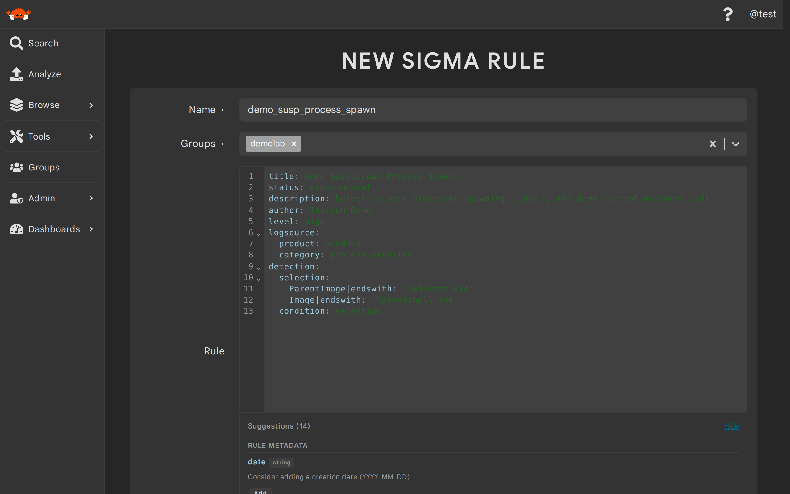
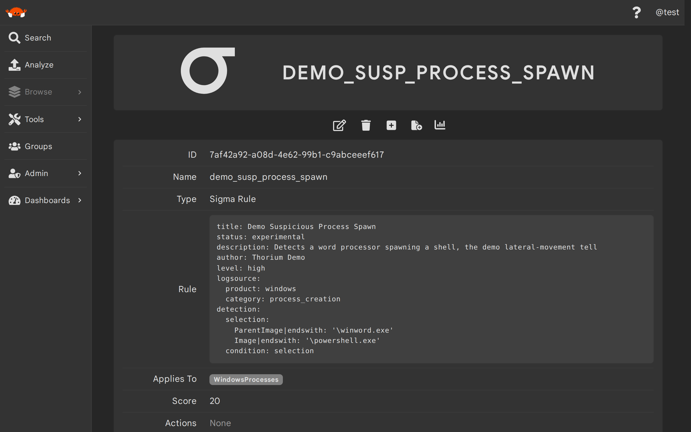

# Sigma Rules

Sigma rules are YAML detection rules that scan the structured entities tools attach to their
[results](./viewing_results.md), like the Windows processes or network connections a sandbox or
parser extracts. Unlike [YARA rules](./yara_rules.md), which scan a file's raw bytes, Sigma rules
never look at file content — they match on the fields of those result entities. Each Sigma rule is
a group-scoped entity in Thorium with its own name, groups, tags, and description.

Scanning is automatic: when a tool result containing scannable entities is saved, Thorium scans
those entities with the Sigma rules that apply to them, usually within seconds. Every rule carries
a score that becomes the suspicion level of the flags it creates. If you don't set a score
yourself, Thorium derives one from the rule's `level` field: `informational` (or no level) is 0,
`low` is 1, `medium` is 5, `high` is 20, and `critical` is 50.

> This page covers using Sigma rules as a Thorium user. If you're an admin looking for how rule
> scanning works under the hood or how to operate and tune it, see
> [Rule Scanning](../architecture/rule-scanning.md) and
> [Operate Rule Scanning and Hunts](../admins/rule_scanning_ops.md).

## Creating Sigma Rules (Web UI)
---

To create a Sigma rule in the Web UI, select `Sigma Rules` under `Browse` in the sidebar and click
the `+` button. The rule editor checks your YAML as you type, and Thorium parses the rule again
when you click `Create`, rejecting any rule that is not valid Sigma YAML. After a successful
create you land on the new rule's details page.

<p align="center"></p>

| Field | Description | Format/Accepted Values | Required |
|-------|-------------|------------------------|----------|
| Name | The name for this rule | Any string | yes |
| Groups | The groups this rule is in<sup>1</sup> | One or more of your groups | yes |
| Rule | The Sigma rule itself | Valid Sigma YAML | yes |
| Applies To | The kinds of result entities this rule scans<sup>2</sup> | `WindowsProcesses`, `NetworkConnections` | no |
| Score | The suspicion score for the flags this rule creates | A number, 0 or greater<sup>3</sup> | no |
| Actions | What to do when this rule matches<sup>4</sup> | `Flag` actions, each with an optional content and a required reasoning | no |
| Description | A description for this rule | Any string | no |

1. You must be a user, analyst, manager, or owner in every group you select. The flags this rule
   creates are also created in these groups.
2. A rule that doesn't apply to any entity kind is never run.
3. Left unset, the score defaults based on the rule's `level` as described above.
4. A match only produces something through its actions, so add at least one `Flag` action to any
   rule whose matches you want to see.

> Thorium only validates the YAML when a rule is **created** — updates do not re-validate it. If
> you edit a rule, double check that your new YAML still parses: a rule that no longer parses is
> silently skipped during scanning.

## Creating Sigma Rules (Thorctl)
---

Use `thorctl rules create` with `-e sigma` to create a Sigma rule from a YAML file on disk:

<div class="asciinema-clip" style="max-width: 800px; margin: 0 auto;" data-cast="../static_resources/casts/sigma-create.cast"></div>

```bash
$ thorctl rules create -e sigma --name <RULE_NAME> --groups <GROUP> --rule-file <PATH_TO_RULE>
$ thorctl rules get <RULE>
```

> `<RULE>` is the rule's ID or its exact name — rule, rule set, and hunt arguments across Thorctl accept
> either, and a name shared by several rules you can see errors with the candidates' IDs.

`--groups` (`-g`) takes one or more comma separated groups. If the file is not valid Sigma YAML,
the create fails and the server's parse error is printed.

Set `--applies-to` to pick which kinds of result entities the rule scans (`windows-processes`,
`network-connections`, `compiled-functions`, or `decompiled-functions` — the Web UI currently
offers the first two), and use `--score` (`-s`) to override the score derived from the rule's
`level`. You can also tag and describe the rule as you create it:

```bash
$ thorctl rules create -e sigma -n <RULE_NAME> -g <GROUP> -f <PATH_TO_RULE> \
    --applies-to windows-processes --score 50 -T Source=internal -d "Flags suspicious process spawns"
```

To bulk import a directory of rule files (`.yml`/`.yaml` files are imported as Sigma rules), use
`thorctl rules import`, which is covered on the [YARA Rules](./yara_rules.md) page.

## What a Sigma Match Produces
---

When a Sigma rule matches an entity, Thorium runs the rule's actions. The only action type today
is a `Flag` action, which creates a `Flag` entity:

- The flag is named after the rule and created in the **rule's** groups.
- Its suspicion is the rule's score, while its confidence, content, and reasoning come from the
  action.
- The flag is tied to the entity it flagged with a `FlagFor` [association](./associations.md) and
  to the rule that created it with a `CreatedBy` association, so you can walk from a rule to its
  flags, or from a flagged entity back to the rule, on their details pages.

A Sigma match does not tag the scanned file and does not create a hit entity the way a YARA match
does — flags are the only record of Sigma matches. A matching rule with no actions produces
nothing visible at all.

> Flags are created on behalf of the user whose tool run produced the results, and that user must
> be a member of at least one of the rule's groups — matches on results from users outside the
> rule's groups are dropped.

## Viewing and Managing Sigma Rules (Web UI)
---

`Sigma Rules` under `Browse` lists the Sigma rules in your groups, and clicking a row opens that
rule's details page where you can read its YAML, metadata, groups, and tags.

<p align="center"></p>

Thorium automatically tags every Sigma rule with info parsed from its YAML and refreshes those
tags whenever the rule is edited. Each tag is only present when the YAML sets the matching field,
and you can filter the rule list by any of them:

| Tag | Value |
|-----|-------|
| `SigmaRuleId` | The rule's `id` field |
| `SigmaRuleAuthor` | The rule's `author` field |
| `SigmaRuleStatus` | The rule's `status` field |
| `SigmaRuleLevel` | The rule's `level` field |

Click the pencil icon on the details page to edit the rule's name, description, groups, YAML,
score, what it applies to, and its actions; click the trash icon to delete it. You need an edit
role (user, analyst, manager, or owner) in the rule's groups to edit it, and only the rule's
submitter, an admin, or a manager/owner of every group the rule is in can delete it.

## Viewing and Managing Sigma Rules (Thorctl)
---

`thorctl rules list` prints a table of your rules from both engines; pass `-e sigma` to only list
Sigma rules:

```bash
$ thorctl rules list -e sigma
```

Use `--groups` (`-g`) to only list rules from certain groups and `--limit` (`-l`) or `--no-limit`
to change how many are listed. Use `--json`, `--condensed` (`-c`), or `--output <PATH>` (`-o`) to
get JSON instead of a table. To see a single rule's full details — a human-readable summary
followed by its YAML verbatim (add `--json` for the full entity as JSON) — use
`thorctl rules get <RULE>`.

`thorctl rules update` edits a rule in place; its flags map to the same fields as the create
command:

```bash
$ thorctl rules update <RULE> --rule-file <PATH_TO_RULE> --score 20
$ thorctl rules update <RULE> --add-groups <GROUP> --description "Now shared with the IR team"
```

Remember that updated YAML is not re-validated, so make sure a replacement rule file still parses.

`thorctl rules delete` deletes one or more rules by ID or name. You will be asked to confirm
before anything is deleted; use `--skip-confirm` (`-y`) to skip the prompt.

```bash
$ thorctl rules delete <RULE>
```

## API Routes
---

| Method | Route | Description |
|--------|-------|-------------|
| `POST` | `/api/entities/` | Create a Sigma rule (multipart form with `kind` set to `SigmaRule`) |
| `GET` | `/api/entities/?kinds[]=SigmaRule` | List Sigma rules |
| `GET` | `/api/entities/details/?kinds[]=SigmaRule` | List Sigma rules with their full details |
| `GET` | `/api/entities/<ID>` | Get a single Sigma rule |
| `PATCH` | `/api/entities/<ID>` | Update a Sigma rule (multipart form) |
| `DELETE` | `/api/entities/<ID>` | Delete a Sigma rule |
| `POST` | `/api/entities/tags/<ID>` | Add tags to a Sigma rule |
| `DELETE` | `/api/entities/tags/<ID>` | Delete tags from a Sigma rule |
| `GET` | `/api/entities/associations/<ID>` | List a rule's associations, including the flags it created |

The create form carries the rule in `metadata[sigma_rule]`, with `metadata[score]`,
`metadata[sigma_applies_to][]`, and `metadata[sigma_actions][]` (one JSON encoded action per
field) alongside the common `name`, `groups[]`, and `description` fields.

> The trailing slash on the list routes is required: `GET /api/entities` returns a 404 while
> `GET /api/entities/` lists entities.

### FAQ

##### Can I run a hunt with Sigma rules?

Not yet. [Hunts](./hunts.md) currently only support the YARA engine, so Sigma rules only scan new
tool results as they are created — results that existed before a Sigma rule did are never scanned
by it.

##### What exactly do Sigma rules scan?

The structured entities that tools attach to their results, such as Windows processes, network
connections, and compiled or decompiled functions. A rule only scans the entity kinds listed in its `Applies To` field, and it never
scans a file's raw bytes — use [YARA rules](./yara_rules.md) for that. If none of your tools
attach these entities to their results, your Sigma rules have nothing to scan.

##### A rule should have matched, so why don't I see any flags?

The usual causes, in the order to check them:

- The rule has no `Flag` actions — a match without actions produces nothing visible.
- The rule's `Applies To` doesn't include the kind of entity you expected it to scan.
- The user who uploaded the results doesn't share a group with the rule, so the flag was dropped.
- The rule's YAML no longer parses after an update — updates are not re-validated, so re-save the
  rule with valid YAML.
