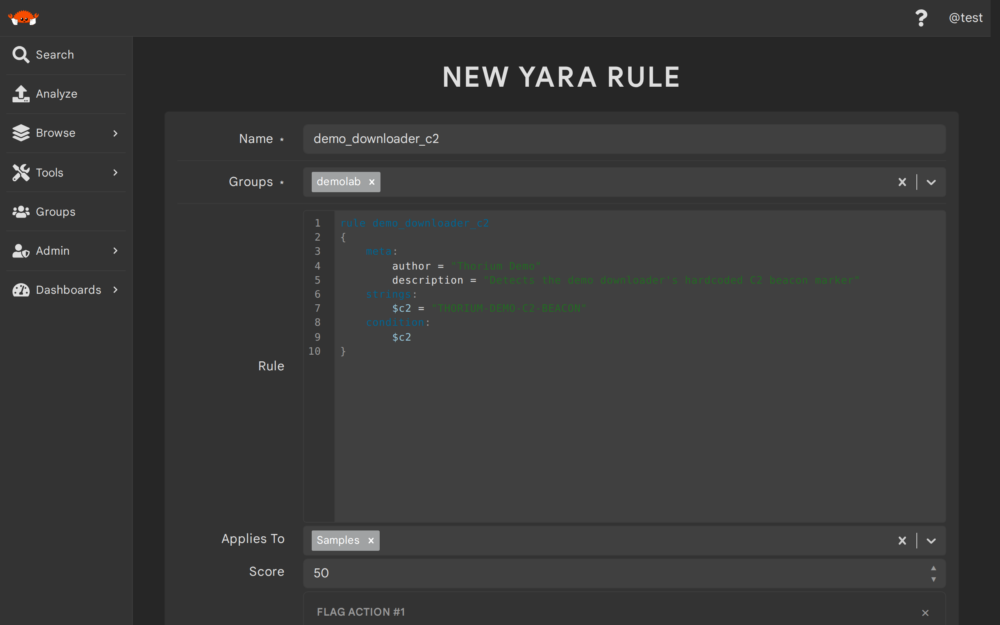
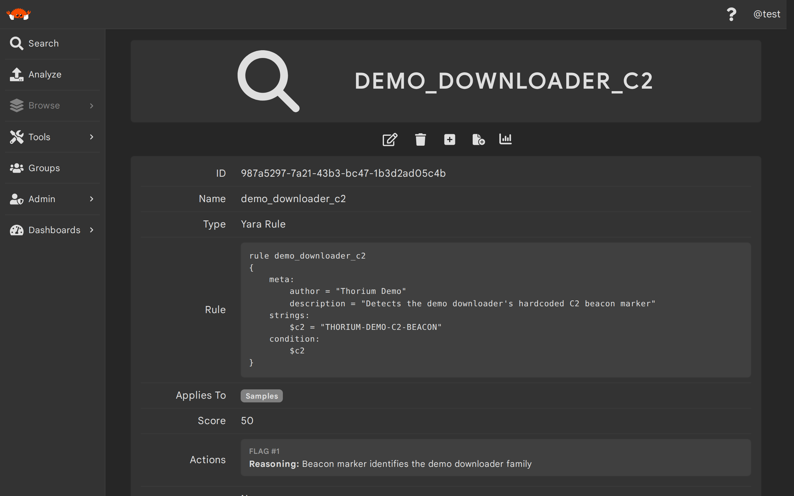
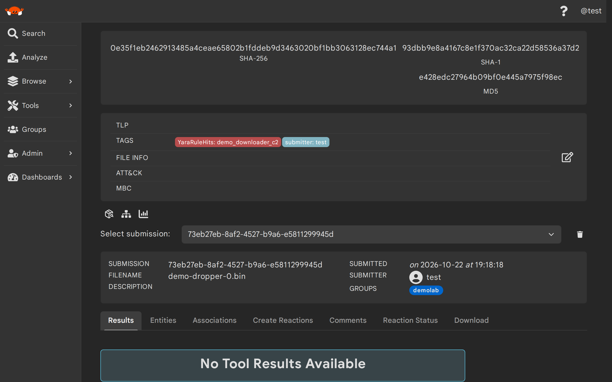
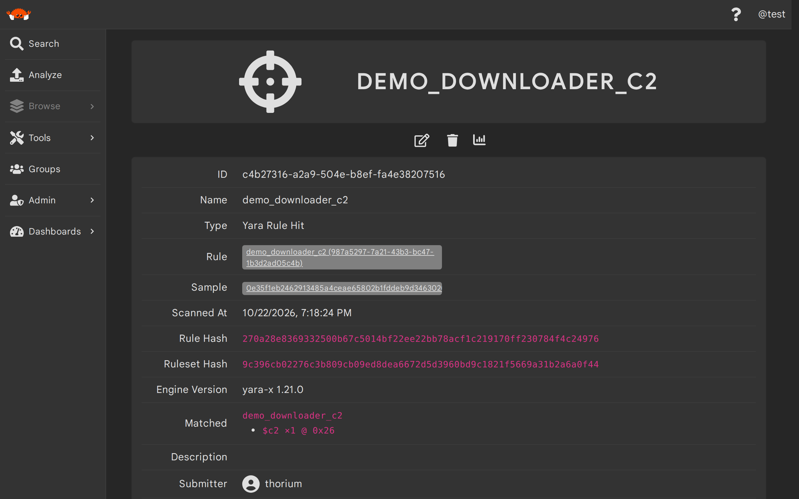

# YARA Rules

YARA rules let Thorium scan every file it ingests for the patterns you care about. A YARA rule in Thorium is a
group-scoped `entity` that holds one YARA source document. A document may define several `rule` blocks and is kept
whole, so private rules and conditions that reference other rules in the same document still resolve. YARA rules
scan the raw bytes of samples; to scan the structured data that tools attach to their results, use
[Sigma rules](./sigma_rules.md) instead.

Once you create a YARA rule, Thorium automatically scans every newly uploaded sample against it, typically within
seconds of upload. Files that were already in Thorium when the rule was created are only scanned when you launch a
[hunt](./hunts.md), and rules can be collected into [rule sets](./rule_sets.md) to hunt with curated collections.

> This page covers using YARA rules as a Thorium user. If you are an admin looking for how scanning works under
> the hood, see [Rule Scanning](../architecture/rule-scanning.md); for how to operate and tune it, see
> [Operate Rule Scanning and Hunts](../admins/rule_scanning_ops.md).

## How Scanning Works
---

When a YARA rule matches a sample, Thorium records a hit:

- A `YaraRuleHit` entity records the rule, the sample's SHA256, the matched strings, when the scan ran, and a
  hash of the exact rule text that fired. Re-scans and hunts converge onto the same hit instead of duplicating it.
- The sample is tagged with the danger tag `YaraRuleHits=<RULE_NAME>`. Because this is a normal file tag,
  pipelines with matching tag triggers automatically spawn reactions on hits.
- The hit is associated `CreatedBy` to the rule and `YaraRuleHit` to the sample (see
  [Associating Data](./associations.md)), and any `Flag` actions on the rule create flag entities for the hit.

Visibility follows groups: a hit is only written to groups that can see **both** the rule **and** the sample. If
none of your groups can see a rule another team wrote, you will never see its hits, and vice versa. Samples
larger than your instance's scan size cap are never scanned and are tagged `YaraScanSkipped=oversize:<CAP>` so
the skip is visible.

## Creating Rules (Web UI)
---

To create a YARA rule in the Web UI, browse to `Yara Rules` in the sidebar and click the `+` button. The rule
editor checks your YARA syntax as you type.

<p align="center"></p>

| Field | Description | Format/Accepted Values | Required |
| ----- | ----------- | ----------- | ----- |
| Name | The name for this rule entity | Any UTF-8 formatted text | yes |
| Groups | The groups this rule is in; they bound who can see the rule and its hits | One or more of your groups<sup>1</sup> | yes |
| Rule | The YARA source document (may define several `rule` blocks) | Valid YARA source<sup>2</sup> | yes |
| Applies To | The kind of data this rule scans | `Samples` | yes |
| Score | How suspicious a match is | An integer; defaults to 0 | no |
| Actions | Flag actions that automatically flag every new hit | A reasoning (required) and content (optional) per flag action | no |
| Tags | Key/value tags for the rule entity | Any key/value pairs | no |
| Description | A description of what this rule finds | Any UTF-8 formatted text | no |

1. You must have an edit role (user, analyst, manager, or owner — not monitor) in every group you select, and
   those groups must allow entities.
2. The rule must compile under the `yara-x` engine, must be 128 KiB or smaller, cannot contain `include`
   statements, and may only `import` modules from your instance's allowlist (by default: `pe`, `elf`, `macho`,
   `dotnet`, `math`, `hash`, `string`, `time`, `lnk`). Rejections quote the compiler's errors and warnings.

## Creating Rules (Thorctl)
---

Use `thorctl rules create` (or `thorctl rule create`) to create a single rule from a file of YARA source:

<div class="asciinema-clip" style="max-width: 800px; margin: 0 auto;" data-cast="../static_resources/casts/rules-create.cast"></div>

```bash
$ thorctl rules create --name <RULE_NAME> --engine yara --rule-file <PATH_TO_RULE> --groups <GROUP>
```

Add `--score` (`-s`) to set a score, `--tags KEY=VALUE` (`-T`) to tag the rule, and `--description` (`-d`) to
describe it. `--groups` (`-g`) takes a comma separated list for multiple groups. If the server rejects the rule,
Thorctl prints the server's error verbatim, including the compiler's errors and warnings.

To bulk import a directory tree of rule files, use `thorctl rules import`:

<div class="asciinema-clip" style="max-width: 800px; margin: 0 auto;" data-cast="../static_resources/casts/rules-import.cast"></div>

```bash
$ thorctl rules import --groups <GROUP> <RULES_DIR>
```

The engine is inferred from each file's extension (`.yar`/`.yara` import as YARA, `.yml`/`.yaml` as Sigma); pass
`--engine` (`-e`) to force one, `--filter`/`--skip` regexes to choose which files are imported, `--include-hidden`
to walk hidden files, and `--dry-run` to preview without creating anything. Each file lands in the report table
as an `IMPORTED` row carrying its new rule ID (re-importing an identical rule shows `EXISTS` instead), and the
run ends with a compatibility report tallying the outcomes. Pass `--report <PATH>` to also write that report to
disk as JSON.

Rules that fail to import show a `FAILED` row quoting the compile error — handy when migrating a legacy
collection, since some legacy rules do not compile under `yara-x`. The compatibility report repeats every
failure's full error and the run exits nonzero:

```text
 STATUS | PATH                 | NAME      | MESSAGE
--------+----------------------+-----------+----------------------------------------
 FAILED | legacy/bad_regex.yar | bad_regex | Yara rule failed to compile: errors: [

Compatibility report: 0 imported, 0 already existed, 1 failed, 0 skipped

Failed: legacy/bad_regex.yar
  Yara rule failed to compile: errors: [
      "error[E014]: invalid regular expression\n --> line:7:17\n  |\n7 |     $re = /DEMO-[0-9/\n  |                 ^ unclosed character class",
  ] warnings: []
1 rule file(s) failed to import
```

## Viewing Rules and Their Hits (Web UI)
---

Browse to `Yara Rules` in the sidebar to list the YARA rules your groups can see, then click a rule to open its
details page showing the rule source, score, actions, and tags:

<p align="center"></p>

Thorium maintains intrinsic tags on every YARA rule and refreshes them whenever the rule is edited: `YaraRuleHash`
(a hash of the source), one `YaraRuleName` per `rule` block in the document, `YaraRuleAuthor` and
`YaraRuleDescription` (pulled from the rules' `meta` fields), and `YaraRuleTags` (the rules' YARA tags).

When a rule hits one of your files, the hit shows up on the file details page as a `YaraRuleHits` danger tag, and
the hit entity appears in the file's `Associations` tab:

<p align="center"></p>

To browse hits themselves, open `Show more` in the sidebar's browse section and select `Yara Rule Hits`. Every
hit carries `YaraHitRuleName=<RULE_NAME>` and `YaraHitRuleHash=<HASH>` tags, so filtering on `YaraHitRuleName`
answers "what has this rule ever hit?". Click a hit to see links to its rule and sample, when the scan ran, the
hash of the exact rule text and the engine version that fired, and the matched strings with counts and offsets:

<p align="center"></p>

> Hits found by a hunt also carry a `HuntId=<HUNT_ID>` tag — see [Hunts](./hunts.md) to browse a hunt's findings.

## Viewing Rules (Thorctl)
---

List the rules you can see with `thorctl rules list`. The first 50 rules are shown in a table of name, engine,
ID, and creation time; use `--groups` (`-g`) and `--tags` (`-t`) to filter, `--limit` (`-l`) or `--no-limit` to
change how many are listed, and `--json`, `--condensed` (`-c`), or `--output <PATH>` (`-o`) for JSON output.

```bash
$ thorctl rules list --engine yara
```

Get a single rule by its ID or its exact name — a human-readable summary of its fields followed by the rule
source verbatim (add `--json` for the full entity as JSON) — or read its notifications, where Thorium records
why a rule was quarantined:

```bash
$ thorctl rules get <RULE>
$ thorctl rules notifications get <RULE>
```

> Every Thorctl command that targets a rule takes its ID or its exact name (rule set and hunt arguments
> resolve the same way). When several rules you can see share the name, the command errors and lists the
> candidates' IDs so you can re-run with the one you meant.

When a rule has been quarantined, `rules get` shows its status under a `Quarantine` field, the notifications
spell out exactly why, and `thorctl rules unquarantine <RULE>` puts it back into scanning rotation:

<div class="asciinema-clip" style="max-width: 800px; margin: 0 auto;" data-cast="../static_resources/casts/rules-notifications.cast"></div>

## Editing and Deleting Rules (Web UI)
---

To edit a rule, click the pencil (edit) icon on its details page, change the fields you want — including the rule
source itself — and save. Edits are validated and compiled just like creates. To delete a rule, click the trash
icon on its details page and confirm.

> Editing requires an edit role in the rule's groups; deleting requires being the rule's submitter, an admin, or
> a manager/owner of every group the rule is in. Deleting a rule does not delete hits it already produced.

If a rule misbehaves, the scanner quarantines it by tagging it with `YaraRuleStatus`:

| Status | Definition |
| ---- | ---- |
| `Broken` | The rule no longer compiles; this generally only happens across engine upgrades. |
| `Noisy` | The rule matches an outsized share of everything it scans. |
| `Slow` | The rule repeatedly takes too long to scan. |

Quarantined rules stop producing hits: `Broken` rules no longer compile at all, while `Noisy` and `Slow` rules
are skipped by live scanning and excluded from new hunts. The reason is written to the rule's notifications and
the status shows as a warning badge on the rule's row in the rules browse page and in the `Quarantine` row of
the rule's details page. To put a rule back into scanning rotation,
fix the rule and then click **Clear quarantine** in that row (it deletes the `YaraRuleStatus` tag) — a rule whose
problem isn't fixed will simply be quarantined again.

Admins can protect a rule that must never be sidelined — say a corporate watchlist rule that legitimately matches
an outsized share of samples — by marking it **exempt from quarantine** in the same `Quarantine` row. Setting the
exemption also clears any `Noisy`/`Slow` status in the same action, so the rule rejoins scanning immediately and
stays there; `Broken` tagging still applies, since a rule that no longer compiles cannot scan regardless.

## Editing and Deleting Rules (Thorctl)
---

To edit a rule's source in place, use `thorctl rules edit`. It opens the rule in your editor as a `.yar` buffer
(or `.yml` for Sigma rules), and submits the change when you save and quit — saving without changes is a no-op.
If the server rejects the edit (e.g. the new source no longer compiles), the compiler's errors are printed and
you can reopen the editor with your edits intact instead of losing them. The editor defaults to `vi`; set a
different one once with `thorctl config --default-editor <EDITOR>` or per run with `--editor`:

<div class="asciinema-clip" style="max-width: 800px; margin: 0 auto;" data-cast="../static_resources/casts/rules-edit.cast"></div>

```bash
$ thorctl rules edit <RULE>
```

For scripted changes, update a rule with `thorctl rules update` and at least one change flag — `--rule-file`,
`--score`, `--name`, `--description` or `--clear-description`, `--add-groups`/`--remove-groups`, and
`--add-applies-to`/`--remove-applies-to`. Updated YARA source is compile-checked like a create. Delete one or
more rules by ID or name; you will be asked to confirm before anything is deleted, and `--skip-confirm` (`-y`)
skips the prompt (required when running without a terminal):

<div class="asciinema-clip" style="max-width: 800px; margin: 0 auto;" data-cast="../static_resources/casts/rules-update.cast"></div>

```bash
$ thorctl rules update <RULE> --rule-file <PATH_TO_RULE> --score 50
$ thorctl rules delete <RULE> [<RULE>...]
```

To re-admit a quarantined rule after fixing it, delete its `YaraRuleStatus` tag with `rules unquarantine` (shown
in the clip under [Viewing Rules](#viewing-rules-thorctl)); admins can exempt a rule from `Noisy`/`Slow`
quarantine entirely with `rules exempt`, which also re-admits it in the same action:

```bash
$ thorctl rules unquarantine <RULE>
$ thorctl rules exempt <RULE>            # admins only; --clear removes the exemption
```

## API Routes
---

Rules are entities, so they use the generic entity routes with the kind `YaraRule`:

| Method | Route | Description |
|--------|-------|-------------|
| `POST` | `/api/entities/` | Create an entity (multipart form) |
| `GET` | `/api/entities/` | List entities (`kinds[]`, `groups[]`, `tags[KEY][]` filters) |
| `GET` | `/api/entities/<ID>` | Get a single entity |
| `PATCH` | `/api/entities/<ID>` | Update an entity (multipart form) |
| `DELETE` | `/api/entities/<ID>` | Delete an entity |
| `POST` | `/api/entities/tags/<ID>` | Add tags to an entity |
| `DELETE` | `/api/entities/tags/<ID>` | Delete tags from an entity |
| `GET` | `/api/entities/associations/<ID>` | List an entity's associations |
| `GET` | `/api/entities/notifications/<ID>` | List an entity's notifications (quarantine reasons) |
| `POST` | `/api/entities/notifications/<ID>` | Create an entity notification (admins only) |
| `DELETE` | `/api/entities/notifications/<ID>/<NOTIFICATION_ID>` | Delete an entity notification (admins only) |
| `POST` | `/api/entities/rules/<ID>/quarantine-exemption` | Exempt a rule from quarantine, clearing any Noisy/Slow status (admins only) |
| `DELETE` | `/api/entities/rules/<ID>/quarantine-exemption` | Clear a rule's quarantine exemption (admins only) |

> The list routes require the trailing slash (`/api/entities/`, not `/api/entities`), and list-valued form fields
> take a trailing `[]` and can be repeated.

For example, to create a YARA rule with `curl` (the `<rule.yar` reads the rule source from a local file):

```bash
$ curl -H "Authorization: token <TOKEN>" \
    -F "name=<RULE_NAME>" \
    -F "kind=YaraRule" \
    -F "groups[]=<GROUP>" \
    -F "metadata[yara_rule]=<rule.yar" \
    -F "metadata[score]=20" \
    -F "metadata[yara_applies_to][]=Samples" \
    "https://<THORIUM_HOST>/api/entities/"
```

### FAQ

##### Why doesn't my new rule have hits on files that were already in Thorium?

Live scanning only covers data uploaded after a rule exists; creating or editing a rule never rescans history.
Launch a [hunt](./hunts.md) over the time window you care about instead.

##### My rule was suddenly tagged `YaraRuleStatus=Noisy` (or `Slow`). What happened?

Thorium protects scanning quality by quarantining rules that match an outsized share of what they scan or that
repeatedly take too long. Check the rule's notifications (`thorctl rules notifications get <RULE>`) for the
reason, then fix the rule and re-admit it with `thorctl rules unquarantine <RULE>` (or **Clear quarantine**
on its details page) — a rule that still misbehaves will simply be quarantined again. If the rule is supposed to
match that much, ask an admin to exempt it from quarantine (`thorctl rules exempt <RULE>`).

##### Why was my rule rejected when it works with my local YARA?

Thorium compiles rules with the `yara-x` engine, which is stricter than legacy YARA in places. Rules also cannot
use `include` statements, may only import allowlisted modules, and are capped at 128 KiB per document. The error
returned on create quotes the compiler's exact errors and warnings.
