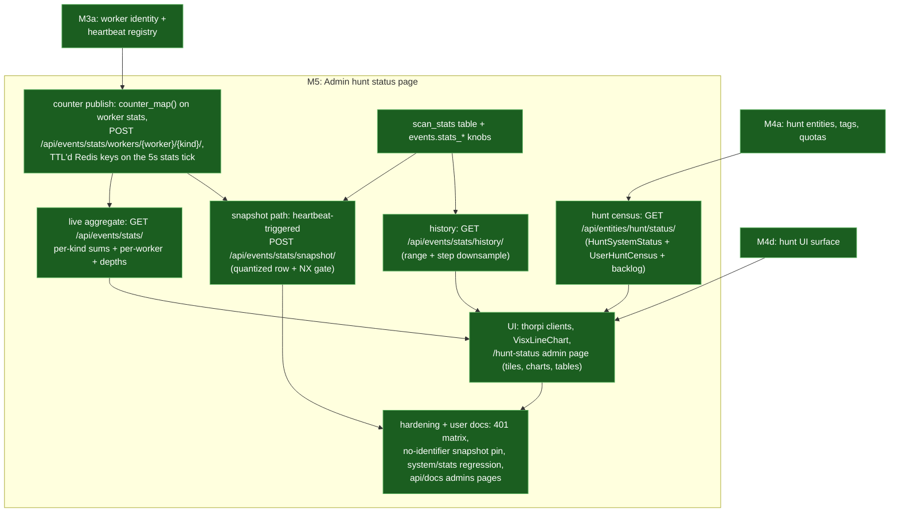

# Admin Hunt Status

---

This page designs **M5: an admin-only status page** answering three operational questions
nothing currently answers in one place — *what is hunting right now and what is queued
next*, *who is using hunts and how close they are to their quotas*, and *how fast is the
system scanning, right now and over time*. Today each answer is scattered or missing:
hunts are browsed through the generic entity list, per-hunt progress lives on the hunt
details page, queue depths hide behind the admin-only `GET /api/events/depths/` (see
[Queue Health](./performance.md#queue-health)), and worker throughput exists only as
tracing INFO gauges (`event-handler/src/libs/stats.rs:85-150`) that die with the log
stream. The proposal: a Redis layer of per-worker cumulative counters published on the
existing stats tick, a TTL'd Scylla time series of periodic snapshots, five admin-only
routes, and a `/hunt-status` admin page.

Scope guard up front: **"upcoming" means queued, never scheduled.** Hunts still start at
creation ([Hunts and Rule Sets](./hunts.md)); the upcoming view shows hunts whose chunk
chains have not advanced yet (`Created` status) plus the paced chunk backlog. Hunt
recurrence, scheduling, and templates stay on the
[deferred list](./whats_left_to_do.md#explicitly-deferred). This milestone lifts the
*admin ops* half of the deferred "UI hit dashboards and analytics" item; per-rule and
per-hit analytics stay deferred.

The hard requirement shaping every decision below: **building this surface must not let
non-admin users see state or data they cannot see today.** The whole page is cross-group,
cross-user data — exactly what the group-intersection model
([Visibility and Partitioning](./visibility.md)) exists to withhold — so every new route
is admin-gated at the backend, and nothing the feature *persists* contains a username,
hunt name, or group name (argued in Security below).

## What Admins Need to See

- **Now and next:** every `Running` hunt with live lane progress and counters; every
  `Created` hunt waiting on its first checkpoint; the depth of the paced chunk backlog;
  recently finished hunts and how they ended (`Completed` / `Cancelled` / `Failed`).
- **Who:** per-user active hunt counts against `max_active_per_user`, the global count
  against `max_active_global`, and who has been creating hunts recently.
- **How fast:** scans per second by worker kind — hunt chunks *and* the event-driven scan
  path — queue depths, and live worker count, as current values and as trends over hours
  to days.

Non-goals, stated so they stay out: no scheduling (above); no per-group quotas (still
deferred); no non-admin dashboard variant; no per-rule or per-hit analytics; and **no new
fields on `GET /api/system/stats`** — that route is reachable by any authenticated user
(`api/src/routes/system.rs:99-117`) and must not become a side channel.

## The Hunt Census Route

**Decision: the page reads one admin aggregate route per domain —
`GET /api/entities/hunt/status/` for the hunt census and `GET /api/events/stats/` (+
`/history/`) for scan throughput — not client-side composition, and not one combined
route.** Three shapes were weighed:

| Shape | Auth gates | Backend ownership | Cost profile |
| --- | --- | --- | --- |
| client-side composition over `GET /api/entities/` | N tag-filtered admin list calls, paging all groups in the browser | none new — but the browser re-implements the census per poll | an admin list expands to *all* groups (`User::authorize_groups`, `api/src/models/backends/users.rs:1262`); paging that every 10 s per open tab is the worst reader doing the most work |
| one combined status route | one `is_admin!` | one handler straddling entities/tags *and* Redis/Scylla | cheapest wire-wise, but couples two domains' failure modes and poll cadences into one response |
| **one route per domain (chosen)** | one `is_admin!` each | census beside the hunt routes, stats beside the event routes | two small polls; history fetched only on range change |

The census route follows the `Event::depths` precedent — a thin admin aggregate the
server assembles once per poll (`api/src/routes/events.rs:296-314`, gate at
`api/src/models/backends/events.rs:446`).

**Decision: the census returns a bounded `HuntStatusLine` per hunt, never the raw
`Entity`.** A hunt's `kind_data` carries its frozen rule snapshot — up to
`max_rules_per_hunt` = 10,000 ids (`api/src/conf.rs:2309`) — which the status page never
needs; the line carries a `frozen_rules` count instead. Lanes and counters ride whole:
the UI's progress math is lane-based
(`ui/src/components/entities/details/configs/huntProgress.ts:34,66`) and both are small
and bounded (`lanes` defaults to 4; `HuntCounters` is a fixed set of integers plus the
capped `error_samples`). The response is O(active quota + recent cap), independent of how
many rules anyone hunts with.

**Decision: "upcoming" = `Created` hunts plus the global paced backlog — no per-hunt
queue attribution.** Chunk events sit in per-kind zsets as opaque serialized payloads
(`api/src/models/backends/db/keys/events.rs:44-56`); attributing backlog to a specific
hunt means popping and deserializing entire queues, versus the O(1) `ZCARD` the depths
route already does. The census therefore reports the backlog per *kind*
(`EventType::is_hunt_chunk()` — today exactly `YaraHuntChunk`; a sigma engine's chunk
kind joins for free). One semantic stated plainly so nobody "fixes" it: a future-scored
paced chunk — every checkpoint win `ZADD`s the next chunk at
`now + inter_chunk_pacing_secs` (`api/src/models/backends/db/hunts.rs:62-82`) — **counts
as queued**. That is not staleness; that *is* the backlog the pacing config deliberately
maintains.

**Decision: the per-user census is computed at read time from entities and tags; nothing
per-user is ever persisted for this feature.** The create path already walks the
`HuntActive=true` tag census across all groups but deliberately returns **only a count**,
because its caller is any user hitting their quota (`exceeds_active_quota`,
`api/src/models/backends/entities/hunts.rs:225`). The census route is the gated,
detail-bearing sibling of that walk: the same tag census under `is_admin!`, hydrated into
lines by a bounded `entities_by_id` detail fetch. Active hunts are capped by
`max_active_global` (default 8, `api/src/conf.rs:2324`), so hydration is a handful of
point reads. "Recent" hunts come from a created-time-ranged, all-groups
`kinds[]=Hunt` list filtered to terminal statuses — with the honest caveat that recency
is by *created*, not *terminated*: the entities table clusters by `created`
(`api/src/models/schema/scylla/entities.rs`), and a terminal-time index
is not worth a new table for an ops page.

```rust
/// One hunt on the admin status page
///
/// A bounded projection of a hunt entity: the frozen rule snapshot (up to
/// `max_rules_per_hunt` ids) is reduced to a count, while the small, bounded
/// lanes and counters ride whole so the UI can reuse its lane progress math.
pub struct HuntStatusLine {
    /// The unique id of this hunt
    pub id: Uuid,
    /// The name of this hunt
    pub name: String,
    /// The user that created this hunt
    pub submitter: String,
    /// The groups this hunt is visible to
    pub groups: Vec<String>,
    /// The engine this hunt scans with
    pub engine: HuntEngine,
    /// The current status of this hunt
    pub status: HuntStatus,
    /// When this hunt was created
    pub created: DateTime<Utc>,
    /// How many rules the frozen snapshot holds (never the ids themselves)
    pub frozen_rules: u64,
    /// The time lanes this hunt walks and their progress
    pub lanes: Vec<HuntLane>,
    /// The cumulative counters for this hunt
    pub counters: HuntCounters,
    /// Why this hunt failed if it did
    pub failure: Option<String>,
}

/// One user's hunt usage in the admin census
pub struct UserHuntCensus {
    /// The username this census row covers
    pub username: String,
    /// How many Created or Running hunts this user has right now
    pub active: u64,
    /// The per-user active quota (`thorium.hunts.max_active_per_user`)
    pub quota: u64,
    /// How many hunts this user created inside the recent window
    pub recent_created: u64,
}

/// The configured quotas and current global usage
pub struct HuntQuotaView {
    /// The per-user active hunt quota
    pub max_active_per_user: u64,
    /// The global active hunt quota
    pub max_active_global: u64,
    /// How many hunts are active globally right now
    pub active_global: u64,
}

/// The admin hunt census (`GET /api/entities/hunt/status/`)
pub struct HuntSystemStatus {
    /// Hunts currently running
    pub ongoing: Vec<HuntStatusLine>,
    /// Hunts created but not yet running (queued, not scheduled)
    pub upcoming: Vec<HuntStatusLine>,
    /// Recently terminal hunts inside the window, newest first
    pub recent: Vec<HuntStatusLine>,
    /// Per-user usage against quotas
    pub users: Vec<UserHuntCensus>,
    /// Queue depths for the hunt chunk kinds (the paced backlog)
    pub chunk_backlog: HashMap<EventType, KindDepth>,
    /// The quotas and global usage
    pub quotas: HuntQuotaView,
}
```

## Worker Counters in Redis

Scan throughput has no queryable source: each worker kind aggregates stats in-process and
emits them as tracing events at most every 5 seconds, on change
(`EventWorkerStats::report`, `event-handler/src/libs/stats.rs:114`). The four stats
structs are the ground truth of what the system can report — `YaraHuntStats`
(`event-handler/src/libs/workers/hunts/yara/hunter.rs:41`), `YaraScannerStats`
(`event-handler/src/libs/workers/hunts/yara.rs:47`), `SigmaRuleStats`
(`event-handler/src/libs/workers/hunts/sigma.rs:50`), and `ReactionTriggerStats`
(`event-handler/src/libs/workers/reaction_triggers.rs:21`).

**Decision: counters ride the existing stats tick and reach Redis through a new admin
publish route — the event-handler keeps zero direct database access.** The event-handler
is a pure API client (no redis or scylla dependency in `event-handler/Cargo.toml`);
heartbeats, reaps, and depth gauges already flow through admin routes
(`event-handler/src/libs/heartbeat.rs:108`). The stats reporter task gains a `Thorium`
client and the process identity and publishes on every rate-floored tick — **even when
counters are unchanged**, while the tracing event keeps its change gate — so a counter
key's TTL expiry means its worker is gone, not idle. Publishes are non-fatal, with the
heartbeat's warn-and-keep-beating failure handling
(`event-handler/src/libs/heartbeat.rs:87-104`), so a stats outage never degrades
scanning. A separate reporting channel or task was rejected: the cadence
is already right, the aggregation already exists, and a second pipeline is pure plumbing.

**Decision: one TTL'd string key per (kind, worker) —
`{ns}:event-handler:stats:{kind}:{worker}` holding a JSON `WorkerStatsReport`, TTL =
`events.worker_expiry_secs`.** The key order mirrors the owned in-flight keys
(`EventKeys::in_flight_map_owned`, `api/src/models/backends/db/keys/events.rs:99`), and
the TTL means dead workers age out of the stats view on the same clock that declares them
dead (90 s default, `api/src/conf.rs:2009`) with no reaper coupling — the steady
unchanged-counter publish above is what makes that equivalence hold. Alternatives:

| Shape | Expiry of dead workers | Read path |
| --- | --- | --- |
| **string key per (kind, worker) (chosen)** | free — per-key TTL | registry zset × `EventType::iter()`, one `MGET` |
| one hash per kind | hash fields cannot carry TTLs — cleanup becomes a reaper job | one `HGETALL` per kind |
| zset of serialized reports | expiry needs score-based pruning | full range read |

Reads intersect the worker registry (`EventKeys::workers`,
`api/src/models/backends/db/keys/events.rs:85`) with the per-kind keys, so the live view
and the stats view agree on who exists. A wedged-but-still-beating worker stays visible
with frozen counters — exactly the case the `per_worker` breakdown exists to show.

**Decision: the counter payload is a flat `BTreeMap<String, u64>`, not typed per-kind
structs.** The four stats structs share no shape and grow fields routinely; a map makes a
new stat a new entry instead of an API schema change. Each stats struct implements a new
`counter_map()` alongside `fn stats` on the `EventWorkerSupportCore` trait
(`event-handler/src/libs/workers.rs:77-114`): flat structs key by field name (`scanned`,
`hits_written`, `checkpoints_won`, …), and nested stats flatten to dotted paths —
`SigmaRuleStats`, the one nested shape (a `total` plus a per-entity-kind breakdown),
publishes `total.scanned` and `by_entity.{kind}.scanned` — the rule any future nested
stat follows. The cost — no per-field serde pinning —
is acceptable for telemetry whose consumers are a chart and an admin's eyeballs.

Counter semantics, stated once: counters are **cumulative since process start**. A worker
restart resets them to zero; event replay after a crash can inflate them — the same
honest-telemetry caveat `HuntCounters` already documents
(`api/src/models/entities/hunts.rs:195-199`). Consumers derive rates between readings and
clamp negative deltas to zero.

```rust
/// One worker's cumulative counters for one event kind
pub struct WorkerStatsReport {
    /// Flat counter map (stats-struct field name -> cumulative count)
    pub counters: BTreeMap<String, u64>,
    /// When the worker took this reading
    pub reported_at: DateTime<Utc>,
}
```

## The Scan-Stats Time Series

Live counters answer "how fast right now"; trends need rows. M5's requirement is
persisted history — admins should see throughput over hours to days, surviving page
reloads and worker restarts.

**Decision: a new `{ns}.scan_stats` table — partitioned `((year, bucket))`, clustered
`snapshot_at DESC`, one `data TEXT` JSON payload per row, with
`default_time_to_live = thorium.events.stats_retention`.** Every piece has precedent: the
events archive table already expired whole rows by config-driven TTL (that table is since
retired to the legacy registry, `api/src/models/upgrades/registry.rs`; the config-driven TTL
mechanism lives on as the `ttl` attribute of the schema declaration,
`api/src/models/schema/scylla/scan_stats.rs`), and time bucketing uses
the shared `helpers::partition` (`api/src/utils/helpers.rs:23`). `data TEXT` over typed
columns because rows are only ever read whole for charting — never aggregated in CQL —
and a JSON payload makes a new counter a no-op schema-wise, exactly like the events
table's `data` column. The table is deliberately **not** added to `thoradm` backups:
TTL'd disposable telemetry, not state.

```text
CREATE TABLE IF NOT EXISTS {ns}.scan_stats (
    year INT,
    bucket INT,
    snapshot_at TIMESTAMP,
    data TEXT,
    PRIMARY KEY ((year, bucket), snapshot_at))
    WITH CLUSTERING ORDER BY (snapshot_at DESC)
    AND default_time_to_live = {thorium.events.stats_retention}
```

**Decision: rows store cumulative counters plus point-in-time gauges; rates derive at
read time.** Persisting pre-computed rates bakes the snapshot cadence into the data and
smears worker restarts into negative spikes that have to be scrubbed at write time.
Storing raw cumulatives keeps the writer dumb and debuggable; the one piece of rate
logic — subtract consecutive rows, divide by their spacing, clamp below at zero — lives
once, in the UI, and works at any stride.

**Decision: snapshots are assembled server-side, triggered by the event-handler
heartbeat; cross-replica dedup is quantized row timestamps, with a lock as a cost
optimization only.** Three writers were weighed:

| Writer | Clock | Failure mode |
| --- | --- | --- |
| event-handler assembles and POSTs the row body | the replica's clock | replicas disagree on time and contents; aggregation logic leaves the API |
| API-internal background loop | API clock | the API has no periodic tasks today, and every API replica would need one plus leader election |
| **heartbeat-triggered, body-less `POST /api/events/stats/snapshot/` (chosen)** | API clock, quantized | a replica dying just stops *triggering*; any surviving replica's beat keeps rows flowing |

The API handles the trigger by reading its own Redis counter keys plus depths and writing
one row whose `snapshot_at` is `now` **quantized to `stats_snapshot_secs`**. Quantization
is the correctness mechanism: two event-handler replicas triggering in the same window
write the same clustering key with near-identical contents, and last-write-wins resolves
them. A short `SET NX` gate **keyed by the window it protects**
(`{ns}:event-handler:stats:snapshot-gate:{quantized_ts}`, expiring with its window)
merely avoids doing the work twice — the hunt persist mutex pattern
(`api/src/models/backends/db/hunts.rs:25-39`,
`api/src/models/backends/db/keys/entities/hunts.rs:29-44`), and like it, safe to lose.
The window key matters: a single cadence-anchored gate set late in one window would still
be held when a peer's beat opens the next, suppressing the only trigger that window gets.
The heartbeat loop (`event-handler/src/libs/heartbeat.rs`) gains a fourth,
time-gated, non-fatal step that fires on the first beat inside each new quantized
window (a beat-counting cadence always has a real period of at least the window
length once the beats' own duration is added, so it skips windows; tracking the
wall-clock window instead makes duplicate triggers the failure mode, which the
gate absorbs). The gate is only taken after the row lands so a failed or
client-cancelled attempt never claims a window without writing it.

**Decision: history reads are ranged with a server-side stride downsample and a hard row
cap.** Thirty days at the 30 s default cadence is 86,400 rows; no chart wants them. The
history route takes `start`, `end`, and `step_secs` (default
`max(stats_snapshot_secs, range / 1,000)`), keeps the first row per stride bucket, caps
the response around 5,000 rows, and enumerates partitions the way the events pull already
did (`bucket IN ?`; today the statement is the `scan_stats` pull in
`api/src/models/schema/queries/scan_stats.rs`, the events pull having been retired with its
table).

```rust
/// Point-in-time stats for one event kind
pub struct KindStats {
    /// Pending-queue depth (includes future-scored paced chunks)
    pub queued: u64,
    /// How many events are claimed and in flight
    pub in_flight: u64,
    /// Cumulative counters summed across this kind's live workers
    pub counters: BTreeMap<String, u64>,
}

/// One persisted row of the scan stats time series
pub struct ScanStatsSnapshot {
    /// The quantized instant this row covers (the clustering key)
    pub snapshot_at: DateTime<Utc>,
    /// How many live workers were registered
    pub workers: u64,
    /// The per-kind depths and counters
    pub kinds: HashMap<EventType, KindStats>,
}

/// The live stats aggregate (`GET /api/events/stats/`)
pub struct EventStats {
    /// When this aggregate was assembled
    pub taken_at: DateTime<Utc>,
    /// How many live workers are registered
    pub workers: u64,
    /// The per-kind depths and summed counters
    pub kinds: HashMap<EventType, KindStats>,
    /// The per-worker reports behind the sums (wedge debugging)
    pub per_worker: HashMap<String, HashMap<EventType, WorkerStatsReport>>,
}
```

## Routes

Every gate below is `is_admin!` (`api/src/utils/macros.rs:214`) **in the backend method,
before any read** — the `Event::depths` shape (`api/src/models/backends/events.rs:446`),
not a handler-side check and not middleware.

- `GET /api/entities/hunt/status/` — **admin only.** Query params `recent` (default 20,
  cap 100) and `window_days` (default 7, cap 30). Returns `HuntSystemStatus`. Mounts
  beside the dedicated hunt routes (`api/src/routes/entities.rs:812-848`); the static
  `status/` segment cannot collide with the `{id}` captures — no single-segment GET
  exists under `/entities/hunt/` today.
- `POST /api/events/stats/workers/{worker}/{kind}/` — **admin only** (in practice the
  event-handler's service account). Body: `WorkerStatsReport`. Upserts the TTL'd counter
  key for that worker and kind. The `{worker}` segment passes the existing worker-id
  validation before any key is built (`api/src/models/backends/db/events.rs:119`) — the
  control every other worker-id path segment gets; registry membership is deliberately
  not required, since a first publish may race the first beat and reads intersect the
  registry anyway.
- `POST /api/events/stats/snapshot/` — **admin only.** Body-less trigger; 200 with the
  written `ScanStatsSnapshot`, 204 when the gate says a peer just wrote this window.
- `GET /api/events/stats/` — **admin only.** The live `EventStats` aggregate.
- `GET /api/events/stats/history/?start&end&step_secs` — **admin only.** Ranged,
  downsampled `Vec<ScanStatsSnapshot>`, oldest first.

The events-side routes take `#[utoipa::path]` annotations and join `EventApiDocs`
(`api/src/routes/events.rs:425-457`); the census route carries the annotation the other
hunt routes do (entities has no aggregating OpenApi struct today, so parity is annotation
only). The Rust client gains `publish_worker_stats`, `snapshot_stats`, `stats`, and
`stats_history` on events plus `hunt_system_status` on entities.

## Security

The invariant: **M5 adds admin-only read surfaces and persists only anonymous
aggregates. Nothing in it moves data across the group boundary for non-admins, and what
it stores is bounded: a mis-gated future surface over `scan_stats` would leak
system-wide activity levels — data that is admin-only today (the depths gate; the reason
no field joins `GET /api/system/stats`) — but never a username, hunt name or id, or
group name.**

| Surface | Gate | What it exposes |
| --- | --- | --- |
| `GET /api/entities/hunt/status/` | `is_admin!` before any read | cross-group hunt names, submitters, groups — admin-only by construction |
| `POST /api/events/stats/workers/{worker}/{kind}/` | `is_admin!` | write-only; numeric counters + a worker id |
| `POST /api/events/stats/snapshot/` | `is_admin!` | write trigger; response is the aggregate row |
| `GET /api/events/stats/` | `is_admin!` | counters, depths, worker ids |
| `GET /api/events/stats/history/` | `is_admin!` | the persisted aggregates |

The checklist, each item an obligation on the implementation:

- **Gates live in the backend methods and run before any read.** The `is_admin!` macro
  returns 401 and logs (`api/src/utils/macros.rs:214`); because it runs first, no error
  path can leak a partially assembled census.
- **UI gating is cosmetic.** `PageWrapper admin` → `RequireAdmin` redirects non-admins
  (`ui/src/utilities/auth.tsx:283`) and the `adminOnly` nav category hides the link
  (`ui/src/components/pages/navConfig.ts:95-103`) — both are UX. The API gate is the
  boundary; the test suite must call every route directly as a non-admin.
- **Scoped tokens cannot reach these routes, by an invariant that already exists.**
  `ScopedTokenRole` has no `Admin` variant (`api/src/models/users.rs:602`), and scoped
  authentication demotes an admin owner to the `User` role precisely "so scoped tokens
  cannot bypass group checks" (`api/src/models/backends/users.rs:195-197`). `is_admin!`
  on the new routes therefore composes safely with scoped tokens with no extra check —
  but the chapter records the dependency so nobody weakens the demotion without finding
  this page.
- **Nothing persisted names anyone.** `scan_stats` rows and the Redis counter keys carry
  numeric counters and gauges keyed by `EventType`, plus worker ids — no usernames, hunt
  names, hunt ids, or group names. The per-user census exists only inside gated
  responses, computed at read time; there is no new store of per-user or per-group
  activity to leak, back up, or expose through a future route. The stored aggregates are
  still admin-only *telemetry*: any future reader of `scan_stats` or the counter keys
  inherits the `is_admin!` obligation for what the numbers reveal — system-wide
  activity — not for what they name.
- **`GET /api/system/stats` is untouched.** It is reachable by any authenticated user
  and group-scoped (`api/src/routes/system.rs:99-117`); no new fields join it, and a
  schema regression test pins that.
- **The non-admin path stays count-only.** The create-time quota census keeps returning
  only whether a quota is exceeded (`exceeds_active_quota`,
  `api/src/models/backends/entities/hunts.rs:225`); generic entity list/get
  authorization (`authorize_groups`, the 404-outside-your-groups read) is unchanged.
- **Worker ids embed hostnames** (`{hostname}-{8 hex}`,
  `event-handler/src/libs/identity.rs:33-40`) — infrastructure data, exposed on admin
  routes only, the same class as the depth gauges already logged.
- **Key hygiene is validated at the edge.** The publish route rejects a `{worker}`
  segment that fails the established worker-id check before any Redis key is built
  (`api/src/models/backends/db/events.rs:119`), and the counter map is size-bounded like
  the rest of the telemetry surface.
- **Test obligations:** a 401 matrix (User / Analyst / Developer roles × all five
  routes); a serde pin asserting a persisted snapshot round-trips with no identifier
  fields; census-vs-quota agreement against `kinds[]=Hunt` + `HuntActive=true` listing;
  history range and cap bounds; the `/api/system/stats` schema regression; a UI e2e that
  a non-admin is redirected off `/hunt-status`.

## The UI Surface

The nav's Admin category (`ui/src/components/pages/navConfig.ts:95-103`) gains
**Hunt Status** → `/hunt-status`, routed as
`<PageWrapper admin Contents={HuntStatus} />` exactly like `/users`
(`ui/src/Thorium.tsx:96`). The page, `ui/src/pages/system/HuntStatus.tsx`:

- **A stat-tile row**: active hunts (vs the global quota), hunt-chunk queued and
  in-flight, live workers, and the current scan rate — derived from the two newest
  snapshots, clamped at zero.
- **Two time-series charts**: scans per second by kind, and queue depth, over a selected
  range (1 h / 6 h / 24 h / 7 d). A new `VisxLineChart` beside the existing
  `VisxBarChart` (`ui/src/dashboards/Dashboard/charts/`) — `scaleTime`/`scaleLinear` +
  `LinePath` from the `@visx/*` packages already in `ui/package.json`, themed through the
  same CSS variables. No new dependencies.
- **Ongoing hunts**: a table of `Running` hunts — name linking to the hunt details page,
  submitter, groups, scanned/matched counters, and the same lane-weighted progress bars
  the details page renders (`laneFraction`/`overallProgress`,
  `ui/src/components/entities/details/configs/huntProgress.ts:34,66`).
- **Upcoming**: `Created` hunts plus a chunk-backlog readout, labeled as *queued paced
  work* so nobody reads it as scheduling.
- **Recently finished**: the terminal hunts inside the window with their end status and
  failure text when present.
- **Users**: the census table — active vs quota (warning styling at quota),
  recent-created count.

Polling matches the house pattern: the census and live stats refetch on a 10 s
`setInterval` (`ui/src/pages/system/SystemStats.tsx:235`), with two hardenings the house
pattern lacks — ticks skip while a fetch is still in flight (a slow API never stacks
requests) and while the tab is hidden, refreshing immediately on return. History
refetches when the range changes and then at the chart's information rate —
`max(60 s, range/1000)` — since the server strides every range to ~1,000 points and a
faster refresh adds bytes but no information; the staleness check tolerates that
refresh interval so a chart that simply has not refreshed yet never reads as stale.
Degraded states are explicit: zero live workers renders a warning
banner, an empty time series renders a "collecting…" state rather than an empty chart,
and gaps in the series stay gaps — no interpolation across windows where no snapshot
exists. New thorpi clients land in `ui/src/thorpi/events.ts` plus a `hunts.ts` addition,
with response models under `ui/src/models/`.

## Config

New knobs join `conf.thorium.events` — scan stats cover all four worker kinds, not just
hunts (`api/src/conf.rs:2020`):

| Field | Default | What it bounds |
| --- | --- | --- |
| `stats_snapshot_secs` | 30 | snapshot cadence; row timestamps quantize to it, making it the cross-replica dedup unit |
| `stats_retention` | 2,592,000 (30 d) | the `scan_stats` TTL — how far back history reaches |
| `stats_partition_size` | 43,200 (12 h) | seconds per `scan_stats` partition (`u16`, like every partition size; 1,440 rows per partition at the default cadence) |

The Redis counter-key TTL deliberately reuses `events.worker_expiry_secs` — the stats
view should die on the same clock that declares the worker dead, and a second knob would
only let those disagree. `Events::validate` (`api/src/conf.rs:2064`) gains three checks
in its existing style: `stats_snapshot_secs >= heartbeat_secs` (the trigger rides the
beat), `stats_partition_size >= stats_snapshot_secs`, and
`stats_retention > stats_snapshot_secs`.

## Implementation Steps (M5)

Eight separable steps; nodes gain `class … done` as they land, exactly like the
[milestone chart](./whats_left_to_do.md). The green nodes are shipped prerequisites.



- **M5a — counter publish.** `counter_map()` on each stats struct
  (`event-handler/src/libs/workers.rs`, the four stats structs), the publish route +
  Redis keys (`api/src/routes/events.rs`, `api/src/models/backends/db/keys/events.rs`),
  the reporter-task client plumbing (`event-handler/src/libs/stats.rs`). Exit: counter
  keys appear within one stats tick of scanning activity and expire within
  `worker_expiry_secs` of a killed worker.
- **M5b — live aggregate.** `GET /api/events/stats/` assembling registry × kinds × depths.
  Exit: the aggregate matches a manual `MGET` + `ZCARD` readout.
- **M5c — the table and knobs.** The `scan_stats` schema declaration in
  `api/src/models/schema/scylla/scan_stats.rs` (created when a schema apply runs) with its
  statements in `api/src/models/schema/queries/scan_stats.rs`, the three `events.stats_*`
  fields + validation in `api/src/conf.rs`. Exit: table exists with the configured TTL;
  invalid knob combinations fail config load.
- **M5d — the snapshot path.** The body-less trigger route, quantized write, NX gate, and
  the heartbeat's fourth step. Exit: two event-handler replicas produce at most one row
  per quantized boundary — duplicate writes collapse on the clustering key, the
  window-keyed gate never suppresses a window a beat reaches, and beatless windows stay
  honest gaps.
- **M5e — history.** The ranged, downsampled read route. Exit: a 7-day range at default
  cadence returns ≤ the cap, oldest first, honoring `step_secs`.
- **M5f — the hunt census.** `HuntSystemStatus` assembly beside the hunt backends. Exit:
  census agrees with `kinds[]=Hunt` + `HuntActive=true` listing; non-admins get 401.
- **M5g — the UI.** thorpi clients, models, `VisxLineChart`, the `/hunt-status` page and
  nav entry. Exit: a Running hunt shows live lane progress; the rate chart spans a worker
  restart and an idle gap longer than `worker_expiry_secs` with no negative values and no
  false spikes.
- **M5h — hardening + user docs.** The security test obligations (Security above), plus
  the user book: `api/docs/src/admins/rule_scanning_ops.md` gains the new routes and a
  page documenting the admin status page. Exit: the 401 matrix and the
  `/api/system/stats` schema regression pass; the user book builds.

## Lifecycle and Edge Cases

- **Worker restart:** counters reset to zero; the UI clamps the one negative delta to
  zero and the chart shows a dip, not a spike.
- **Idle worker:** the steady publish keeps the counter key alive with unchanged
  values — the stats view shows a zero rate, never a vanished worker, and a
  wedged-but-beating worker shows frozen counters instead of silently dropping out after
  `worker_expiry_secs`.
- **Replica killed (`kill -9`):** its counter keys expire within `worker_expiry_secs`;
  its registry entry dies on the same clock; a surviving replica's heartbeat keeps
  snapshots flowing.
- **Zero event-handler replicas:** no snapshots are written — the gap is honest. The page
  flags staleness from the live aggregate's `taken_at` and the newest `snapshot_at`.
- **Redis flush:** counters restart from zero (one clamped sample); the Scylla history
  is unaffected.
- **Rolling upgrades:** an old API 404s the publish/trigger calls — the event-handler
  warns once and keeps scanning; a new API with an old event-handler serves empty
  counters and the page renders its collecting state.
- **Multiple API replicas:** counter writes are atomic `SET`s; snapshot rows are
  quantized and last-write-wins; the NX gate is best-effort by design.
- **Census consistency:** the tag census is eventually consistent with entity writes —
  the same best-effort caveat the quota check already accepts
  (`api/src/models/backends/entities/hunts.rs:225`).
- **Paced chunks:** future-scored chunk events count as queued; that is the pacing
  working, restated here so a depth that never reaches zero mid-hunt is read correctly.
