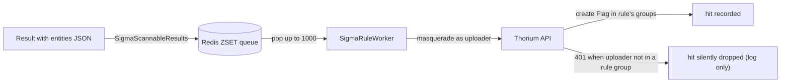

# Current State

---

Thorium already runs one event-driven hunt pipeline — sigma rules stored as entities,
scanned by an event-handler worker — plus a legacy YARA tool image and an already-built
YARA UI stack. This page is the census of that machinery. The design reuses most of it
verbatim; the table at the bottom records the defects it must **not** reuse.

## The Sigma Hunt Pipeline

The sigma hunt is the template for the `YaraScannerWorker`. Its stages, API side first
(paths relative to `api/src/models/` unless noted):

| Stage | What exists | Where |
| --- | --- | --- |
| Rule model | `SigmaRule { rule, applies_to, score, actions }` as entity metadata | `entities/rules/sigma.rs:95-105` |
| Create validation | `sigma_rust::rule_from_yaml` parse, level-to-score mapping | `entities/rules/sigma.rs:157-168`, form path `:180-205` |
| Event emission | result create with scannable entity kinds emits `EventType::SigmaScannableResults` | `backends/db/results.rs:109-123` |
| Event model | `SigmaScannableResultsEvent { key, groups, applies_to, tool }`, depth hardcoded to 0 | `events.rs:57-66`, constructor `backends/events.rs:108-138` |
| Queues | one Redis ZSET per `EventType`; queue and in-flight keys derive from the kind's `Display` | `backends/db/keys/events.rs:44-78` |
| Pop | `zpopmin` a page, then a second pipeline moves it into an in-flight map/queue (M3 closes the gap between them with one atomic Lua pop for owned pops) | `backends/db/events.rs:69-93` |
| Immature grace | events younger than 3s are reset so Scylla reads reach consistency first | `backends/db/events/shared.rs:23` |
| Admin surface | pop/clear/reset/cache-status routes, all `is_admin!` gated | `api/src/routes/events.rs:168-174`, `backends/events.rs:149-193` |

The event-handler daemon drives it:

- The controller builds `EventWorkerCache { triggers, sigma, users, conf }` **once** at
  startup (`event-handler/src/libs/controller.rs:57-74`) and spawns exactly one worker
  per `EventWorkerKinds` variant (`controller.rs:189-207` — the TODO there acknowledges
  it). A 5s loop polls the Redis cache-status flag (`controller.rs:277`).
- The generic `EventWorker` loop: pop up to 1000 events, process them
  `buffer_unordered(10)`, clear successes from the in-flight queue per event id, and on
  any single failure arm a 3-minute retry (`EventWorker::process`,
  `event-handler/src/libs/workers.rs`). Startup and that retry originally called
  `reset_all`, replaying the kind's **entire** in-flight queue, peers' events included —
  M3 scopes both resets to the worker's own in-flight set and closes the two-pipeline
  pop crash window with an atomic Lua pop (see [Scan Execution](./execution.md)).
- `SigmaRuleContext::new` lists every `SigmaRule` entity and compiles **all** of them
  into one context at startup (`event-handler/src/libs/workers/hunts/sigma.rs:108-170`).
- The worker scans **as the uploader**: it clones its service client per user and calls
  `masquerade(&user)` (`hunts/sigma.rs:857-877`), then handles each event through that
  event's user client (`hunts/sigma.rs:949-961`). Events from disabled users are skipped
  rather than retried forever (`hunts/sigma.rs:1136-1158`).
- On a hit it creates `Flag` entities named after the rule **in the rule's groups**
  (`hunts/sigma.rs:369`, `:912-914`), associated `FlagFor` the scanned entity and
  `CreatedBy` the rule (`hunts/sigma.rs:922-926`), deduped against the sample's association
  tree by `hash_identifying` before creation (`hunts/sigma.rs:590-634`).

The write path is where the pipeline leaks correctness — the masqueraded create 401s
whenever the uploader cannot edit a rule's group, and the failure is only logged:

## The Entities Framework

Rules, flags, and (in this design) hits are all entities. The framework pieces:

| Piece | Shape | Where |
| --- | --- | --- |
| Model | `Entity { id, name, kind, metadata, description, submitter, groups, tags, image, created }` | `api/src/models/entities.rs:316-337` |
| Kinds | `EntityKinds` falls out of a strum discriminant derive on `EntityMetadata` | `api/src/models/entities.rs:631-700` |
| Storage | one Scylla row per group; metadata serialized into a `kind_data` TEXT column | `api/src/models/schema/scylla/entities.rs` |
| Lookup MVs | `entities_by_id` and `entities_by_name` — the name MV, unused at design time, now backs `GET /api/entities/by-name/` (see [Hunts](./hunts.md#entity-lookup-by-name)) | `schema/scylla/entities.rs` |
| Dedupe hash | `hash_identifying()` over name, kind, and per-kind identifying metadata | `api/src/models/entities.rs:341-351` |
| Associations | per-group rows; `kind` is a TEXT column, so new `AssociationKind`s are additive | `api/src/models/associations.rs:46-97`, `schema/scylla/associations.rs` |
| Tags | one row per `(type, group, year, bucket, key, value)` partition | `schema/scylla/tags.rs` |
| Trees | graph walks over associations, depth-bounded by `TreeOpts.limit` | `api/src/models/trees.rs:90-92` |
| Census | per-group Redis sorted sets back the entity list cursors | `api/src/models/backends/db/keys/entities.rs:19-41` |

The entities partition key is worth quoting exactly, because adding a new kind costs no
schema change: `PRIMARY KEY ((kind, group, year, bucket), created, id)` with `kind TEXT`
(the `EntitiesTable` declaration in `schema/scylla/entities.rs`). Two precedents matter for
hits: the enum already defines
an `AssociationKind::SigmaRuleHit` variant (`api/src/models/associations.rs:94`) that
**no backend ever writes** — it appears only in UI models (`ui/src/models/associations.ts:46`)
— and the `(SigmaRule, Flag)` pair already maps to `CreatedBy`
(`api/src/models/associations.rs:168`). The dedupe hash is likewise advisory: its only
callers are in the event-handler, and entity create inserts unconditionally
(`api/src/models/backends/db/entities.rs:30-121`).

## Samples and Visibility

- One `Sample` per sha256 with per-group `Submission` rows; a sample's visible groups are
  the **union of its submissions' groups** (`api/src/models/files.rs:2266-2293`,
  `Submission` at `:1958-1979`, the union at `:2298-2311`).
- Bytes are CaRTed and streamed to S3 once per sha256
  (`api/src/models/backends/files.rs:203-207`); only the submission rows are written per
  group (`api/src/models/backends/db/files.rs:260-265`).
- Sample create emits a `NewSample` event carrying **only that submission's groups**
  (`backends/db/files.rs:288-290`); the duplicate-submission conflict path deliberately
  emits nothing (`backends/db/files.rs:217-243`).
- Reads are gated per group by the `for_groups!` macro
  (`api/src/models/backends/db/helpers.rs:289`), and entity create authorizes edit access
  in **all** requested groups in one call (`api/src/models/backends/entities.rs:173-182`).

## Legacy YARA Today

- The only YARA in the product is a pipeline tool image:
  `tools/images/github.com/virustotal/yara/run_yara.py` shells out to the yara CLI with
  an image-baked `rules.bin` (`run_yara.py:31`), parses stdout with a regex
  (`run_yara.py:16-27`), and writes results plus `YaraRuleHits` tags
  (`run_yara.py:45-52`). Rule changes mean image rebuilds; attribution is a bare rule
  name in a tag value. No yara crate exists anywhere in `Cargo.lock`; `sigma-rust` is the
  only rule engine in the workspace (`Cargo.toml:62`).
- The UI is further along than the backend: a full YARA editor stack already ships
  (`ui/src/utilities/rules/yara/` — `parse.ts`, `validate.ts`, `suggestions.ts`,
  `schema.ts`), a read-only `YaraRenderer` is wired into the renderer registry
  (`ui/src/components/shared/renderers/YaraRenderer.tsx`, `registry.ts:26`),
  `YARARULEHITS` is styled as a danger tag (`ui/src/components/tags/tag_groups.ts:36`),
  and `YaraRuleHit` tags score +100 in association-graph badges
  (`ui/src/components/associations/shared/scaling.ts:14`).

## Gaps the Design Must Fix

Each row below is verified in the tree today and is addressed by a specific design page.

| # | Gap | Where | Consequence |
| --- | --- | --- | --- |
| 1 | Sigma and users caches are never refreshed: `rebuild_stale` only rebuilds triggers, yet pushes `ReactionTriggers` even when nothing was rebuilt; the cache hash has a single `status` field | `event-handler/src/libs/controller.rs:82-115`, `api/src/models/backends/db/events.rs:161-183` | new or edited rules are invisible until a daemon restart; entity CRUD sets no flag at all |
| 2 | Exactly one worker per event kind (TODO in code), and nothing in the daemon is replica-safe | `event-handler/src/libs/controller.rs:189-207` | scanning cannot scale horizontally (M3: operator `replicas` + ownership-scoped reclaim) |
| 3 | Context build compiles stored rules with `.unwrap()` | `event-handler/src/libs/workers/hunts/sigma.rs:127` | one malformed stored rule panics the whole daemon (fixed at M1: log-and-skip, `sigma.rs:129-143`) |
| 4 | The sigma update arm swaps rule text with no `rule_from_yaml` re-validation | `api/src/models/backends/entities.rs:1017-1019` (`update!` at `:1019`) | invalid text can be stored, making gap 3's panic reachable |
| 5 | Hits are written by masquerading as the uploader into the **rule's** groups; create failures are log-only | `hunts/sigma.rs:369`, `:912-914`, `:672-683` | uploader outside a rule group → 401 → the cross-group hit is silently dropped |
| 6 | `filter_reqs` skips already-existing entities without merging new groups | `hunts/sigma.rs:615-632` | a hit's visibility freezes at first write and never widens |
| 7 | `SubmissionUpdate` `add_groups`/`remove_groups` emits no event of any kind | `api/src/models/backends/db/files.rs:898-957` | samples that become visible to new groups are never rescanned |
| 8 | `SigmaRuleAppliesTo::FromStr` parses only 2 of its 4 variants | `api/src/models/entities/rules/sigma.rs:45-51` (enum at `:14-23`) | forms cannot create rules targeting the function kinds; a trap for any mirrored enum |
| 9 | The queue-to-in-flight pop is two Redis pipelines, not one atomic step | `api/src/models/backends/db/events.rs:69-93` (`zpopmin` at `:75`, in-flight write at `:82-91`) | a crash between them loses events with no trace (M3 closes it with one atomic Lua pop for owned pops) |
| 10 | Entity delete prunes tags and entity rows but never associations | `api/src/models/backends/db/entities.rs:547-590` | dangling association rows accumulate platform-wide |

The design pages reference these rows as **the sigma gaps** (see [Design](./design.md)).
