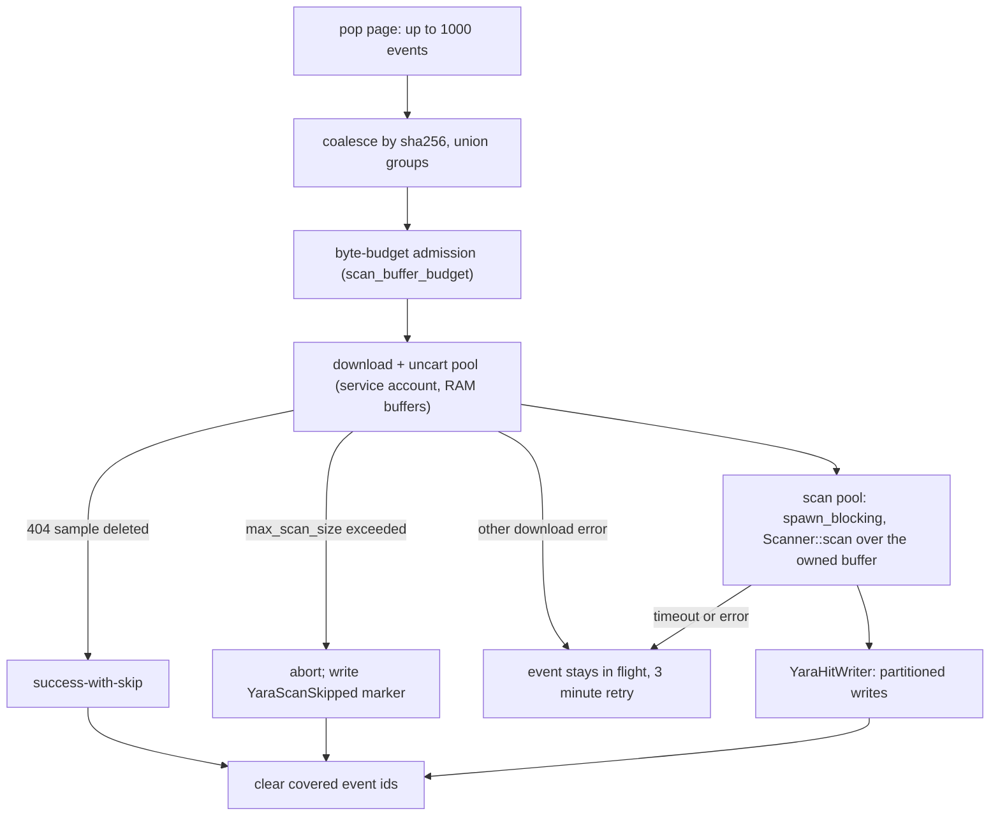

# Scan Execution

---

This page fixes where scans run, how N event-handler replicas share one queue without
replaying each other's work, and how a worker turns a page of events into partitioned
hits. The scanner lives inside the event-handler, and at M3 the event-handler itself
scales horizontally.

## Venue

Three venues were weighed:

1. **`EventWorkerKinds::YaraScanner` inside the event-handler, with the event-handler
   scaled by replicas.** The worker diff was small and mechanical (M2 shipped it): a new
   variant in the worker-kinds enum, a stats channel, and a spawn arm — pop pages,
   process, clear, retry all inherited, full sigma parity. Scaling it is one operator
   knob on the component that already exists: `spec.components.event_handler.replicas`,
   default 1 (`operator/src/k8s/crds.rs:279-282`, applied at
   `operator/src/k8s/deployments.rs:431`). The real cost is correctness, not shape:
   nothing in the pre-M3 event-handler was safe to run twice, and that unsafety was
   shared by **all three** worker kinds (`ReactionTriggers`, `SigmaScanner`,
   `YaraScanner`) — so the replica-safety work below pays off platform-wide, not just
   for yara.
2. **A dedicated `yara-scanner` deployment reusing the `EventWorker` machinery** — the
   same worker struct behind a new spawn site or binary role flag, scaled independently.
   Everything that makes replicas safe — worker identity, ownership-scoped in-flight
   reclaim, heartbeats, drains — is needed *identically* in this venue, because its
   replicas share the same queues with the same semantics. What the second deployment
   adds is only a resource-envelope split: byte-scanning (CPU plus multi-GB downloads)
   stops sharing a pod with latency-sensitive trigger handling. It also adds a second
   deployment surface — another CRD component, image role flag, and reconcile path — to
   operate forever. **Rejected for now, deferred, not dead:** if profiling shows scan
   load actually starving trigger latency, the split is additive on top of the same
   reclaim machinery.
3. **Scaler-scheduled system jobs** (a yara reaction stage per sample) — **rejected for
   the scan path**. Container-per-sample overhead dwarfs the median scan time; shipping
   the compiled ruleset to agents is the stale `rules.bin` problem again; and agents run
   as the reaction's user, which reintroduces the uploader-permission bug the partitioned
   writer exists to kill (see [Visibility and Partitioning](./visibility.md)). The legacy
   yara tool image remains available for ad-hoc pipeline use.

**Decision: keep the scanner inside the event-handler and make the event-handler itself
horizontally scalable — operator `replicas` (default 1) plus worker-aware ownership of
in-flight events (below); the dedicated deployment is deferred until a resource-envelope
split is proven necessary.** M3 ships this alongside the serialized-ruleset cache (see
[Ruleset Compilation and Caching](./ruleset.md)). Hunts (M4) reuse this venue as sibling
workers — per-engine chunk queues, worker kinds, and budgets (`EventType::YaraHuntChunk`
at M4) on the same chassis (see [Hunts and Rule Sets](./hunts.md)).

## Ownership and Reclaim

Before M3, replicas would have replayed each other's work: pops were already atomic
`ZPOPMIN`s and clears already per event id (`db::events::pop` and `db::events::clear`,
`api/src/models/backends/db/events.rs`), but both `reset_all` call sites — worker
startup and the 3-minute error retry, in both `EventWorker` and `EventWorkerMutable`
(`event-handler/src/libs/workers.rs`) — replayed the kind's **entire** in-flight queue,
peers' events included. One replica restarting re-queues every peer's
currently-processing events: duplicate scans, and duplicate reactions (reaction creation
is not idempotent). The in-flight ZSET was also scored by event *creation* time, so no
lease or age policy could hang off it. M3 replaces that machinery with explicit
ownership:

- **Worker identity** (`event-handler/src/libs/identity.rs`): each process generates
  `{hostname}-{8 hex random}` once at boot — the hostname is the pod name under k8s, and
  the fresh suffix per boot means a restarted process never collides with its previous
  identity; its old leftovers come back through the reaper or a SIGTERM drain, not a
  startup self-reset. The API validates ids against `^[A-Za-z0-9._-]{1,128}$` because
  they embed in Redis keys.
- **Worker registry + heartbeats**: a ZSET `{ns}:event-handler:workers` maps worker id →
  last-heartbeat timestamp. A ZSET beats per-worker TTL keys because the reaper must
  still *see* dead owners to find their keys, and one `ZRANGEBYSCORE` enumerates live
  and dead without a `SCAN`. Beats come from a dedicated tokio task
  (`event-handler/src/libs/heartbeat.rs`) every `conf.thorium.events.heartbeat_secs`
  (default 10) — deliberately not the controller loop, which blocks on multi-second
  compiles. The pop script below also upserts the caller's registry entry, so a pop that
  precedes the first beat can never orphan keys. `Events::validate()` (`api/src/conf.rs`)
  rejects configs unless `worker_expiry_secs` (default 90) ≥ 3× the heartbeat and
  `in_flight_backstop_secs` (default 3600) exceeds the expiry.
- **Per-owner, lease-scored in-flight keys**:
  `{ns}:event-handler:in_flight_map:{kind}:{worker}` (hash, event id → body) and
  `{ns}:event-handler:in_flight_queue:{kind}:{worker}` (ZSET, **score = pop/lease
  time** — the legacy shared keys scored by creation time). Per-owner keys won over
  encoding the owner into members of one shared key: `clear` stays a cheap per-id
  `ZREM`+`HDEL` on the worker's own keys, reaping a dead owner is a bounded drain of
  exactly two keys, and the registry indexes every owner so nothing ever `SCAN`s.
- **Atomic pop** — one Lua script (`POP_EVENTS_SCRIPT`,
  `api/src/models/backends/db/events.rs`, modeled on `POP_JOB_SCRIPT`,
  `api/src/models/backends/db/jobs.rs:291` — the same standalone-Redis assumption):
  `ZPOPMIN`, re-queue immature (< 3 s) events, write mature ones into the caller's owner
  keys at lease time, upsert the registry entry, return the mature members. This closes
  the old crash window where queue → in-flight was two separate pipelines and a crash
  between them lost events silently. Owner-less pops from old clients keep the legacy
  two-pipeline path and the legacy un-owned keys.
- **Scoped resets** — `db::events::reset_worker` restores one owner's in-flight events
  for a kind back to pending. Worker startup and the 3-minute retry both use it, so a
  replica only ever replays its *own* leftovers (startup reset is usually a no-op under
  fresh identities, but stays correct when the controller respawns a worker in-process).
  The client calls it through a dedicated worker-reset route rather than a param on the
  legacy reset route, so an old API answers 404 — which the handler warns about and
  skips — instead of silently running the whole-kind `reset_all` and replaying every
  peer's in-flight events during a mixed-version window. The whole-kind `reset_all`
  survives for legacy clients only. Every restore — reset, drain, or reap — scores the
  pending queue by the event body's own `timestamp` (`Event::timestamp`,
  `api/src/models/events.rs`), never the lease, so reclaimed events keep their original
  queue order.
- **SIGTERM drain** — the controller selects on `SignalKind::terminate()`, asks each
  worker to stop cleanly after its current page (so in-progress batches finish their
  clears), aborts any worker still mid-page at the quiesce deadline, and then calls
  `drain_worker`, which server-side moves every kind's per-owner entries back to pending
  and removes the registry entry (then re-drains after deregistering, so a straggling
  pop that re-registered the worker mid-drain can never strand events). A rolling update
  therefore replays at most the pages still mid-processing when the quiesce grace
  expires — and, rarely, a page whose clear was still executing server-side when its
  worker was aborted — the same bounded duplication envelope as a crash replay;
  fatal-error exits attempt the same drain best-effort.
- **Reaper + age backstop** — every replica's heartbeat task calls the admin route
  `POST /api/events/workers/reap/` once at startup and once per tick. Concurrent reaps
  are safe without leader election because each drained entry moves exactly once (an
  atomic pop per entry — the same guarantee `reset_all` always relied on); leader-gating
  was rejected as the only lock machinery in the system, bought to optimize a 10-second
  no-op. A reap pass (1) drains owners whose last beat is older than
  `worker_expiry_secs` back to pending and unregisters them, (2) individually restores
  entries of *live* owners whose lease is older than `in_flight_backstop_secs` — the
  wedged-but-still-beating case, and (3) age-gates leftovers in the legacy un-owned keys
  so events stranded there after the last old pod dies are recovered. The pass-3 bound
  is honest rather than free: legacy in-flight scores are event *creation* times, so
  every legacy in-flight event older than the backstop is re-queued — re-evaluated on
  every tick — which recovers strands but, during a rollout with a backlog deeper than
  the backstop, also steals pages a still-live old pod is actively processing and
  replays them (bounded duplicates, see
  [Risks and Open Questions](./risks.md)); fresh strands wait up to the backstop before
  recovery. It returns a `ReapSummary { dead_workers, reclaimed, backstopped,
  legacy_reclaimed }`.

Reclaim is therefore **hybrid**: death detection is primary, lease age is a generous
backstop. Either can fire on a worker that is alive but stalled, so a reclaimed event
can be processed twice. That is accepted and bounded: yara hit writes converge
(deterministic UUIDv5 identity + create-as-merge — see
[Hits and Attribution](./hits.md)), clears of reclaimed ids are no-ops, and duplicate
reactions are exactly what today's single-replica crash replay already produces —
reaction idempotency keys stay out of scope (see
[Risks and Open Questions](./risks.md)).

One rolling-upgrade subtlety is **per-request**, not per-pod: with mixed API replicas
behind one Service, a pop and its matching clear can be served by *different* API
versions. Owned clears therefore also delete the same ids from the legacy un-owned keys
(an id only ever lives in one family, so the extra removals are idempotent), which makes
clears version-agnostic in the dominant direction — pop served by an old replica, clear
by a new one. The reverse direction (pop claimed into owned keys by a new replica, clear
served by an old one that ignores the worker param) cannot be fixed from the new side;
those events replay after the lease backstop as bounded duplicates. Rolling the API
deployment fully before the event-handler deployment avoids that direction entirely (see
[Risks and Open Questions](./risks.md)).

## Mechanics

The same worker body runs on every replica. The scan path is **memory-only by default**:
sample bytes are never written to local disk just to be read back and thrown away — on a
large corpus that scratch round-trip burns SSD endurance and spends local I/O bandwidth
for zero benefit (see [Scaling and Performance](./performance.md) for the numbers).

- **Download as the service account, uncarted, into RAM.** The download client already
  decodes CaRT as a stream — it wraps the response body in `UncartStream`
  (`cart-rs/src/uncart.rs:26`) — which before M2 only copied that stream to a file path
  (`download`, `api/src/client/files.rs:372-451`; the agent uses it that way,
  `agent/src/libs/agents/setup.rs:421-435`). The scan path adds a buffer-returning
  download variant over the same `UncartStream` (implemented at M2 as
  `files.download_bytes`, `api/src/client/files.rs:278-333`): streaming decode
  accumulating into a `Vec<u8>` that is handed to the scanner and dropped. No scratch
  files, no cleanup pass, no disk writes.
- **Byte-budgeted admission, not task counts.** Submissions do not record an uncarted
  size (`api/src/models/files.rs:1958-1979`), so sizing is enforced, not assumed: a
  global `scan_buffer_budget` (config, sized to the pod) bounds total in-flight buffer
  bytes. Reservations are granted whole and up front — a fixed small-class size for
  every new download (most samples are KBs–MBs), or one of a bounded count of
  large-class grants of `max_scan_size` when a download outgrows its small slot — never
  grown incrementally against the shared budget. Large holders never wait on anything,
  and an outgrown download waits only for a large grant that a running large holder
  will free, so the wait graph has no cycle: a burst of multi-GB samples queues behind
  the budget instead of OOM-killing or deadlocking the worker. `scan_buffer_budget`
  must be at least one large grant (`max_scan_size` or more); admission fail-fasts
  anything that could never fit, counting it as a skip like the oversize abort below.
  The carted `content-length`, when present, only pre-classifies.
- **Scan with `Scanner::scan(&buffer)`** over the in-memory bytes. Resident memory is
  O(ruleset) + `scan_buffer_budget` — the budget, not the sample mix, is what an
  operator sizes.
- **Bounded per sample:** `conf.thorium.yara.scan_timeout` (default 60s) via
  `set_timeout`, and `max_scan_size` (default 2 GiB) enforced *while the buffer fills*.
  An oversize sample is a **deliberate skip, not a failure**: the download aborts at the
  cap, the sample is marked `YaraScanSkipped=oversize:<cap>` (the only per-sample marker
  scanning leaves — see [Scan Triggering](./triggering.md)), the skip is
  counted in stats, and the event **clears** like a success. Oversize objects therefore
  cost at most one capped download each and can never pile up: the carted
  `content-length` pre-filters clear cases without downloading at all (a marker based
  short-circuit for repeat events is a later refinement; M2 ships the pre-filter) (CaRT's compression expands incompressible data by
  well under 0.1%, so a carted length comfortably above the cap proves the uncarted
  bytes exceed it too; borderline cases still stream-and-abort). Backlog can only grow
  from throughput deficit, never from a population of unscannable objects.
- **Optional spill mode:** `conf.thorium.yara.spill_dir` routes samples above
  `conf.thorium.yara.spill_threshold` through a size-capped file download plus
  `Scanner::scan_file` (mmap) — `max_scan_size` is enforced while spilling exactly as
  while buffering. Point it at node disk to deliberately trade drive wear for RAM: mmap
  pages are evictable under memory pressure where budget bytes are not. A tmpfs-backed
  emptyDir keeps the no-disk-write property but is still pod RAM outside
  `scan_buffer_budget` — it buys no memory relief and must be sized
  (`emptyDir.sizeLimit`) alongside the budget. Unset by default: memory-only. *Spill
  mode is not implemented — it sits on the explicitly-deferred list (the revised M3
  dropped it in favor of scaling replicas); the memory-only path (with its two-class
  budget) is the only implemented path today.*
- **Concurrency split:** downloads run async with `buffer_unordered(N)` (sigma uses 10,
  `event-handler/src/libs/workers.rs:361`), but scans run on `spawn_blocking` — yara is
  CPU-bound and must not starve the tokio runtime that also services trigger handling.
  Each blocking task takes ownership of its buffer and builds its `Scanner` from the
  shared `Arc<yara_x::Rules>` in `YaraRuleContext` (the owned buffer plus the `Arc` are
  what make the `'static` closure possible). Scan parallelism is a config knob
  defaulting to the core count, and the pools pipeline across samples: while one sample
  scans, the next samples' buffers are already filling.

## Why Not a True Streaming Scan

Streaming the *matching* — feeding chunks to the engine as they arrive and never holding
the whole sample — is not possible under YARA semantics, in yara-x or libyara:

- Conditions are random-access: `filesize`, `uint32(0x3C)`-style reads at arbitrary
  offsets, and `@a[i]` / `at` / `in` offset arithmetic can touch any byte of the object
  during evaluation.
- The file-format modules (`pe`, `elf`, `macho`, `dotnet`, `lnk`) parse the whole object
  before any condition runs.
- Patterns match at any offset — including across whatever chunk boundary a stream would
  impose.

libyara's multi-block API (still shipped in 4.x, built for fragmented process memory)
documentedly misses cross-block matches and breaks the file-format modules; yara-x
deliberately has no equivalent and exposes only whole-object scans
(see [Engine Choice](./engine.md)). So the pipeline
streams everything *around* the match instead: the CaRT decode is streaming, the size cap
aborts mid-stream, and the download pool keeps the scan pool fed so neither side stalls —
the bytes are held once, in RAM, for exactly one scan.

Hits flow through `YaraHitWriter::write_hit`, which since M3d is one idempotent call to
`POST /api/entities/yara/hit/`: the server recomputes
`write_groups = rule.groups ∩ event.groups ∩ sample.groups ∩ allowable_groups` from
authoritative state and performs the whole partitioned write in one audited place; the
worker keeps its cached intersection only as a pre-filter that skips the call when empty
(see [Visibility and Partitioning](./visibility.md)).

## Failure Handling

- **Deleted sample (404)** — success-with-skip: the event clears; the sample is gone, so
  there is no coverage left to record (see [Scan Triggering](./triggering.md)).
- **Scan timeout** — retryable *and* a slow-rule investigation signal: a timeout does not
  attribute a culprit rule, so repeated timeouts feed the profiling-based
  `YaraRuleStatus=Slow` quarantine (see [Scaling and Performance](./performance.md)).
- **Any other error** — the event stays in flight for the retry pass, while successes
  clear per event id (`processed_event_clears`, `event-handler/src/libs/workers.rs`), so
  one bad sample never replays the page. The retry is **owner-scoped** (`reset_worker`,
  see [Ownership and Reclaim](#ownership-and-reclaim)): it replays only this worker's
  own leftovers, never a peer's in-flight work.
- **Observability** — `GET /api/events/depths/` returns per-kind
  `{queued, in_flight}` — the legacy `ZCARD` plus the sum of per-owner `ZCARD`s found
  through the worker registry — and the live worker count in one call; each replica's
  heartbeat task also logs those depths as a tracing gauge every tick, so backlog growth
  is visible before it is an incident.

