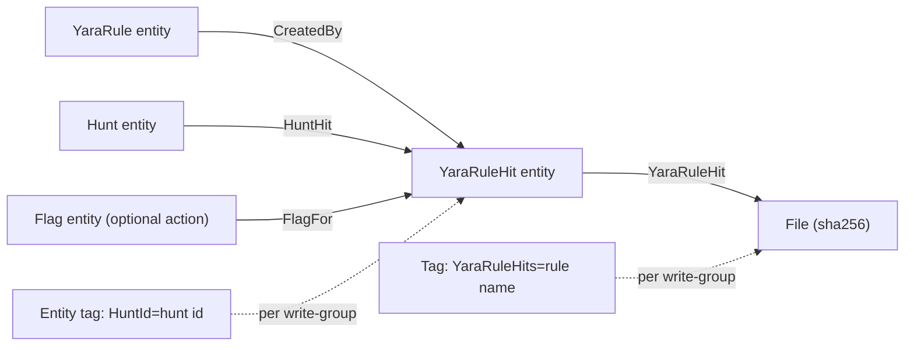

# Hits and Attribution

---

Every match writes a durable, first-class record. **Decision: hits are entities
(`EntityKinds::YaraRuleHit`), associated to both the rule and the sample, plus a hit tag
on the sample** — not sigma's action-only flags (no record unless an action is
configured), and not legacy tags alone (no stable attribution, no metadata, no graph).

## The YaraRuleHit Entity

The hit's `kind_data` records exactly which rule text fired, under which engine and
ruleset build, and what matched:

```rust
/// The metadata for a single yara rule hit on a sample
pub struct YaraRuleHit {
    /// The entity id of the rule that hit
    pub rule_id: Uuid,
    /// The name of the rule entity when the scan ran
    pub rule_name: String,
    /// The sha256 of the exact rule source that fired
    pub rule_hash: String,
    /// The hash of the compiled ruleset build this scan used
    pub ruleset_hash: String,
    /// The pinned yara-x version that performed the scan
    pub engine_version: String,
    /// When the scan that produced this hit completed
    pub scanned_at: DateTime<Utc>,
    /// The yara rules inside this entity's source that matched
    pub matched: Vec<MatchedRule>,
}

/// A single matched rule identifier within a rule entity's source
pub struct MatchedRule {
    /// The identifier of the matching rule inside the entity's namespace
    pub rule_identifier: String,
    /// The string patterns that fired for this rule
    pub strings: Vec<MatchedString>,
}

/// A bounded record of one matched string pattern
pub struct MatchedString {
    /// The string identifier within the rule (e.g. `$a`)
    pub id: String,
    /// The exact total number of matches for this string
    pub count: u64,
    /// The offsets of the first matches, truncated to a fixed cap
    pub first_offsets: Vec<u64>,
}
```

The record is bounded: total serialized metadata is capped at ~32 KiB — `count` stays
exact while `first_offsets` truncates — and v1 stores **no matched-data excerpts**; they
would bloat `kind_data` and every association tree, and recording bounded excerpts is an
open question (see [Risks and Open Questions](./risks.md)).

## Deterministic Identity

**Decision: hit identity is deterministic — the hit entity id is UUIDv5 over
`(rule_id, sha256)`, with create-as-merge semantics** (equivalently: an identifying-hash
lookup the API enforces at create for dedupe-able kinds). Today nothing enforces identity
server-side: `hash_identifying` (`api/src/models/entities.rs:379-389`,
`IdentifyingEntityInfo` at `:952-991`) is only ever called from the sigma worker, and
entity create inserts unconditionally (`api/src/models/backends/db/entities.rs:30-121`).

Sigma's tree-walk dedupe (`filter_reqs`) is not enough, for structural reasons:

- It is read-then-write: it walks the sample's association tree and skips requests whose
  identifying hash exists (`event-handler/src/libs/workers/hunts/sigma.rs:604-653`), and
  entities are created **before** their associations (`create_all`,
  `event-handler/src/libs/workers/hunts/sigma.rs:655-729`) — a crash or failed event
  clear between the two leaves a hit the next walk cannot see; the retry duplicates it.
- Replay is routine: clears are a separate call after processing
  (`processed_event_clears`, `event-handler/src/libs/workers.rs`); startup and the
  3-minute retry replay the worker's own uncleared leftovers (ownership-scoped
  `reset_worker` since M3 — see [Scan Execution](./execution.md)); and the reaper
  redelivers a dead or wedged replica's in-flight events — including events that
  succeeded but failed to clear. Multi-replica event-handlers (M3) make that redelivery
  concurrent.
- It is the wrong tool at scale: `TreeOpts.limit` bounds tree depth, not breadth
  (`api/src/models/trees.rs:90-99`), so dedupe cost grows with everything else associated
  to the sample.

With deterministic identity, duplicate delivery converges: every writer computes the same
hit id, and group-merge is commutative. The identity deliberately **excludes
`rule_hash`**, so rescans after a rule edit land on the same hit entity. Today the
converge path merges groups only (`converge_hit`,
`api/src/models/backends/entities.rs:261-314`); at M4 every hit-write converge whose
scan is newer also refreshes the stored metadata to the fresh scan facts, so scan-path
rescans and hunts alike repair stale `rule_hash` metadata (see
[Hunts and Rule Sets](./hunts.md)).

## Associations

Three association kinds anchor the attribution chain (the third arrived with M4c):

- `AssociationKind::CreatedBy`, rule → hit — the mapping sigma already defines:
  `(SigmaRule, Flag) → CreatedBy` (`api/src/models/associations.rs:168`).
- A new `AssociationKind::YaraRuleHit`, hit → `AssociationTarget::File(sha256)` — an
  additive variant in a TEXT-stored enum (`ScyllaStoreAsStr`,
  `api/src/models/associations.rs:45-99`), so no schema change. The precedent that the
  enum extension *is* the whole backend change is `SigmaRuleHit` itself: defined at
  `api/src/models/associations.rs:94`, written by no backend code path today.
- `AssociationKind::HuntHit`, hunt → hit (M4c) — written by the hit route when a scan
  carries a hunt id, so triage can walk from a hunt to everything it hit; the kind is
  engine-generic, like the hunt itself, and appended last for rkyv discriminant
  stability (`api/src/models/associations.rs:104-108`; see
  [Hunts and Rule Sets](./hunts.md)).

The UI's association-kind lists gained the new kind beside `YaraRuleHit`: the enum
(`ui/src/models/associations.ts:49-50`), display labels (`:89`) and the
default-bidirectional set (`:132-133` — a hit node reveals the hunts that found it).

## Tags

The writer tags the sample `YaraRuleHits=<rule entity name>` in each write-group — the
legacy convention the UI already renders as a danger tag
(`ui/src/components/tags/tag_groups.ts:36`; the association-graph badge scoring at
`ui/src/components/associations/shared/scaling.ts:14` keys on the singular
`YaraRuleHit`). File tags emit `NewTags` events
(`api/src/models/backends/db/tags.rs:103-107`; `TagType::Files` supports events,
`api/src/models/tags.rs:52-57`), and the event's depth comes straight from
`TagRequest.trigger_depth` (`api/src/models/backends/events.rs:157`), which defaults to 0
(`api/src/models/tags.rs:270`). The hit writer therefore always sets
`trigger_depth = event.depth + 1`, propagating the depth carried on the
`YaraSampleScanEvent` (see [Scan Triggering](./triggering.md)). Hits deliberately drive
tag-based reaction triggers; `max_depth` bounds the resulting chains only because the
depth is propagated rather than reset. Hunt-written hits additionally carry a
`HuntId=<hunt uuid>` **entity** tag in the hit's write groups (M4c, key constant
`Hunt::ID_TAG`): entity tags emit no events, and the tag is what makes "list everything
hunt X hit" one efficient tag-filtered call (see [Hunts and Rule Sets](./hunts.md)).

## Optional Actions

`YaraActionToTake::Flag(YaraAutoFlag)` mirrors sigma's auto-flag action: it creates a
`Flag` entity, `FlagFor`-associated to the hit, in the same write-groups. The contrast
with sigma matters: there, no configured action means no record at all; here, actions are
**additive** to the always-written hit record.

## Delete Semantics

- **Rule delete:** hits persist as historical observations. The rule-side `CreatedBy`
  association dangles: entity delete prunes tags and entity rows only
  (`api/src/models/backends/db/entities.rs:547-590`) — a platform-wide gap documented,
  not solved, here (reaper deferred — see [Risks and Open Questions](./risks.md)).
- **Sample delete:** the same, from the hit's side.
- **Sample group revocation:** handled by shrinking the hit's groups — or deleting the
  hit when the recompute is empty (see [Visibility and Partitioning](./visibility.md)).

As implemented (M2): the deterministic id is derived **server side** in the entity create
path from the hit metadata's `rule_id` and `sha256` (there is no client supplied id to
trust); the existence probe reads the `entities_by_id` view across **all** groups in one
single-partition query, and merges reuse the first row's `created` so every row of one
hit stays in its original time buckets.

As implemented (M3d): the whole hit write moved behind
`POST /api/entities/yara/hit/` — the route recomputes the write groups from
authoritative state, converges the entity, writes both associations, stamps the hit tag
at `event depth + 1`, and runs the rule's auto-flag actions from its freshly loaded
entity (so a removed action stops firing immediately). The generic create path keeps
accepting `YaraRuleHit` forms for compatibility but trims their groups to the rule's
authoritative groups whenever the rule exists.

As implemented (M4c): the route's optional `hunt` adds the `HuntHit` association and the
`HuntId` entity tag to the same idempotent call — the hunt probe runs only once a write
is certain, a vanished or wrong-kind hunt is a reported skip (`hunt_missing`, mirrored
into the hunt worker's `hits_undecorated` stat), never a failed write — and every
converge (route and generic path alike) now fetches the stored hit and refreshes its
scan facts newer-wins, sweeping the stale `YaraHitRuleHash` value rows the add-only
intrinsic refresh leaves behind (see [Hunts and Rule Sets](./hunts.md) for the full
semantics, including the read-then-write race and the additive association-row caveat).

## Attribution Chain


