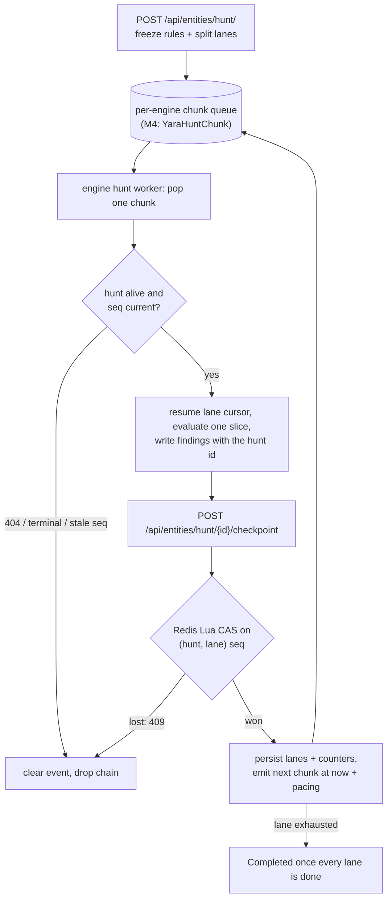

# Hunts and Rule Sets

---

A hunt is a user-created, bounded, paced pass of a frozen set of rules over historical
data, with every finding it writes attributed back to it. **Hunts fully replace the
automatic backscan this milestone previously planned**: nothing rescans history on rule
create or update anymore. Rescanning a corpus re-reads every byte of it (see
[Scaling and Performance](./performance.md)), so covering history is an explicit user
decision with an explicit cost — made through a hunt, bounded by quotas and the system's
first pacing configuration — not a side effect of editing a rule.

**Decision: hunts are a generic chassis with per-engine plugs, not a yara feature.** The
hunt machinery — selectors and frozen snapshots, corpus bounds, lanes and chunk chains,
checkpointing, pacing, quotas, status, and finding decoration — contains nothing
engine-specific, while everything that *is* engine-specific (what a corpus item is, how
to fetch and evaluate it, and how findings converge) differs between the two rule engines
Thorium already has. A `Hunt` carries an `engine` field; M4 ships the chassis plus the
**yara engine**; a sigma engine and other historical-scan types land later as plugs. The
full argument — what genericity buys, what stays specific, and what it costs — is its own
page: [Generic Hunt Trade-offs](./hunt_tradeoffs.md).

A naming note before the design: the event-handler's scan workers have lived in a module
literally named `hunts` since the sigma worker landed
(`event-handler/src/libs/workers/hunts.rs:1-7` — "could support hunting in historic
data"). This milestone makes that name load-bearing. In this book, a *hunt* is the
user-created pass over history defined on this page; the always-on event-driven pass that
scans every new upload is the *scan path*. (The [Current State](./current_state.md)
page's "sigma hunt pipeline" phrasing predates this definition and keeps its historical
name, exactly like the module path.)

## The RuleSet Entity

**Decision: a `RuleSet` is an entity whose membership is stored as
`AssociationKind::RuleSetMember` associations to its member rule entities — any rule
kind — hydrated at read time, not an id list in `kind_data`.** Both patterns have working
precedent:

| Pattern | Precedent | Validation | Navigation | Read cost |
| --- | --- | --- | --- | --- |
| ids in `kind_data` | `FileSystemFolderEntity.filesystem_id` (`api/src/models/entities/filesystem.rs:80-82`) | none — ids are stored unchecked and dangle silently | one-way | free |
| membership associations | `Device` → `DevelopedBy` → vendor (`api/src/models/backends/entities.rs:1587-1638`) | each id checked to exist and be a rule kind at create | both directions in the association graph ("which rule sets contain this rule?") | an association crawl per detail read |

A rule set exists to be browsed and shared, so the validated, bidirectional shape wins;
the read-time crawl is bounded by the membership cap below. Membership rides the same
machinery as device vendors end to end: hydrated into the metadata on read
(`populate_associations`, `api/src/models/backends/entities.rs:791-831`), stripped before
every persist (`drop_associated_data`, `:1434-1457`), and edited through the generic
entity update path. `RuleSetMember` is an additive variant in the TEXT-stored association
enum, appended at the end like every variant before it (the enum is rkyv-archived in
backups, `api/src/models/associations.rs:37-43`).

Members may be rules of **any** engine — a `SigmaRule` and a `YaraRule` can share a set
(each id is validated to exist and be *a* rule kind). Rule sets are useful groupings on
their own, before and beyond hunts; a hunt that selects a mixed set freezes only the
members of its own engine and counts the rest as excluded (see the snapshot decision
below).

```rust
/// A named group of associated rules of any engine
///
/// Membership is stored as `RuleSetMember` associations to the member rule
/// entities (the `Device -> DevelopedBy -> vendor` pattern); this struct
/// carries only the read-time hydrated member list, which is stripped before
/// every persist exactly like `Device.vendors`.
pub struct RuleSet {
    /// The member rules, hydrated from associations at read time
    pub rules: Vec<Entity>,
}
```

Rule sets use the generic multipart entity surface (create field
`metadata[ruleset_rules][]` — the form field namespace is flat and shared across all
kinds, hence the prefix) and no kind-specific intrinsic tags: name and kind browse are
already first-class, and a member-count tag would churn on every edit for no query it
enables. Membership is capped at `conf.thorium.hunts.max_rules_per_ruleset`.

Two scoping notes:

- **Rule sets are freely mutable and deletable.** A hunt created from a rule set
  snapshots its membership at that instant (next section) and is unaffected by later
  edits or even deletion of the set.
- **Membership hydration is group-scoped**, so two viewers can see different member lists
  of the same rule set — and a hunt's frozen snapshot resolves under its *creator's*
  visibility (see [Risks and Open Questions](./risks.md)).

(A side benefit of the generic name: the UI already exports `type YaraRuleset` as the
`YaraRule` metadata-fields type (`ui/src/models/entities/rules/yara.ts:33`), which a
`YaraRuleSet` entity model would have collided with up to casing; `RuleSet` does not.)

## The Hunt Entity

**Decision: a hunt runs exactly one engine, named by an `engine` field frozen at
creation.** The engine decides what the corpus items are, how they are fetched and
evaluated, and how findings are written (see Engines below); everything else on the
entity is engine-blind. Mixed-engine hunts are deliberately not a thing — "hunt this with
sigma *and* yara" is two hunts, each with honest per-engine progress and cost (weighed in
[Generic Hunt Trade-offs](./hunt_tradeoffs.md)).

**Decision: a hunt freezes its rule selection to a snapshot of rule entity ids at
creation.** The alternative — re-resolving a `Tag`/`All`/`RuleSet` selector as the hunt
progresses — was weighed and rejected: items scanned early would have seen fewer rules
than items scanned late, making "what did this hunt cover?" unanswerable, and a selector
that keeps growing mid-hunt has no bounded cost. Freezing *ids* rather than rule text
keeps the common case cheap and the semantics simple: rule text is read when a chunk
loads its evaluator, so a rule edited mid-hunt scans with its current text, a deleted
rule skips and counts, and rules created after the hunt never join it.

Resolution runs under the **creator's** authorization, not the admin service account: the
frozen set is exactly the rules the creator could see at creation. (Resolving as admin
would also be lossy — the admin all-groups expansion silently caps at 10,000 groups,
`api/src/models/backends/users.rs:1270-1283`.) Selectors resolve only rules of the
hunt's engine: an `All` selector means every rule of that engine's kind visible to the
creator, a `Tag` selector matches within that kind, and `RuleSet` members of another
engine's kind are excluded and counted (`excluded_foreign`). Each engine may add a
snapshot filter — the yara engine excludes rules already quarantined as `Noisy` or
`Slow`, counted in `excluded_quarantined` (see Engines below); engines without a
quarantine concept make it a no-op. A selector that resolves past `max_rules_per_hunt`
is a 400 at create telling the user to narrow it: the frozen list lives in the hunt's
`kind_data`, which every checkpoint rewrites whole, so the cap bounds every progress
write.

**Decision: the corpus is a kind-tagged query — one shared bounds shape, an enum picking
the listing — defaulting to everything the creator can see up to the creation instant.**
The bounds shape is `FileListParams` (`api/src/models/files.rs:2959-2979`), which is
field-for-field the repo listing's shape too (`RepoListParams`,
`api/src/models/git/repos.rs:1350-1370`); the enum-beside-shared-shape pattern is exactly
the `Collection` entity's (`CollectionKind { Files, Repos }`,
`api/src/models/entities/collections.rs:40-45`, bounds at `:12-34`). `start` is the
newest bound, clamped to the creation instant — the scan path owns everything after it;
`end` is the oldest, defaulting to the corpus kind's configured `earliest`. Tag filters
are **strict AND across every (key, value) pair, with no OR and no negation** — the list
backend keeps an item only when it matched every requested pair (`sort_tags`,
`api/src/models/backends/db/cursors.rs:452-486`); the `Collection` doc comment's
"at least one" phrasing describes an OR the backend does not implement, and this page
does not repeat the mistake. M4 activates `Files` only: `Repos` is designed-in but
rejected at create until an engine scans repos (deferred with
`YaraRuleAppliesTo::Repos`), and a `Results` corpus is explicitly deferred with the
sigma engine (see [Generic Hunt Trade-offs](./hunt_tradeoffs.md) for why results need
new listing machinery and what result retention does to the semantics).

**Decision: status and engine are mirrored as intrinsic entity tags —
`HuntStatus=<state>`, `HuntActive=true` while Created or Running, and
`HuntEngine=<engine>`.** Because tag filters are strict AND, "status ∈ {Created,
Running}" is inexpressible in one tag query — two values of one key must *both* match —
so the binary Active tag makes both the browse filter ("my running hunts") and the
create-time quota check (count `kind=Hunt` entities with `HuntActive=true`, per submitter
and global) a single tag-census listing. The engine tag exists because one `Hunt` kind
cannot be split by the `kinds[]` list param — "my yara hunts" is
`kinds[]=Hunt&tags[HuntEngine][]=yara`.

```rust
/// The rule engine a hunt runs
///
/// M4 ships Yara; adding an engine means implementing the six plug points
/// in Engines below (see Generic Hunt Trade-offs for the contract).
pub enum HuntEngine {
    /// Scan sample bytes with yara rules
    Yara,
}

/// How a hunt chose its rules
///
/// The selector is kept for display; the frozen snapshot resolved from it at
/// creation — filtered to the hunt engine's rule kind — is what actually
/// scans.
pub enum HuntSelector {
    /// An explicit list of rule entity ids
    Rules(Vec<Uuid>),
    /// Every rule of the engine's kind carrying this entity tag at creation
    Tag {
        /// The tag key to match
        key: String,
        /// The tag value to match
        value: String,
    },
    /// Every rule of the engine's kind visible to the creator at creation
    All,
    /// The members of a RuleSet entity at creation time
    RuleSet(Uuid),
}

/// The lifecycle of a hunt
pub enum HuntStatus {
    /// Created, but no chunk has checkpointed yet
    Created,
    /// At least one chunk has checkpointed and some lane still has work
    Running,
    /// Every lane exhausted its time range; terminal
    Completed,
    /// Cancelled by the submitter or an admin; terminal
    Cancelled,
    /// Stopped by the system because the hunt can no longer produce work
    /// (e.g. its frozen snapshot loads to zero usable rules); terminal
    Failed,
}

/// One lane: a contiguous time shard of the corpus, walked newest to oldest
pub struct HuntLane {
    /// The newest timestamp this lane covers
    pub start: DateTime<Utc>,
    /// The upload timestamp of the oldest line this lane has checkpointed
    pub current: DateTime<Utc>,
    /// The oldest timestamp this lane covers
    pub end: DateTime<Utc>,
    /// The checkpoint sequence number this lane expects next
    pub seq: u64,
    /// The server-side list cursor this lane is walking, while one is alive
    pub cursor: Option<Uuid>,
    /// Whether this lane has exhausted its time range
    pub exhausted: bool,
}

/// Scan counters persisted at each checkpoint
///
/// Counters are operational telemetry: a chunk replayed after a lost
/// checkpoint re-counts its work, so totals can drift. The `HuntId` tag
/// browse is the exact record of what a hunt found.
pub struct HuntCounters {
    /// How many corpus list lines the hunt has walked
    pub listed: u64,
    /// How many corpus items were fetched and evaluated
    pub scanned: u64,
    /// How many evaluations matched at least one rule
    pub matched: u64,
    /// How many findings the engine's writer reported written
    pub written: u64,
    /// How many finding writes the engine's writer reported suppressed
    pub suppressed: u64,
    /// How many items the engine's admission policy declined (yara: oversize)
    pub skipped: u64,
    /// How many items were deleted before they could be evaluated
    pub missing: u64,
    /// How many items failed to fetch or evaluate
    pub errors: u64,
    /// A bounded sample of per-item errors (capped by max_error_samples)
    pub error_samples: Vec<String>,
}

/// The corpus a hunt walks: a kind picking the listing, plus shared bounds
pub enum HuntCorpus {
    /// Walk the sample listing (the only kind an M4 engine scans)
    Files(HuntCorpusBounds),
    /// Walk the repo listing (rejected at create until an engine scans repos)
    Repos(HuntCorpusBounds),
}

/// The shared corpus bounds: the file/repo list params shape
pub struct HuntCorpusBounds {
    /// The groups to list from; must be a subset of the hunt's groups
    pub groups: Vec<String>,
    /// The newest bound; clamped to the hunt's creation instant
    pub start: DateTime<Utc>,
    /// The oldest bound; defaults to the corpus kind's configured earliest
    pub end: DateTime<Utc>,
    /// Tag filters; strict AND across every pair, like the file list
    pub tags: HashMap<String, Vec<String>>,
    /// Whether tag matching is case-insensitive
    pub tags_case_insensitive: bool,
}

/// The metadata for a user-created hunt
pub struct Hunt {
    /// The rule engine this hunt runs
    pub engine: HuntEngine,
    /// The selector as submitted, kept for display
    pub selector: HuntSelector,
    /// The frozen snapshot of rule entity ids resolved at creation
    pub rules: Vec<Uuid>,
    /// How many rules the engine's snapshot filter excluded (yara: Noisy/Slow)
    pub excluded_quarantined: u64,
    /// How many RuleSet members of another engine's kind were excluded
    pub excluded_foreign: u64,
    /// The corpus this hunt walks
    pub corpus: HuntCorpus,
    /// Where this hunt is in its lifecycle
    pub status: HuntStatus,
    /// Per-lane progress through the corpus
    pub lanes: Vec<HuntLane>,
    /// Scan counters, persisted at each checkpoint
    pub counters: HuntCounters,
    /// Why this hunt was marked Failed if the system stopped it
    pub failure: Option<String>,
}
```

Progress is reported per lane as the position of `current` inside `[end, start]` —
monotonic, cheap, and honestly time-based. There is no cheap corpus count — for files,
`GET /api/files/count/` is itself a paged full walk that fetches per-sample details — so
a hunt does not know its denominator until it finishes.

## Routes

**Decision: hunts get dedicated JSON routes; the generic update path stays machine-only
for them.** The selector enum and nested corpus do not fit the flat multipart field
namespace every entity kind shares, and hunt creation does real work — resolve, freeze,
lane init, first events — with typed failure modes. The M3d hit-write route is the
precedent for a kind-specific JSON route beside the generic surface
(`POST /api/entities/yara/hit/`, `api/src/routes/entities.rs:70-91`), and `YaraRuleHit`
is the precedent for machine-managed metadata the generic update path refuses to touch
(`api/src/models/backends/entities.rs:1142-1146`).

- `POST /api/entities/hunt/` — any user. Validates the engine (an unknown engine name is
  rejected at the serde layer as a 422; the in-code match is the landing spot that will
  400 any future engine that gains a variant before its execution plug ships), the
  corpus kind, the groups, and the quota — the quota check is
  best-effort by design: it counts `HuntActive` tags through the eventually-consistent
  census, so concurrent creates can briefly exceed `max_active_*` — then resolves and
  freezes the selector through the engine's snapshot filter, clamps the corpus, splits it
  into lanes, writes the entity and its status/engine tags, seeds the per-lane Redis
  sequence keys, and emits one depth-0 chunk event per lane on the engine's queue.
- `POST /api/entities/hunt/{id}/cancel` — the submitter or an admin; flips the status and
  tags to Cancelled. Running chunks observe it lazily (see Lifecycle below).
- `POST /api/entities/hunt/{id}/checkpoint` — the admin service account only; the single
  audited place hunt progress commits (next section). The route is engine-blind: it reads
  the hunt's engine to know which queue the next chunk event lands on.

```rust
/// A request to create a hunt
pub struct HuntCreateRequest {
    /// The name for the hunt entity
    pub name: String,
    /// The groups this hunt, and everything it writes, is bounded to
    pub groups: Vec<String>,
    /// The rule engine this hunt runs
    pub engine: HuntEngine,
    /// How to choose the rules this hunt freezes
    pub selector: HuntSelector,
    /// The corpus; omitted bounds default to everything up to creation
    /// (`HuntCorpusRequest` is the all-optional request mirror of `HuntCorpus`)
    pub corpus: Option<HuntCorpusRequest>,
    /// A description for the hunt entity
    pub description: Option<String>,
}

/// The commit for one processed hunt chunk
pub struct HuntCheckpoint {
    /// The lane this chunk advanced
    pub lane: u32,
    /// The sequence number this chunk is committing: the CAS term
    pub seq: u64,
    /// The oldest upload timestamp this chunk processed
    pub current: DateTime<Utc>,
    /// The live list cursor to resume from, if one is still alive
    pub cursor: Option<Uuid>,
    /// Whether this lane exhausted its time range
    pub exhausted: bool,
    /// A terminal failure, when the hunt can no longer produce work
    pub failed: Option<String>,
    /// Counter deltas from this chunk
    pub counters: HuntCounters,
}

/// The outcome of committing one hunt chunk checkpoint
///
/// A lost compare-and-set is a 409, not this response: losers clear their
/// stale chunk and emit nothing, so chains collapse instead of forking.
pub struct HuntCheckpointResponse {
    /// The hunt's status after this checkpoint committed
    pub status: HuntStatus,
    /// Whether this checkpoint emitted the next chunk event on its lane
    pub emitted: bool,
}
```

Edge case: if emitting the first lane events fails after the entity write, the hunt sits
in Created with no chain behind it. The v1 remedy is cancel and recreate; a kick/resume
route is explicitly deferred (see [Whats Left To Do](./whats_left_to_do.md)).

### Entity Lookup by Name

Thorctl's rule, rule set, and hunt arguments take an id **or an exact name**, and names
resolve server side so the client never pages a listing: `GET /api/entities/by-name/`
(`api/src/routes/entities.rs`, mounted beside `/entities/details/`) reads the previously
unused `entities_by_name` materialized view (see
[Current State](./current_state.md#the-entities-framework)) — a single-partition
exact-name read. Query params are `name` (required: the extractor deliberately skips the
list params' empty-default fallback, so a missing name is a 400) and `kinds[]`
(defaulting to every kind). The kind restriction rides **in the CQL** — kind is the
clustering column right after group — because other kinds legally share a rule's name:
every yara rule hit is named after its rule, so a Rust-side filter would crawl (and
false-trip the ambiguity guard on) one row per hit when resolving a productive rule's
name. Scylla caps the clustering-key IN cartesian product (groups × kinds) at 100 per
query, so the db layer dedupes the kinds and sizes its group chunks to stay under the
cap. The response is the plain `Vec<Entity>` of visible matches ordered oldest-created
first, with group rows deduped by entity id exactly like `get_many` — zero matches is an
empty 200, not a 404, because callers distinguish the zero/one/many cases themselves. A
literal `LIMIT 501` in the prepared statement backs a row-count guard: more than 500
rows of the requested kinds sharing one name is a 400 ("address this entity by its id"),
so a pathological shared-name partition can never force an unbounded read. Thorctl's resolver (`thorctl/src/utils/entities.rs`) layers the
UX on top: a target that parses as a uuid is an id, full stop (a name that happens to
parse as a uuid must be addressed by its id), with the fetched entity kind-checked
against the family's kinds; anything else resolves by name and must match exactly one
entity — zero errors "No {noun} named ... was found", several errors with a line per
candidate (id, created time, groups) so the user can re-run with an id. `hunts hits` and
`hunts cancel` keep a no-prefetch fast path for uuid input, so a deleted hunt's hits
stay listable by id and cancel-by-id never grows a GET round trip.

## Execution: Chunk Chains

**Decision: each engine gets its own chunk event kind and worker on the shared hunt
chassis, and the never-emitted `YaraScanTrigger::Backscan { rule }` variant is removed.**
Fairness is by construction twice over: the live `YaraScannableSample` queue is a strict
`ZPOPMIN` with no priority mechanism, so a corpus-sized backlog must never share it — and
per-engine chunk queues keep one engine's backlog from head-of-line blocking another's
(a yara chunk holds byte-budget grants and burns the blocking pool; other engines'
chunks may be pure async I/O — see [Generic Hunt Trade-offs](./hunt_tradeoffs.md)).
Per-kind queue/in-flight keys fall out of the kind's `Display` with zero new key code
(`api/src/models/backends/db/keys/events.rs:44-78`), and the `EnumIter` on `EventType`
automatically covers each new kind in reap, drain, and depth reporting — so per-engine
kinds also keep per-engine queue depths observable. M4 ships
`EventType::YaraHuntChunk`. The old sketch's `Backscan { rule }` trigger variant
(`api/src/models/events.rs:89-93`) is removed rather than repurposed: nothing ever
constructed it, so no serialized event can carry it and the removal is wire-safe. There
is still no route to create events — `EventRequest` remains dead code
(`api/src/models/events.rs:152-159`) — and hunts do not add one: chunk events are
emitted server-side (`db::events::create`, `api/src/models/backends/db/events.rs:173-189`)
by the create and checkpoint routes, the same side of the API as every other emitter.

```rust
/// An event advancing one lane of a hunt by one chunk
///
/// Each engine's EventType variant carries this same payload (M4 ships
/// EventType::YaraHuntChunk), so engines keep separate queues, workers,
/// budgets, and depth gauges while sharing one chassis.
pub struct HuntChunkEvent {
    /// The hunt entity id
    pub hunt: Uuid,
    /// The lane index this chunk advances
    pub lane: u32,
    /// The checkpoint sequence this chunk will try to commit
    pub seq: u64,
}
```

The engine's worker is a new `EventWorkerKinds` variant beside the three existing kinds
(`event-handler/src/libs/workers.rs:113-121`) — M4 adds
`EventWorkerKinds::YaraHunter` backing a `YaraHuntWorker` in `workers/hunts/yara/` — on
the same chassis as the scan path: same pop/claim/clear machinery, its own budget. One
chunk event processes as (steps 3, 5, and 6 are the engine's; the rest is chassis):

1. **Load the hunt entity.** A 404 or a terminal status clears the event and drops the
   chain — cancellation and deletion are observed lazily, within one chunk.
2. **Drop stale chains.** If the event's `seq` is behind the lane's authoritative
   sequence, clear and drop: duplicate deliveries collapse instead of forking (the CAS
   below).
3. **Load the frozen snapshot's evaluator** — however the engine does it (the yara
   engine: LRU → serialized-cache GET → local compile; see Engines below).
4. **Walk one bounded slice of the corpus** — resume the lane's server list cursor, or on
   loss restart from `current` plus a one-second overlap (decision below). The walk is
   the plain listing (`GET /api/files/` for a Files corpus), never the deduping details
   walk: a deduping cursor accumulates every item it has ever returned into one Redis
   value re-serialized per page (`ScyllaCursorRetain.dedupe_set`,
   `api/src/models/backends/db/cursors.rs:100-103`) — unbounded at corpus scale.
5. **Coalesce the slice and evaluate each item** under the engine's admission policy and
   budget. Duplicate items across chunks re-evaluate and converge — accepted waste,
   bounded by submission duplication.
6. **Write findings through the engine's audited write path** with the hunt id attached
   and the *corpus groups* as the event groups: the listings deliberately hide which
   group produced a line (`SampleListLine.groups` is skip-serialized,
   `api/src/models/files.rs:3036-3038`), and the engine's server-side intersection
   narrows every write per item anyway (see
   [Visibility and Partitioning](./visibility.md)) — breadth here costs nothing in
   correctness.
7. **Checkpoint** (decision below), which emits the next chunk event on the engine's
   queue or finalizes the lane.

**Decision: a chunk commits through a Redis Lua compare-and-set that advances the lane
and emits the next chunk event atomically.** The obvious alternative — checking a
sequence number stored in the entity row — cannot work: `db::entities::update` is
last-write-wins with no LWT, so two API replicas serving a duplicated checkpoint would
both pass the check and both emit the next event, forking the lane chain *permanently*
(double scan cost for the rest of the hunt). Instead the checkpoint route runs a small
script against a per-`(hunt, lane)` sequence key in Redis — the atomic-script precedent
is the pop script itself (`POP_EVENTS_SCRIPT`,
`api/src/models/backends/db/events.rs:37-61`) — that compares the submitted `seq`,
increments it, and `ZADD`s the next chunk event in the same script. Exactly one committer
wins; a loser gets a 409, clears its stale event, and emits nothing — chains collapse
instead of forking. The entity's `lanes` and `counters` are the persisted *view*, written
under a short per-hunt Redis mutex (fresh re-read inside the lock, ownership verified
right before the write, bounded re-applies on an expired hold), because concurrent lane
checkpoints rewrite the whole `kind_data` blob and would otherwise lose each other's
updates; cancel and hunt deletion take the same mutex so a checkpoint's read-modify-write
can never resurrect a terminal or deleted hunt, and the status merge never overwrites a
terminal status. The view is written on wins *and* losses: a loser merges only its
sticky facts — sequence floor, exhaustion, failure, progress, never counters — so a
lane-exhausting checkpoint whose view persist was lost is repaired by its own 409'd
replay instead of stranding the hunt in Running forever. If Redis loses a lane's
sequence key, it is reseeded at the further along of the entity's persisted sequence and
the committing chunk's own `seq` — a chunk event carrying seq N is proof the chain
legitimately reached N, and seeding at a lagging entity floor would 409 the live head
and kill the lane; the cost is a bounded, idempotent replay of at most the unpersisted
tail.

**Pacing.** The checkpoint script scores the next chunk event at
`now + inter_chunk_pacing_secs`. The pop script only claims events older than three
seconds — anything younger is re-added at its original score
(`api/src/models/backends/db/events.rs:47-48`) — so a future-dated score simply is not
claimable until it matures: pacing with zero new queue machinery. The cost is a ~3 s
floor (effective delay ≈ configured pacing + 3 s + pop cadence; every configured value
rides on top of the floor). One caveat: the restore paths (reset, drain, reap) re-score
events by the body's own timestamp, so a reclaimed paced event can deliver early —
bounded and harmless.

**Lanes.** Creation splits `[end, start]` into `lanes` contiguous time shards, each
walked newest-to-oldest by its own chain — within-hunt parallelism with no per-chunk
bookkeeping. (The shape is the deleted exports system's `{start, current, end}`
sub-cursors, recoverable at `git show 2e66bcb^:api/src/models/exports.rs`; the exports
feature was removed in the 1.1.0 release.) Internal lane boundaries overlap by one
second — the older lane's `start` is the boundary plus one second — because the page pull
is strict on both ends (`uploaded < ? AND uploaded > ?`, the shared time cursor in
`api/src/models/schema/cursors.rs` behind the `samples_list` cursor declared in
`api/src/models/schema/queries/samples.rs`): without the overlap, a
sample uploaded exactly on a boundary would belong to *no* lane. Cursor loss gets the
same treatment: lanes carry the server list-cursor id — cursor keys are scoped to the
creating username (`api/src/models/backends/db/keys/cursors.rs:19-26`) and every hunt
worker runs as the one service account, so any replica can resume any lane; cursors live
seven days once paged (`api/src/models/backends/db/cursors.rs:1732-1736`) — and on a
cursor 404 the lane restarts from its persisted `current` plus the same one-second
overlap. Overlap rescans converge through the engine's deterministic finding identity.
Lanes are *equal* time shards, so a recency-skewed corpus loads the newest lane hardest;
that is accepted — lanes exist for parallelism, not balance (census-weighted splitting is
deferred).

**Failure taxonomy.**

- **Per-item failures** (fetch error, evaluation timeout, 404) skip and count, recording
  up to `max_error_samples` of them — a bad item never stalls a lane.
- **Chunk-level failures** (hunt unreadable, list 5xx) leave the event in flight for the
  normal 3-minute retry; the replay converges through the CAS.
- **`Failed` is terminal and system-set**: the hunt can no longer produce work — e.g. its
  frozen snapshot loads to zero usable rules. Per-item and per-chunk errors never set it;
  `Cancelled` is the user-set terminal state.

Chunk sizing versus the in-flight lease is stated, not hidden: worst case for the yara
engine, a 500-sample chunk of all-timeout scans at 4-way parallelism runs ≈ 125 minutes —
past the 1-hour `in_flight_backstop_secs` — so the age backstop can redeliver a
still-processing chunk. The two copies then share the lane's one server cursor (one
serialized Redis value saved per page), so they race and *split* the page stream rather
than duplicating it; finding writes stay convergent, the losing checkpoint 409s and
clears, and its counter deltas are lost — one more reason the counters are telemetry
while the `HuntId` tag browse is the record. Typical chunks — few timeouts — finish in
minutes.

**Depth.** Chunk events emit at depth 0: hunts start trigger chains, exactly like the
other user-initiated emission sites (see [Scan Triggering](./triggering.md)). Yara-engine
hit tags land at `event depth + 1` and deliberately **can** fire tag triggers — hunts
feeding pipelines is a feature — and auto-flag actions fire for hunt hits like any other
hit. Pacing is what bounds the resulting reaction-creation rate (see
[Risks and Open Questions](./risks.md) for the burst risk). Any future engine that
writes event-emitting tags inherits the same depth invariant.



## Engines

An engine is six plug points on the chassis; everything else on this page is shared. The
contract (argued in [Generic Hunt Trade-offs](./hunt_tradeoffs.md)):

| # | Plug point | What the engine supplies |
| --- | --- | --- |
| 1 | Rule kind + snapshot filter | which `EntityKinds` its rules are; any create-time exclusions (counted) |
| 2 | Corpus kinds | which `HuntCorpus` variants it can walk |
| 3 | Item fetch + admission | how a corpus item becomes scannable input, under what budget/caps |
| 4 | Evaluator | how the frozen snapshot loads/compiles, and any caching strategy |
| 5 | Finding writer | one audited, idempotent write path with a convergent identity the hunt id can decorate |
| 6 | Config block | its knobs under `conf.thorium.hunts.<engine>` |

### The Yara Engine (M4)

- **Rule kind + snapshot filter**: `EntityKinds::YaraRule`; rules already quarantined as
  `Noisy` or `Slow` are excluded at snapshot and counted, matching the live context
  build's list-time skip (`event-handler/src/libs/workers/hunts/yara/context.rs:111`,
  `is_status_quarantined` `:532-534`). `Broken`-tagged rules are **not** excluded here —
  the live build does not exclude them at list time either; their sources drop out at the
  compile classify step (`classify`, `context.rs:183`), so a broken-tagged rule whose
  text was since fixed hunts exactly like it scans.
- **Corpus**: `Files` (samples). `Repos` activates with `YaraRuleAppliesTo::Repos`.
- **Item fetch + admission**: `files.download_bytes` into RAM under a hunt-dedicated
  `ScanBudget` (`hunts.yara.scan_buffer_budget`; the budget type already validates
  `budget ≥ max_scan` at construction,
  `event-handler/src/libs/workers/hunts/yara/budget.rs:62-84`); oversize items count as
  `skipped`.
- **Evaluator — Decision: the subset compile reuses the live pipeline but is GET-only
  against the serialized-ruleset cache.** `classify`, `hash`, and `compile` are already
  public, pure steps (`context.rs:183`, `:228`, `:256`), and the cache key is
  content-addressed over sorted `(entity id, rule_hash)` pairs — a hunt whose frozen
  subset happens to equal the live set even hits the live cache object for free. But the
  cache uploader best-effort deletes same-engine-version siblings precisely so the bucket
  holds about one object per engine version (`prune_yara_ruleset_siblings`,
  `api/src/models/backends/events.rs:62-104`): if hunts uploaded their subset builds they
  would evict the live global ruleset's cache object and each other's. So hunt workers
  GET (`from_cache`, `context.rs:367`), compile locally on a miss, and keep up to
  `ruleset_lru_size` compiled subsets per worker; they never POST. Rule text is fetched
  by id on LRU miss; a deleted rule skips and counts. Cached subsets remember the rule
  text hashes they compiled from, and a rule-cache update evicts only the subsets an
  edit actually touched (or whose member the global build cannot witness) — so a
  mid-hunt edit lands within seconds while the ten-minute full-rebuild backstop leaves
  warm builds alone. Broken sources quarantine out at
  `classify` exactly as the live build's do — but hunts write no quarantine tags and gain
  no noisy/slow windows in v1: the live windows are keyed to the global context, and a
  hunt's blast radius is already bounded by its own pacing (see
  [Risks and Open Questions](./risks.md)).
- **Finding writer**: the M3d hit-write route with the hunt id attached — the convergent
  anchor is the deterministic `YaraRuleHit` (next section).
- **Config**: `conf.thorium.hunts.yara { scan_buffer_budget, ruleset_lru_size }`.

### The Sigma Engine (deferred)

A sigma hunt means re-evaluating sigma rules over historical **tool results**, and it is
deliberately not in M4: the chassis carries it, but sigma's own machinery is not ready to
plug in. The gaps, verified against the live code and catalogued in full in
[Generic Hunt Trade-offs](./hunt_tradeoffs.md): sigma writes as per-user masqueraded
clients into the rule's groups verbatim with client-side read-then-write dedupe — no
audited route, no intersection, and no deterministic finding to decorate (a sigma match
with no configured actions persists *nothing* today) — and no results-corpus listing
exists, while result retention (default 3 per key/tool/group) makes "all historical
results" a much shallower corpus than it sounds. The engine ships when those
prerequisites land; the chassis does not change for it.

## Hits: Attribution and Browse

**Decision: a hunt finding is the engine's own convergent record, decorated — never a
hunt-scoped duplicate.** The chassis decorates; the engine supplies the anchor. Two
decorations, both kind-agnostic:

- **`AssociationKind::HuntHit`, hunt → finding** — graph navigation, an additive variant
  appended last for rkyv discriminant stability (`api/src/models/associations.rs:104-108`).
- **A `HuntId=<hunt uuid>` entity tag on the finding**, in the finding's write groups —
  the browse path. Both marks are needed: associations cannot be filtered by kind
  server-side (every consumer pages the source's whole partition and filters in app
  code), while `GET /api/entities/?kinds[]=YaraRuleHit&tags[HuntId][]=<id>` rides the
  per-(key, value) tag-census partitions and answers "what did my hunt hit?" in one
  listing — and because entity tags are kind-blind, the same query shape works for any
  engine's finding kinds without naming them. Entity tags emit no events
  (`api/src/models/tags.rs:52-57`), so the tag carries no trigger-depth concern.

For the yara engine the anchor is the deterministic hit: identity is UUIDv5 over
`(rule_id, sha256)` with no hunt dimension (`api/src/models/entities/hits.rs:101-110`), so
a hunt re-firing a pair the scan path already hit converges onto the existing entity and
simply gains the hunt's marks. `YaraHitWriteRequest` carries an optional, serde-defaulted
`hunt` field (`api/src/models/entities/hits.rs:240-250`); when set, the hit route probes
the hunt — the same kind-extended id probe the rule gets, run only once a write is
certain so suppressed outcomes never pay it — and writes both decorations in the same
idempotent call (the `HuntId` tag upserts; association rows are additive per apply, the
platform-wide duplicate-row gap the deferred reaper covers). A hunt deleted mid-scan does
not fail the write: the probe misses (a wrong-kind id is treated the same, with a WARN —
the rule is the hit's identity while the hunt is only decoration), the hit lands
undecorated, and the response reports the skipped decoration (`hunt_missing`,
serde-defaulted for rolling upgrades) so the worker's stats stay truthful
(`hits_undecorated` in the hunt worker's stats line).

**Decision: converging on an existing yara hit refreshes its metadata when the incoming
scan is newer.** Before M4c the converge path merged groups only and never touched
`kind_data`; now (`converge_hit`, `api/src/models/backends/entities.rs:384`) every
converge fetches the stored hit — one extra bounded single-partition read, the feature's
accepted cost — and a converge whose `scanned_at` is *strictly* newer replaces the stored
scan facts — `rule_hash`, `ruleset_hash`, `engine_version`, `scanned_at`, `matched`
(re-bounded), never the identity fields or `rule_name` (`refresh_hit_facts`,
`api/src/models/backends/entities.rs:193`) — so newer-wins ordering means a redelivered
stale or equal-timestamp write can never clobber a fresher refresh (and an idempotent
redelivery stays write-free; group merges and refreshes share one update). The refresh is
read-then-write, not a CAS: two concurrent different scans can land last-write-wins, the
same documented race class as converge's probe-then-create window. Because the intrinsic
tag refresh is add-only, a refresh that changes `rule_hash` sweeps the stale
`YaraHitRuleHash` value rows, detected from the entity's own fetched tags so a crash
between update and sweep self-heals on any later converge. This folds the old backscan's
"hit metadata refresh" into *every* write path: scan-path rescans, hunts, and even the
generic multipart create alike repair stale `rule_hash` metadata, and the update guard's
comment now reads "refreshed newer wins on every hit converge (M4c)"
(`api/src/models/backends/entities.rs:1431-1433`). (This refresh is a property of the
yara hit record, not of the chassis — the chassis promises decoration, engines define
what converging means.)

The no-leak argument extends unchanged: hunt writes satisfy
`write_groups ⊆ event.groups = corpus groups ⊆ hunt.groups`, so anyone who can see a
hunt-written finding row can also see the hunt that wrote it (see
[Visibility and Partitioning](./visibility.md)). The chassis requires this of every
engine's writer — it is one of the reasons the sigma engine is gated on its writer
modernization (see [Generic Hunt Trade-offs](./hunt_tradeoffs.md)).

## The UI Surface (M4d)

Rule sets ride the generic config-driven entity UI (browse `/rulesets`, details
`/ruleset/:id`, create `/create/ruleset` with a mixed-engine member picker); hunts get a
dedicated create page at `/create/hunt` posting the JSON route above, because the
selector enum and nested corpus do not fit the generic multipart form. Engine-awareness
lives in one registry (`HUNT_ENGINES`, `ui/src/models/entities/hunts.ts` — the UI mirror
of `HuntEngine::rule_kind()`): it picks the rule kind the selector pickers list and the
finding kind the details page's inline Hits tab (and the toolbar's open-in-browse
crosshairs button) lists, so a future engine is one entry plus one inline-list row
component. Hunt details render the machine-managed metadata read-only with time-based
progress (per lane, `current`'s position inside `[end, start]`; overall width-weighted —
never counter-derived, since there is no item denominator), auto-refreshed on a 10 s poll
only while the hunt is Created/Running, plus a submitter-visible Cancel. "What did my
hunt hit?" is answered on the page itself: the findings section is a tab strip (the same
shared Tabs the file details page uses) whose default Hits tab lists the hits inline
(the `HuntId`-tag listing, refetched on status transitions but never by the poll) with
the frozen snapshot behind a Frozen Rules tab badged with the exact snapshot size, and
the crosshairs button — in the top action row beside the dashboard button — opens the
full hit browse pre-filtered by the `HuntId` tag (`/rules/yara/hits?tags[HuntId]=<id>`)
— the same query shape as the API browse above. The intrinsic
`HuntStatus`/`HuntEngine`/`HuntActive` tags stay off hunt browse rows (the row already
shows engine and status) but remain omnibar/URL-filterable, so the status/engine/active
browses still need no custom filter UI.

## What Hunts Replace

| Old backscan plan (M4) | Hunt equivalent |
| --- | --- |
| Automatic paced rescan on rule create/update targeting coverage-ledger mismatches | Nothing automatic. The rule's author runs a hunt — `Rules([id])` or any other selector — over the history they care about |
| Single-rule throwaway compile per `Backscan { rule }` event | Frozen-subset compile per hunt, content-addressed and LRU-cached; the `Backscan` trigger variant is removed |
| Hit metadata refresh on `rule_hash` change | Newer-wins metadata refresh on every yara hit converge, from any write path |
| Rule-group-widening repair | Run a hunt: a re-match re-runs the write-groups intersection with the rule's *current* groups |
| Engine-upgrade refresh ("an upgrade is a rule edit") | A documented manual operation: run hunts over affected history after an engine bump |

Hunts also write no `YaraScanSkipped` markers — their counters carry the skips — and
there is no per-sample coverage record for them to consult: the `YaraScanned` ledger the
backscan would have consumed was removed outright once hunts replaced it. A yara hunt
scans a frozen subset, so its build hash was never the global `ruleset_hash` the ledger
recorded, and the backscan's "exact convergent target set" was never expressible through
the list API anyway: tag filters are strict AND with no negation, so "samples whose
ledger hash differs from current" cannot be asked (see
[Scan Triggering](./triggering.md)). Per-sample coverage records are an engine concern
the chassis does not touch.

## Lifecycle Edge Cases

- **Cancel** — flips the status and tags; each lane's next chunk sees the terminal status
  and drops its chain; the evaluation in a currently-running chunk finishes first.
  Within-one-chunk latency, no new machinery.
- **Delete** — the generic entity delete works; workers treat the resulting 404 exactly
  like a cancel. The hunt's own rows and tags prune
  (`api/src/models/backends/db/entities.rs:547-590`), but `HuntId` tags on finding
  entities and `HuntHit` association rows dangle — the same platform-wide
  dangling-reference gap every entity delete has, covered by the already-deferred
  association reaper. The per-lane Redis keys expire by TTL, refreshed at each
  checkpoint.
- **Rule set edited or deleted after create** — no effect; the hunt froze ids.
- **Rule deleted after snapshot** — its text fetch 404s; skip and count (the yara hit
  route would 404 its hits anyway).
- **Rule edited after snapshot** — scans with current text, like the scan path; a yara
  hit records the `rule_hash` that actually fired.
- **Rule quarantined after snapshot** — still scans in the hunt: quarantine protects the
  *shared* live ruleset, while a hunt's subset is isolated and its cost is bounded by its
  own pacing.
- **Creator loses groups after create** — the hunt keeps running, like a rule whose
  author left a group: every write is still bounded by the engine writer's fresh
  rule ∩ item ∩ policy terms, which never included the creator.
- **Duplicate chunk delivery** — routine under retry, reaper, and backstop; collapses at
  the CAS.
- **Counters under replay** — can drift in both directions (a replayed chunk re-counts;
  a lost persist drops deltas); the `HuntId` tag browse is the exact record.

## Config

`conf.thorium.hunts` is the system's first pacing configuration — nothing rate-limits
any queue today. The chassis knobs are engine-blind; each engine adds a sub-block:

| Field | Default | What it bounds |
| --- | --- | --- |
| `lanes` | 4 | parallel chunk chains (time shards) per hunt |
| `chunk_size` | 500 | corpus list lines walked per chunk |
| `inter_chunk_pacing_secs` | 5 | delay between a lane's chunks (rides on the ~3 s pop maturity floor) |
| `max_rules_per_hunt` | 10,000 | frozen snapshot size; create 400s past it |
| `max_rules_per_ruleset` | 1,000 | `RuleSet` membership |
| `max_active_per_user` | 2 | Created/Running hunts per user, all engines (best-effort) |
| `max_active_global` | 8 | Created/Running hunts cluster-wide (best-effort) |
| `max_error_samples` | 25 | per-hunt bounded error list |
| `yara.scan_buffer_budget` | 1 GiB | in-flight hunt sample bytes per worker; load-validated ≥ the live `conf.thorium.yara.max_scan_size` |
| `yara.ruleset_lru_size` | 4 | compiled subsets held per worker |

Memory is additive: a replica running the yara hunt engine holds the live scan budget
*plus* the hunt scan budget *plus* up to `ruleset_lru_size` compiled subsets — raise pod
memory together with these knobs, never alone (see
[Scaling and Performance](./performance.md) for the cost model and sizing math).
