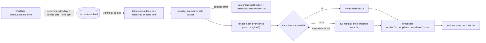

# Ruleset Compilation and Caching

---

**Decision: ONE global compiled ruleset — every rule entity in its own namespace, named
by the entity UUID; visibility partitioned at hit-write time, never at compile or scan
time; per-rule quarantine; debounced full rebuilds; a serialized-rules cache in M3.**

## One Global Ruleset

| Strategy | Compile cost | Scan passes per sample | Memory | Invalidation |
| --- | --- | --- | --- | --- |
| Global, namespace per rule | one compile of `R` rules | **1** | one ruleset | debounced full recompile on any change |
| Per-group rulesets | `G` compiles; a rule in `k` groups compiles `k` times | one per sample group | `G` rulesets | per-group recompile |
| Per-distinct-group-set | one per distinct submission group set | 1 | up to `2^G` rulesets | one rule change invalidates many sets |

Byte scanning dominates the cost, and yara-x shares one Aho-Corasick atom pass across
every rule in a compiled set — one pass of `R` rules costs far less than `k` passes over
subsets of the same bytes. Per-group rulesets also get the semantics wrong: a sample
visible to `{A, B}` scanned under A's and B's sets still needs cross-set dedupe and
per-hit group math — write-time partitioning is paid *anyway*, plus `k`-fold scanning.
Per-group-set cardinality is unbounded. The explicit, bounded price of the global set —
scanning rules whose groups never intersect the sample's — is absorbed by CPU headroom
(see [Scaling and Performance](./performance.md)).

## Building the YaraRuleContext

The build is modeled on `SigmaRuleContext::new`
(`event-handler/src/libs/workers/hunts/sigma.rs:108-170`) with its flaws fixed:

1. List all `YaraRule` entities as the service account — `EntityListOpts` with
   `kind(YaraRule)` and `page_size(2000)` (`api/src/models/entities.rs:1247-1266`,
   client cursor `api/src/client/entities.rs:337`).
2. Feed every source into **one combined `Compiler` pass**, one namespace per entity
   UUID. yara-x isolates per-source errors — a failed `add_source` does not poison the
   compiler — so M2 needed no O(R) solo pre-validation pass. (M3's serialized cache
   reintroduces a cheap per-source `classify` pass so quarantine still works on cache
   hits — see below.)
3. Quarantine each failure: skip the rule, record `(entity_id, error)` in the context,
   notify the submitter (the framework exists, `api/src/models/notifications.rs:86`),
   and tag the rule `YaraRuleStatus=Broken`. Never `.unwrap()`: sigma unwraps every
   compile, so one malformed stored rule panics the daemon
   (`event-handler/src/libs/workers/hunts/sigma.rs:127`).
4. Keep a side map of per-rule metadata and hash the build.

```rust
/// The global compiled YARA ruleset plus everything needed to attribute hits
pub struct YaraRuleContext {
    /// The compiled ruleset, shared across workers without copying
    pub rules: Arc<yara_x::Rules>,
    /// Per-rule metadata keyed by the entity UUID that names its namespace
    pub meta: HashMap<Uuid, RuleMeta>,
    /// A hash over sorted `(entity uuid, rule_hash)` pairs identifying this build
    pub ruleset_hash: String,
}

/// The write-time metadata for one compiled rule entity
pub struct RuleMeta {
    /// The groups this rule belongs to
    pub groups: Vec<String>,
    /// The sha256 of the exact rule source that was compiled
    pub rule_hash: String,
    /// The score to apply when this rule hits
    pub score: i64,
    /// The actions to take when this rule hits
    pub actions: Vec<YaraActionToTake>,
}
```

`RuleMeta.groups` feeds the single audited partition computation in `YaraHitWriter`:
`write_groups = rule.groups ∩ event.groups ∩ allowable_groups`
(see [Visibility and Partitioning](./visibility.md)). `ruleset_hash` is recorded on every
hit and keys the serialized-rules cache (below).

## Arc, Rebuilds, and Debounce

The context holds `Arc<yara_x::Rules>`: `Rules` is not `Clone`; cache-update broadcasts
clone the whole update enum (`event-handler/src/libs/workers.rs:29-54`, built per
broadcast at `event-handler/src/libs/controller.rs:222`) and must not copy hundreds of
MB of compiled rules; and `spawn_blocking` scan closures are `'static` — they take the
`Arc` and build their `Scanner` inside the task.

Rebuilds are **full, never incremental** — yara-x cannot remove rules from a compiled
set. The controller coalesces change flags over its 5 s poll
(`event-handler/src/libs/controller.rs:277`) behind a debounce window sized **at least
as large as the last measured compile time**, so rebuilds never overlap even at 10^5
rules. Workers keep scanning the old `Arc` until the broadcast swaps it — sigma's
cache-update pattern (`event-handler/src/libs/workers/hunts/sigma.rs:1085-1092`).

## Serialized-Rules Cache (M3)

Every replica and every restart used to pay the full combined compile independently —
with N replicas, one rule edit cost N multi-second compiles and a rolling update
recompiled the world for nothing. `Rules::serialize`/`deserialize` (round-trip verified
on the pinned yara-x 1.21.0) makes a build portable; the decisions are where hundreds of
MB of compiled rules live and how they are keyed. Stores weighed:

1. **Redis.** Already deployed, but compiled rulesets are hundreds-of-MB values: they
   crowd out the working set and stall the single-threaded event loop on transfer, and
   Redis is the one store the event pipeline cannot afford to degrade.
2. **Replica-local disk.** Free until the pod moves; a fresh pod always recompiles, so
   rolling updates — the common case — get no help.
3. **S3 behind admin API routes.** Big blobs in the store built for big blobs, no S3
   credentials in the event-handler, and the API stays the only thing touching S3 — the
   shape the agent's reaction-cache download already proved
   (`agent/src/libs/agents/setup.rs:183-273`).

**Decision: serialized rulesets live in S3 (`conf.thorium.yara.cache_bucket`, default
`thorium-yara-rulesets`), content-addressed by `(engine_version, ruleset_hash)`, served
through admin routes `GET|POST
/api/events/yara/ruleset/{engine_version}/{ruleset_hash}/`.** The serialized format is
not stable across yara-x versions, so `ruleset_hash` alone is never a valid key (see
[Engine Choice](./engine.md)).

Having the key *before* the expensive build required splitting the build.
`YaraRuleContext::from_rules` becomes three steps
(`event-handler/src/libs/workers/hunts/yara/context.rs`):

1. `classify(sources)` — cheap per-source solo passes that split the list into good
   sources and the quarantined list, so broken rules are still tagged and notified even
   when the combined build never runs (a cache hit).
2. `hash(good)` — the existing sha256 over sorted `(entity uuid, rule_hash)` pairs, now
   computed **before** any combined compile.
3. `compile(good)` — the combined one-namespace-per-rule build, now only on cache miss.

The rebuild flow is list → classify → hash → cache GET: a hit `deserialize`s the
compiled rules; a miss compiles, `serialize`s, and best-effort POSTs the result for its
peers. Combined with the debounce above, one rule change costs roughly **one compile
cluster-wide** (see [Scaling and Performance](./performance.md)). Content addressing
makes invalidation free — any rule change changes `ruleset_hash`, so stale entries are
simply never read again — and the uploader best-effort deletes same-engine-version
siblings, keeping the bucket at about one live object per engine version. **Every cache
failure is non-fatal by construction**: a missing bucket, a GET 404, a failed
deserialize, or a failed upload logs a warning and falls back to a local compile — the
cache is a cost optimization, never an availability dependency.

## Context Lifecycle



See [Cache Invalidation and Freshness](./cache.md) for the flag mechanics — today the
controller rebuilds only the trigger cache (`event-handler/src/libs/controller.rs:92-97`).

## Edge Cases

- **Zero rules** — an empty context; the scanner no-ops cheaply.
- **Valid at create, broken by an engine upgrade** — quarantined at the next rebuild with
  a notification; since create and update both validate, this is the only path to a
  stored-but-uncompilable rule.
- **Duplicate sources across groups** — distinct entities and namespaces, by design:
  different owners, different groups, independent hits.
