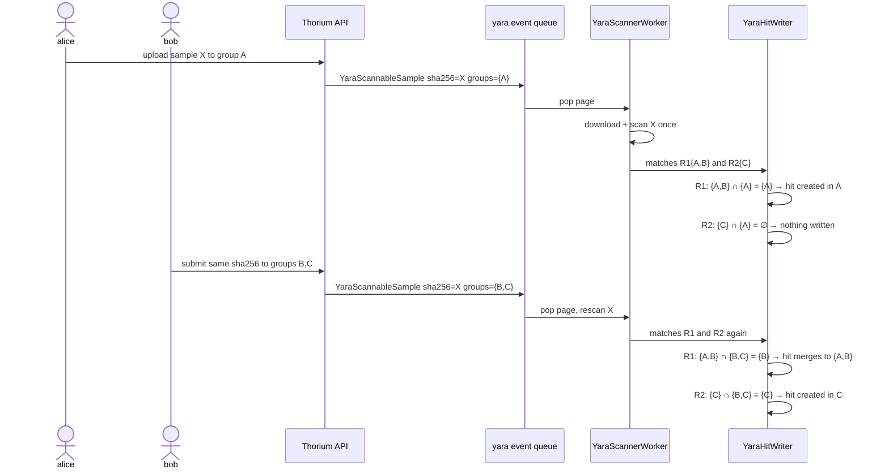

# Scan Triggering

---

YARA scanning is event-driven, not polled: every write that makes sample bytes newly
visible to a group emits a scan event into a dedicated Redis queue consumed by the
`YaraScannerWorker` (see [Scan Execution](./execution.md)). This page defines the event,
the depth invariant that keeps the trigger system loop-free, the emission sites, and the
skip markers that keep deliberate skips distinguishable from losses.

## A New Event Type

**Decision: add `EventType::YaraScannableSample` with its own queue.** Queue and in-flight
keys are formatted from the event kind's `Display`, so a new variant gets its own queue,
in-flight map, and in-flight queue with zero new key code
(`api/src/models/backends/db/keys/events.rs:44-78`). The payload is
`EventData::YaraScannableSample(YaraSampleScanEvent)`:

```rust
/// What caused a yara scan event to be emitted
pub enum YaraScanTrigger {
    /// A new submission made this sample visible to a set of groups
    NewSubmission,
    /// Groups were added to an existing submission
    GroupsAdded,
    /// Groups were removed from a submission or a submission was deleted
    GroupsRemoved,
}

/// An event for a sample that yara rules can scan
pub struct YaraSampleScanEvent {
    /// The sha256 of the sample to scan
    pub sha256: String,
    /// The groups whose visibility of this sample just changed
    pub groups: Vec<String>,
    /// What caused this event to be emitted
    pub trigger: YaraScanTrigger,
}
```

The originating trigger depth is not duplicated in the payload: the enclosing `Event`
already carries a `depth` field and the yara constructor populates it from the write that
emitted the event (as implemented in M1 — one source of truth instead of two fields that
can disagree).

**Decision: the never-emitted `YaraScanTrigger::Backscan { rule }` variant was removed at
M4b.** M1 shipped it as pre-staged wire format, but nothing ever constructed it, so no
serialized event could carry it and the removal was wire-safe. Hunts do not reuse it:
they run through their own per-engine chunk queues (`EventType::YaraHuntChunk` at M4) so
a corpus-sized backlog never contends with this one (see
[Hunts and Rule Sets](./hunts.md)).

`could_trigger` returns `TriggerPotential::CanNot` for the new variant, exactly like the
sigma arm (`api/src/models/events.rs:304-323`): scan events feed the scanner, never
reaction triggers. `trigger` is pure observability — admin pops and logs distinguish a
new-submission wave from a group-change wave at a glance.

## Trigger Depth Is Load-Bearing

**Invariant: the event carries the originating trigger depth, and `YaraHitWriter` sets
`trigger_depth = event.depth + 1` on every sample tag it writes.** This is a hard
requirement, not an inherited convention. Sigma's constructor hardcodes `depth: 0`
("depth has no meaning", `api/src/models/backends/events.rs:194-224`), which is safe only
because sigma writes *entity* tags and `TagType::Entities` emits no events
(`supports_events`, `api/src/models/tags.rs:52-57`). YARA hits deliberately write
*sample* tags (`YaraRuleHits=<rule entity name>`, see
[Hits and Attribution](./hits.md)), and `TagType::Files` **does** emit `NewTags` events
(`api/src/models/backends/db/tags.rs:102-108`) whose depth comes from
`TagRequest.trigger_depth` (`api/src/models/backends/events.rs:138-160`), default 0
(`api/src/models/tags.rs:264-274`). The max-depth guard is the trigger system's **only
loop breaker**, keyed entirely off event depth
(`event-handler/src/libs/cache.rs:149-164`; default 5, `api/src/conf.rs:1998-2014`).

A hit tag written at a reset depth of 0 re-arms the only brake in the system: a trigger
on `YaraRuleHits` runs an unpacker pipeline → the agent uploads a derived sample at depth
n → the scanner writes its hit tag at depth 0 → `NewTags` at depth 0 → the trigger fires
again at depth 1 → another derived sample — forever, whenever a tool's output re-matches
a rule (an appended byte suffices), growing corpus and queue unboundedly. With the depth
propagated, the chain terminates at `max_depth` like every other trigger chain. Sample
create has the depth in hand (`form.trigger_depth`,
`api/src/models/backends/db/files.rs:287-290`); group updates are user-initiated and emit
at depth 0 — correct, since they start chains rather than extend them. Hunt chunk events
follow the same depth-0 rule for the same reason (see
[Hunts and Rule Sets](./hunts.md)).

## Emission Sites

- **Sample create** — `db::files::create` emits beside the existing `NewSample` event
  (`api/src/models/backends/db/files.rs:287-300`), carrying the submission's groups. The
  duplicate-submission path returns 409 before either event (`db/files.rs:217-243`) —
  correctly, since nothing new became visible.
- **Existing sha256, new submission — handled by construction.** A new submission of a
  known sha256 runs the same create path and emits an event whose `groups` are the *new*
  submission's groups. The worker rescans; deterministic hit identity plus group-merge
  make the rescan idempotent and cumulative (see [Hits and Attribution](./hits.md)).
- **Submission update** — `db::files::update` gains emissions: `add_groups` →
  `GroupsAdded`; `remove_groups` and submission delete → `GroupsRemoved`, so hit groups
  can shrink with revoked access (see [Visibility and Partitioning](./visibility.md)).
  Today that path emits nothing at all (`api/src/models/backends/db/files.rs:898-957`) —
  not even a `NewSample` event — an adjacent gap this design closes for yara.

## Coalescing

A popped page (≤1000 events, `event-handler/src/libs/workers.rs:394-395`) is grouped by
sha256 with unioned `groups` before any bytes move: one download and one scan per sha256
per page, no matter how many submissions or group edits landed in the window. All event
ids covered by a coalesced scan clear together on success.

## Deliberate-Skip Markers

Not every unscanned sample is a gap to repair. A sample the scanner **will not** scan
under current policy — today only the `max_scan_size` abort — gets a positive marker:
`YaraScanSkipped=oversize:<cap>`, written through `YaraHitWriter` like every other sample
tag, so it is pre-filtered by the same tags-allowability check and, being a
`TagType::Files` tag that emits `NewTags` events, carries the same stamped
`trigger_depth = event.depth + 1`: an unstamped marker would rebuild exactly the
depth-reset loop this page closes above. The skip's event **clears** like a success, and
"it never will be scanned under the current cap" becomes an explicit answer instead of an
absence — without the marker an oversize sample would be indistinguishable from a
transient loss forever.

That marker is the only per-sample record scanning leaves. A completed scan writes its
hits and nothing else, so coverage is two-valued: a `YaraScanSkipped` marker means
deliberately not scanned, and why; no marker means the sample matched nothing, was never
scanned, or its scan was lost — indistinguishable per sample. Confidence over a window,
like repair, is a hunt (see [Hunts and Rule Sets](./hunts.md)); loss *detection* is
aggregate (queue depths, worker stats), and the loss windows keep shrinking: M3's atomic
Lua pop closed the pop crash window for owned pops (see [Scan Execution](./execution.md)),
leaving stragglers like a missed cache flag to the periodic rebuild backstop.

A scan-coverage ledger used to make that third state explicit: from M2 every completed
scan — zero-match scans included — stamped `YaraScanned=<ruleset_hash>` into the scanned
groups. It was removed after M4. Every scan paid a tag write plus a `NewTags` event, and
every ruleset change churned every scanned sample's tag row, for a record nothing ever
read: its planned consumer — the backscan — was replaced by hunts, and the "convergent
target set" it promised (samples whose ledger hash differs from the current
`ruleset_hash`) was never expressible through the list API anyway — tag filters are
strict AND with no negation (`sort_tags` keeps an item only when it matches every
requested pair, `api/src/models/backends/db/cursors.rs:452-486`). Match provenance
survives where it is actually read: every hit records the `ruleset_hash` that produced it
(see [Hits and Attribution](./hits.md)). Samples scanned before the removal keep their
stale `YaraScanned` tags; they are inert.

## Hunting History (M4)

The automatic backscan was cut at M4: nothing rescans history on rule create or update.
History is covered on demand by user-created **hunts** — a frozen rule snapshot walked
over a bounded corpus through dedicated per-engine chunk queues (`YaraHuntChunk` at M4),
so the live scan queue is never contended (see [Hunts and Rule Sets](./hunts.md)). The
old framing
survives as the pacing rationale: retroactive scanning of a corpus is a capacity decision,
not a latency one — hunts just make it the *user's* decision, bounded by quotas and the
pacing config.

## Edge Cases

- **Event races Scylla consistency** — events younger than 3 seconds reset back into the
  queue (`api/src/models/backends/db/events/shared.rs:46-49`); no new code needed.
- **Sample deleted between event and scan** — the 404 is success-with-skip so the retry
  loop is not poisoned, mirroring sigma's disabled-user skip
  (`event-handler/src/libs/workers/hunts/sigma.rs:959-966`); the sample is gone, so
  there is no coverage left to record or repair.
- **Duplicate events across pages** — resolved at write time: deterministic hit identity
  and group-merge make redelivery a no-op (see [Hits and Attribution](./hits.md)).

The two-submission flow end to end (`write_groups = rule.groups ∩ event.groups ∩
allowable_groups`; every group here permits entity writes, so the third term is elided):


