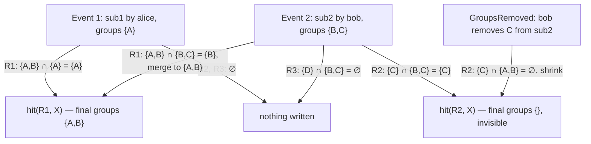

# Visibility and Partitioning

---

The scanner runs one global compiled ruleset over every scannable sample (see
[Ruleset Compilation and Caching](./ruleset.md)); visibility is enforced in one place —
at hit-write time. This page defines that rule, its guarantees, and every lifecycle case.

## The Formula

For a scan event carrying groups `E`, for each rule `R` that matched:

```text
write_groups = rule.groups ∩ event.groups ∩ allowable_groups
```

- **`rule.groups`** — the groups of the matching `YaraRule` entity, read from the
  `RuleMeta` map the `YaraRuleContext` keeps beside the compiled ruleset. A rule never
  produces output its own group members could not have produced themselves.
- **`event.groups`** — the groups the triggering `YaraSampleScanEvent` made the sample
  newly visible to: a new submission's groups for `NewSubmission`, the added set for
  `GroupsAdded` (see [Scan Triggering](./triggering.md)) — deliberately not the sample's
  full group set; accumulation is the merge rule's job below.
- **`allowable_groups`** — groups whose kill switches permit the write. Groups carry
  `GroupAllowed` toggles per `GroupAllowAction` — entities, associations, tags
  (`api/src/models/groups.rs:92-123`); `Group::authorize_check_allow_all` enforces them
  **even for admins** (`api/src/models/backends/groups.rs:651-677`); and entity and
  association creates authorize every requested group in one call
  (`api/src/models/backends/entities.rs:173-182`,
  `api/src/models/backends/associations.rs:70-78`) — one disallowing group would 401 the
  whole write and silently lose the hit everywhere. The `YaraHitWriter` therefore caches
  `GroupAllowed` per group — refreshed off the group-mutation cache flag
  (`api/src/models/backends/db/groups.rs:81`, `:408`) — pre-filters `write_groups`, and
  counts `hits_suppressed_by_policy` (see [Scaling and Performance](./performance.md)).
  A group disabling `Entities` has deliberately opted out of hits.

**If `write_groups` is empty, nothing is written** — no hit entity, no association, no
tag, not even a rule-owner breadcrumb. A count-only signal for suppressed cross-group
matches is an open question (see [Risks and Open Questions](./risks.md)).

**Merge semantics.** If a hit for `(rule, sha256)` exists, the writer adds the new
`write_groups` via `EntityUpdate.add_groups` (`api/src/models/entities.rs:1592-1596`),
which writes the new per-group rows, census and tags
(`api/src/models/backends/db/entities.rs:392-503`). Over a sample's lifetime a hit's
groups converge to `rule.groups ∩ (union of submission groups) ∩ allowability`.

## No Leaks — a Write-Time Invariant

Visibility of any object is membership in one of its per-group rows: reads fan out over
the caller's groups via `for_groups!` (`api/src/models/backends/db/helpers.rs:289`), and
a sample's groups are the union of its submissions' groups
(`api/src/models/files.rs:2298-2311`). A user sees hit `H` only by holding some
`g ∈ H.groups`, and the formula bounds `g` in both directions:

- **Sample direction:** every `g` entered `H.groups` through an event where
  `g ∈ event.groups ⊆ sample.groups`, so anyone who sees `H` could already see the
  sample — `H` discloses no sample's existence to non-viewers.
- **Rule direction:** `g ∈ rule.groups`, so anyone who sees `H` — whose name and metadata
  embed the rule name — could already see the rule, so `H` discloses no rule's existence
  or content to non-viewers.

Associations and tags inherit the property — written only in `write_groups`, their rows
are also per group, in both directions for associations
(`api/src/models/schema/scylla/associations.rs`). **The invariant
holds at write time, not for all time**: revocation can later falsify `g ∈ sample.groups`.

## Revocation

`SubmissionUpdate.remove_groups` and submission delete are live code — the update path
deletes the submission's per-group sample rows
(`api/src/models/backends/db/files.rs:900-967`) — and today they cascade to nothing.
Unhandled, a hit in group `B` keeps disclosing "sha256 X exists and matched rule R" after
`B`'s access to `X` was revoked: a permanent leak, not a race window. **Decision:
revocation shrinks hits.** The remove paths emit a `GroupsRemoved` scan event; the worker
recomputes `rule.groups ∩ current sample groups` per hit and removes the difference —
entity update already supports `remove_groups`, deleting per-group entity and tag rows
(`api/src/models/backends/db/entities.rs:392-503`). A hit whose recompute is **empty is
deleted outright** (entity updates reject empty group sets; the deterministic identity
recreates it on any future merge). A periodic reconciliation sweep backstops missed
events (deferred scope — see [Risks and Open Questions](./risks.md)).

## Why Not Masquerade

Sigma scans as the uploading user through masqueraded per-user clients
(`event-handler/src/libs/workers/hunts/sigma.rs:959-980`) but writes outputs into the
**rule's** groups (`event-handler/src/libs/workers/hunts/sigma.rs:369`, `:912-914`); an
uploader outside a rule's group means the create 401s and the hit is dropped with only a
log line (`event-handler/src/libs/workers/hunts/sigma.rs:672-683`). Masquerade fails even
under intersection semantics: alice (groups `{A}`) uploads `X`; bob's later submission
makes `X` visible to `{B}`; a rule in `{B}` matches. The correct hit belongs to `B` —
where alice has no write access at all. Partitioned hit writes are a **system
invariant**, not a user action — the event-handler's service account writes hits directly.

## Keeping Checks Meaningful Under Admin Writes

The service account is the operator-provisioned admin — the operator mints its `keys.yml`
credentials and tracks its admin user account (`operator/src/k8s/secrets.rs:125-170`) —
so beyond the kill switches above, API-side group checks will not constrain it. The
intersection must live in exactly one audited place:

- **Phase 1 (M2):** `YaraHitWriter` was the *only* code path computing `write_groups`,
  with a unit-tested intersection matrix.
- **Hardening (M3d, landed):** `POST /api/entities/yara/hit/` takes the scan-time facts
  (`rule_id`, `sha256`, match metadata, raw event groups, event depth) and recomputes
  the write groups **server-side from authoritative DB state**: the rule's groups,
  name, score, and auto-flag actions come from its freshly loaded entity, the sample
  term binds against the sample's *current* groups, deleted groups are filtered
  explicitly, and kill-switch allowances are snapshotted fresh and pre-filtered per
  group. This closes the rule-loses-groups direction of the scan→write TOCTOU window —
  context-cached rule groups can lag an edit by poll + debounce + compile (see
  [Cache Invalidation and Freshness](./cache.md)), during which a rule removed from a
  group kept writing hits visible to just-revoked members — and also closes a hit-loss
  window where a stale client allowance snapshot 401'd the whole write. The response
  reports the per-cause split (`suppressed_rule`/`suppressed_sample`/
  `suppressed_policy`, plus `sample_missing` as a convergent skip) so scanner stats
  stay truthful; the scanner keeps its cached intersection purely as a pre-filter that
  can only under-write, never leak. The generic create path additionally trims
  `YaraRuleHit` groups to the rule's authoritative groups whenever the rule exists
  (401 when the trim empties them), so both write paths are bounded.

## Later Changes

| Change | Effect |
| --- | --- |
| Sample gains groups | `GroupsAdded` event → rescan → hit merges the new groups |
| Sample loses groups | `GroupsRemoved` event → hit shrinks (see Revocation) |
| Rule gains groups | Hits are not retroactively widened until a hunt re-matches and re-runs the intersection — a manual operation (see [Hunts and Rule Sets](./hunts.md)) |
| Rule loses groups | Write-time stops at the next context refresh; the reconciliation sweep repairs history |
| Group deleted | Per-group rows become unreachable; reconciliation deferred (see [Risks and Open Questions](./risks.md)) |

## Worked Example

Sample `X` has `sub1` = alice `{A}` and `sub2` = bob `{B,C}`; rules `R1{A,B}`, `R2{C}`
and `R3{D}` all match `X`. Event 1 (groups `{A}`): `R1` writes a hit in `{A}`; `R2` and
`R3` write nothing. Event 2 (groups `{B,C}`): `R1`'s hit merges to `{A,B}`; `R2` writes a
hit in `{C}`; `R3` again nothing — `D` members see nothing, `C` members see only `R2`'s
hit. Bob then removes `C` from `sub2`: the sample's groups shrink to `{A,B}`, the
`GroupsRemoved{C}` event recomputes `R2.groups ∩ {A,B} = ∅`, and `R2`'s hit loses `C`.


