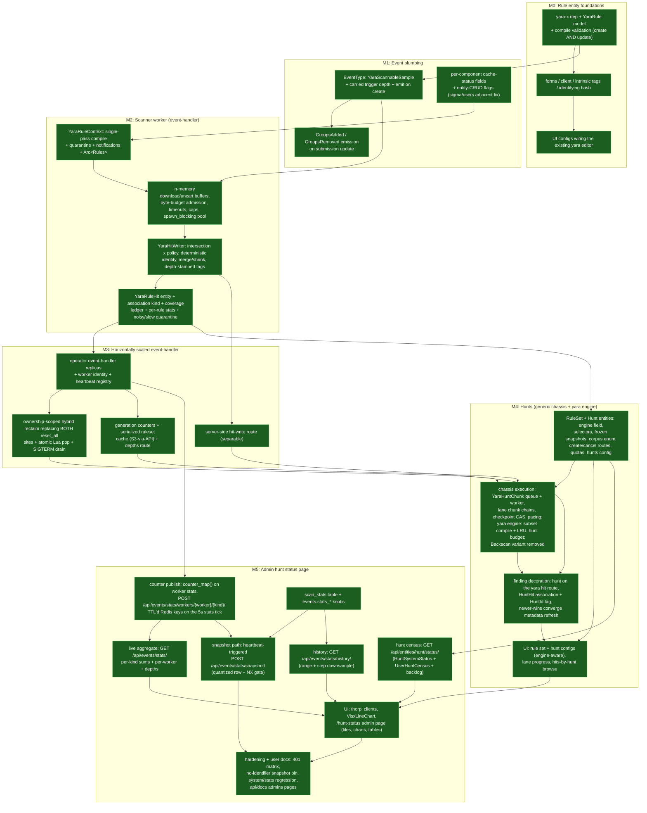

# Whats Left To Do

---

End state: every yara rule is a group-scoped entity validated by the real compiler at
write time; every sample upload is scanned exactly once by one global compiled ruleset
within tens of seconds; a user sees a hit exactly when some group of theirs can see both
the rule and the sample; every hit names the precise rule text that produced it
(`rule_hash`); scanners scale horizontally against one shared queue; history is covered
on demand by user-created hunts — bounded, paced passes that freeze a rule snapshot and
record exactly what they hit; and deliberate skips are marked (`YaraScanSkipped`) so
they never masquerade as lost scans. **Every milestone through M4 is implemented: M0 through M3
including the separable server-side hit-write route (M3d), M4a (the RuleSet and Hunt
entities with their create/cancel routes, quotas, and config), M4b (chunk execution: the
checkpoint route with its lane CAS and pacing, the yara hunt worker with subset compile +
LRU and its own budget, and the Backscan variant removal), M4c (finding decoration: the
optional `hunt` on the hit-write route, `HuntHit` associations + `HuntId` tags, and the
newer-wins converge metadata refresh), M4d (the UI: rule set and engine-aware hunt
configs, live lane progress, and the hits-by-hunt browse), and M5 (the admin hunt
status page)** — every node below is green. Yara scanning works end to end in a
horizontally scaled event-handler, hunts run their corpus to Completed through paced,
crash-convergent chunk chains, every hunt finding is decorated, browsable, and
metadata-fresh, the whole surface is drivable from the UI, and admins have a live +
historical ops view of all of it: **M5**, designed in
[Admin Hunt Status](./admin_status.md), shipped stage by stage (M5a–M5h: the
per-worker counter publish, live stats aggregate, `scan_stats` table and knobs,
quantized snapshot path, downsampled history route, hunt census route, the
`/hunt-status` admin page, and the hardening + user docs pass).

M0 and M1 are purely additive — a new entity kind, a new event type, new cache-status
fields — and can ship early, in separate releases, with nothing consuming them yet. M2 is
the feature: the first release in which a rule hits a sample end to end, visible only in
the right groups. M3 unlocks scale (replicas, restart cost, hardened writes) without
changing semantics. M4 completes the correctness story for history — samples that existed
before a rule did are covered on demand by hunts, hits whose rule text has since changed
refresh whenever a newer scan converges onto them, and rule-group widening and engine
upgrades become documented hunt runbooks instead of automatic rescans. The hunt machinery
itself is engine-generic; M4 ships it with the yara engine, and a sigma engine follows
once its prerequisites land (see [Generic Hunt Trade-offs](./hunt_tradeoffs.md)).

## Milestone Details

| # | Name | Deliverable | Depends on |
| --- | --- | --- | --- |
| M0 ✅ | Rule entity foundations | `yara-x` pinned as the workspace engine; `EntityMetadata::YaraRule` with `rule`, `applies_to` (v1: `Samples`), `score`, `actions`; real-compiler validation on create **and** update; forms/client plumbing, intrinsic tags, `rule_hash` identity; UI configs wiring the already-built yara editor — [YaraRule Entity](./rule_entity.md), [Engine Choice](./engine.md) | — |
| M1 ✅ | Event plumbing | `EventType::YaraScannableSample` + `YaraSampleScanEvent { sha256, groups, trigger }` emitted on sample create and on submission-update `add_groups`/`remove_groups`, carrying the originating trigger depth; per-component cache-status fields with entity-CRUD flags (sigma/users refresh fixed alongside) — [Scan Triggering](./triggering.md), [Cache Invalidation and Freshness](./cache.md) | M0 |
| **M2** ✅ | **Scanner worker (event-handler)** | `YaraRuleContext` (single-pass compile, broken-rule quarantine + notifications, `Arc<yara_x::Rules>`); `YaraScannerWorker` in-memory download/uncart buffers (byte-budgeted admission; `spill_dir` stays deferred), timeouts, size caps, `spawn_blocking` scan pool; `YaraHitWriter` (`write_groups = rule.groups ∩ event.groups ∩ allowable_groups`, deterministic identity, merge/shrink, depth-stamped tags); `YaraRuleHit` entity + `AssociationKind::YaraRuleHit` + coverage ledger + per-rule stats + noisy/slow quarantine — [Ruleset Compilation and Caching](./ruleset.md), [Scan Execution](./execution.md), [Visibility and Partitioning](./visibility.md), [Hits and Attribution](./hits.md) | M1 |
| M3 ✅ | Horizontally scaled event-handler | Operator `replicas` for the event-handler component (default 1); worker identity (`{hostname}-{8 hex}`) + heartbeat registry; ownership-scoped hybrid reclaim — per-owner lease-scored in-flight keys, `reset_worker` replacing both whole-kind `reset_all` call sites, reaper (`POST /api/events/workers/reap/`) with dead-owner drain + age backstop, SIGTERM drain — plus an atomic Lua pop closing the pop crash window; cache generation counters; serialized ruleset cache keyed `(engine_version, ruleset_hash)` behind admin S3 routes; `GET /api/events/depths/`; server-side hit-write route (M3d ✅, shipped separately) — [Scan Execution](./execution.md), [Scaling and Performance](./performance.md), [Cache Invalidation and Freshness](./cache.md) | M2 |
| M4 ✅ | Hunts (generic chassis + yara engine) *(M4a ✅, M4b ✅, M4c ✅, and M4d ✅ shipped separately — see [Completion Notes](#completion-notes))* | `EntityKinds::RuleSet` (membership as capped `RuleSetMember` associations to rules of any engine) and `EntityKinds::Hunt` (an `engine` field — M4 ships Yara — plus a selector — explicit list / tag / all / rule set — frozen to a rule-id snapshot at create; corpus = the `HuntCorpus` kind enum over shared file-list-shaped bounds, defaulting to everything up to creation; status machine, lanes, counters, `HuntStatus`/`HuntActive`/`HuntEngine` tags); dedicated JSON create/cancel/checkpoint routes, per-user and global quotas, and the first pacing config (`conf.thorium.hunts` + its `yara` sub-block); per-engine chunk queues (`EventType::YaraHuntChunk`) with lane chunk chains and per-lane Redis CAS checkpoints; the yara engine plug: subset compile + LRU (serialized cache GET-only), a hunt-dedicated scan budget, and the Noisy/Slow snapshot filter; finding decoration (`hunt` on the hit-write route, `AssociationKind::HuntHit`, `HuntId` hit tags, newer-wins converge metadata refresh — the entities.rs "refreshed by the backscan" comment updates with it); `YaraScanTrigger::Backscan` removed; UI configs for both kinds — [Hunts and Rule Sets](./hunts.md), [Generic Hunt Trade-offs](./hunt_tradeoffs.md) | M3 |
| M5 | Admin hunt status page *(✅ completed 2026-10-23; stages shipped separately — see [Completion Notes](#completion-notes))* | Admin-only hunt/system status: per-worker cumulative counters published on the existing 5 s stats tick through `POST /api/events/stats/workers/{worker}/{kind}/` into TTL'd Redis keys; `GET /api/events/stats/` live aggregate; a TTL'd `{ns}.scan_stats` time series written by a heartbeat-triggered, timestamp-quantized `POST /api/events/stats/snapshot/` plus the ranged, downsampled `GET /api/events/stats/history/`; `GET /api/entities/hunt/status/` census (ongoing/upcoming/recent hunts + per-user active-vs-quota, computed at read time — nothing per-user persisted); the `/hunt-status` admin UI page (stat tiles, visx time-series charts, census tables, 10 s poll); user-docs update — [Admin Hunt Status](./admin_status.md) | M3, M4 |

## Exit Criteria

- **M0:** ✅ create/update/list/delete a `YaraRule` via API and UI; invalid rules are
  rejected with the real compiler's errors; update re-validates the source; `thoradm`
  backup covers rules automatically through the shared entities table
  (`thoradm/src/backup/tables/entities.rs:21-25`). *Implemented — see
  [Completion Notes](#completion-notes).*
- **M1:** ✅ an admin pop shows a `YaraScannableSample` event on upload **and** on
  `add_groups`/`remove_groups`; cache flags flip on rule CRUD; every event carries the
  originating trigger depth. *Implemented — see [Completion Notes](#completion-notes).*
- **M2:** ✅ *(code-level criteria met; the dev-cluster end-to-end walkthrough below
  remains the final manual acceptance before release)* — a rule in `{A,B}`; upload a
  sample to `A` ⇒ hit entity, association, and tag visible only in `A`; bob submits the
  same sha256 to `B` ⇒ the *same* hit gains `B` (no duplicate); revoke `B` ⇒ the hit
  loses `B`; a broken rule quarantines with a notification instead of crashing the
  daemon; a hit-tag-triggered pipeline chain terminates at `max_depth`; the `YaraScanned`
  ledger updates per scan *(met as written at M2 acceptance; the ledger was later removed
  — see the deferred list)*; an oversize sample clears its event with a
  `YaraScanSkipped=oversize:<cap>` marker instead of retrying; no sample bytes are ever
  written to local disk (the memory-only path is the only implemented path).
- **M3:** ✅ *(implemented and accepted on a live dev cluster — see
  [Completion Notes](#completion-notes); the 10k-rule serialized-cache load and the
  oversize-skip criterion were verified at test scale only and remain pre-release perf
  checks)* — two event-handler replicas share every event queue with no duplicate hits;
  `kill -9` one replica ⇒ its in-flight events are reclaimed by the reaper within
  `worker_expiry_secs` — never a whole-kind reset — while the survivor's in-flight set
  is untouched; a wedged-but-still-beating worker's events come back via the
  `in_flight_backstop_secs` age backstop; a rule create/update/quarantine reaches
  **every** replica's ruleset within seconds (generation counters, not the ten-minute
  backstop); a 10k-rule set loads from the serialized cache after restart without
  recompiling; a normal pod delete (SIGTERM quiesce + drain) replays at most the pages
  still mid-processing when the quiesce grace expires — an idle replica replays nothing;
  and `GET /api/events/depths/` reports per-kind queued/in-flight depths plus the live
  worker count.
- **M3d:** ✅ a hit written through `POST /api/entities/yara/hit/` lands in exactly
  `rule.groups ∩ event.groups ∩ sample.groups ∩ allowable_groups` computed from fresh
  DB state — a stale client cache narrows the write but can never widen it; a deleted
  sample reports a `sample_missing` success-with-skip; repeating a call converges on
  the same hit; suppressions come back split per cause so scanner stats stay truthful;
  and the generic create path trims `YaraRuleHit` groups to the rule's authoritative
  groups (401 when the trim empties them). *Implemented — see
  [Completion Notes](#completion-notes).*
- **M4:** ✅ *(the create-side criteria — selector freezing, exclusion counts, engine and
  corpus 400s, quotas, cancel — shipped with M4a; the execution-side criteria — chunk
  replay without forking, cancel within one chunk, isolated live-scan latency, monotonic
  lane progress to Completed — shipped with M4b; the decoration criteria — `HuntId`
  browse, `HuntHit` associations, newer-wins converge refresh — shipped with M4c; the UI
  criteria — rule set and engine-aware hunt configs, live lane progress, the hits-by-hunt
  browse — shipped with M4d)* — a hunt created with each selector shape (explicit rules, tag, all, rule set)
  freezes the expected rule ids — Noisy/Slow-quarantined rules excluded and counted, and
  mixed rule-set members of another engine's kind excluded and counted; a create naming
  an engine with no shipped plug, or a `Repos` corpus, is a 400; run over a pre-existing
  corpus the hunt produces hits whose `HuntId` tag makes "what did my hunt hit?" one
  tag-filtered entity list (and `HuntEngine=yara` one tag-filtered hunt browse), with
  `HuntHit` associations walkable from the hunt; a hunt hit on a pair the scan path
  already hit converges on the same entity and refreshes its metadata when the hunt's
  scan is newer; `kill -9` of a worker mid-chunk replays the chunk without forking the
  lane chain (checkpoint CAS); cancel stops the hunt within one chunk; creates past
  `max_active_*` are rejected; a running hunt leaves live-scan latency unaffected (own
  queue, own budget); lane progress advances monotonically to Completed; and rules
  created after the hunt never join it.
- **M5:** *(✅ all stages shipped separately — see [Completion Notes](#completion-notes))* a non-admin gets a 401 from
  every one of the five new routes
  and is redirected off `/hunt-status`; persisted `scan_stats` rows carry no usernames,
  hunt names/ids, or group names (serde pin); worker counter keys appear within one 5 s
  stats tick of scanning activity and expire within `worker_expiry_secs` of a `kill -9`;
  with two event-handler replicas at most one row exists per quantized
  `stats_snapshot_secs` boundary and the window-keyed snapshot gate never suppresses a
  window a beat reaches; the admin page shows a Running hunt's lane progress,
  the paced `YaraHuntChunk` backlog as upcoming work, and a per-user active-vs-quota
  census matching a `kinds[]=Hunt` + `HuntActive=true` listing; a scans/sec chart spans
  a worker restart and an idle gap longer than `worker_expiry_secs` with no negative
  rates and no false spikes; and `GET /api/system/stats` is schema-identical before and
  after the roll.
- **M5a:** ✅ every worker kind publishes its cumulative counters as a `WorkerStatsReport`
  through the admin-only `POST /api/events/stats/workers/{worker}/{kind}/` on every
  rate-floored 5 s stats tick — even when counters are unchanged, while the tracing
  event keeps its change gate — into `{ns}:event-handler:stats:{kind}:{worker}` keys
  whose TTL rides `events.worker_expiry_secs`; counter keys appear within one stats tick
  of boot and expire within `worker_expiry_secs` of a `kill -9`; a non-admin publish gets
  a 401 and unsafe worker ids or oversized counter maps get a 400 before any key is
  built. *Implemented — see [Completion Notes](#completion-notes).*
- **M5b:** ✅ `GET /api/events/stats/` assembles the live aggregate by intersecting the
  worker registry with the TTL'd counter keys in one `MGET`: per-kind counter sums ride
  beside the depths, every event kind is always present, the per-worker breakdown round
  trips reports byte-equal, unregistered and dead workers never contribute, and a
  non-admin read gets a 401 before anything is read. *Implemented — see
  [Completion Notes](#completion-notes).*
- **M5c:** ✅ the `{ns}.scan_stats` table is declared in the schema, created when a
  schema apply runs — partitioned
  `((year, bucket))`, clustered `snapshot_at DESC`, one `data TEXT` JSON payload per row,
  rows expiring whole on `default_time_to_live = thorium.events.stats_retention` — and
  the three `events.stats_*` knobs default to 30 s / 30 d / 12 h while invalid
  combinations (snapshot faster than the heartbeat, a partition smaller than one window,
  retention not outliving a window) fail config load. *Implemented — see
  [Completion Notes](#completion-notes).*
- **M5d:** ✅ the heartbeat rides a fourth, time-boxed, non-fatal step that fires every
  ⌈`stats_snapshot_secs` / `heartbeat_secs`⌉-th beat (and on the first beat at boot) and
  triggers the body-less admin-only `POST /api/events/stats/snapshot/`; the API
  quantizes `snapshot_at` down to the window, takes the window-keyed `SET NX` gate
  (204 for the loser; a gate taken late in one window can never suppress the next), and
  persists only the anonymous aggregate — never the per-worker breakdown — so racing
  replica triggers collapse to at most one row per quantized boundary and beatless
  windows stay honest gaps. *Implemented — see [Completion Notes](#completion-notes).*
- **M5e:** ✅ `GET /api/events/stats/history/?start&end&step_secs` returns the persisted
  snapshots oldest first over a half-open `[start, end)` range, downsampled to the
  newest row per stride (default ~1,000 points, floored at the snapshot cadence) and
  clamped so no response exceeds ~5,000 points; ranges wider than what could hold the
  cap at the snapshot cadence read one bounded row per stride window instead of scanning
  partitions, so reads scale with points returned — and empty windows stay honest gaps.
  Inverted ranges and ranges wider than the retention 400. *Implemented — see
  [Completion Notes](#completion-notes).*
- **M5f:** ✅ `GET /api/entities/hunt/status/?recent&window_days` assembles the
  `HuntSystemStatus` census at read time — ongoing/upcoming from the `HuntActive` tag
  walk hydrated through `entities_by_id` and split on the authoritative metadata status,
  recent terminal hunts and per-user `recent_created` from one bounded created-window
  scan, the paced chunk backlog from the depths filtered to the new
  `EventType::is_hunt_chunk()`, and quotas from config — with `is_admin!` before any
  read, nothing per-user persisted, and the census count agreeing with a
  `kinds[]=Hunt` + `HuntActive=true` listing. *Implemented — see
  [Completion Notes](#completion-notes).*
- **M5g:** ✅ the `/hunt-status` admin page ships: thorpi clients and TS models for the
  three new reads, a reusable `VisxLineChart` (gaps stay gaps via a `defined` predicate,
  legend + crosshair tooltip, zero new dependencies), a stat-tile row, scans/sec and
  queue-depth charts over a 1h/6h/24h/7d range picker with validated fixed-order series
  colors in both themes, census tables reusing the hunt lane-progress math and status
  badges, upcoming labeled *queued paced work*, and explicit degraded states
  (zero-workers banner, "collecting" charts, data-derived staleness note); rate
  derivation clamps worker-restart deltas to zero and breaks lines across gaps longer
  than 2.5× the observed cadence — never a configured one. *Implemented — see
  [Completion Notes](#completion-notes).*
- **M5h:** ✅ the 401 matrix covers every non-admin role (User/Analyst/Developer) against
  all five new routes **plus** `GET /api/events/depths/` (its first non-admin test ever),
  and proves rejected snapshot triggers never consume a window gate; the persisted
  snapshot shape is pinned by a recursive key-set serde test (no `per_worker`, worker
  ids, usernames, hunt names/ids, or group names — growing the struct means consciously
  editing the pin); `GET /api/system/stats` is pinned by a raw-request schema regression
  as a plain `User`; a playwright spec proves a non-admin is redirected off
  `/hunt-status` and never sees its nav entry; and the user book gains a "The Hunt
  Status Page" admins chapter plus the `stats_*` knobs, the rewritten Worker Stats
  section, and all five routes in the admin ops reference.
  *Implemented — see [Completion Notes](#completion-notes).*

## Completion Notes

### ✅ M0 — Rule entity foundations (completed 2026-10-14)

`YaraRule` is a full entity kind: `yara-x =1.21.0` pinned (default modules minus
`zip-module`, whose `tinyzip` dep was unfetchable through the dev proxy — revert note in
the root `Cargo.toml`), feature-gated behind the api feature so client-only consumers
never compile the engine; model in `api/src/models/entities/rules/yara.rs` with compile
validation on **create and update** (size cap, `include` rejection + `enable_includes(false)`,
module allowlist, compiler errors *and* warnings in the 400 body); intrinsic tags
(`YaraRuleName/Author/Description/Tags/Hash`, non-fatal on stale-rule compile errors);
`strum::EnumString` enums (no hand-written `FromStr`); the full `conf.thorium.yara`
section with load-time `scan_buffer_budget ≥ max_scan_size` validation; and the complete
UI surface (model, create/browse/details configs wired to the existing yara editor +
`YaraRuleChecker`, routes `/rules/yara*`, nav entry, multipart builders).

Acceptance: serviceless gates green — `cargo check --workspace`, fmt, clippy (no new
warnings vs baseline), `cargo test -p thorium-api --lib` (7 yara unit tests: compile/
syntax/include/module/oversize/EnumString-roundtrip/pinned-hash), `cargo test -p
thorium-event-handler`, UI `tsc` + eslint + prettier (no new findings) + `vitest` (1684
tests incl. the multipart field-name contract tests) + production build. Integration
tests `api/tests/entities/yara.rs` (create/update/delete + `invalid_rule_create_400` +
`invalid_rule_update_400`) compile under `cargo test -p thorium-api --features
test-utilities --no-run` and execute in CI's service-backed `cargo test`.

### ✅ M1 — Event plumbing (completed 2026-10-14)

`EventType::YaraScannableSample` has its own queue (free via the per-kind key scheme) with
`YaraSampleScanEvent { sha256, groups, trigger }` payloads; the originating trigger depth
rides on the enclosing `Event` (deliberately not duplicated in the payload — book sketch
updated). Emissions: sample create (after the 409-duplicate early return, depth =
`form.trigger_depth`), submission update (`GroupsAdded`/`GroupsRemoved` with the exact
delta, snapshotted before the merge drains it), and submission delete (`GroupsRemoved`,
emitted from the model layer where the `User` is available). The event-handler cache flag
split into `EventCacheStatus { triggers, users, sigma_rules, yara_rules }`: the seven
existing writer sites now set per-component fields (user writes stale `users` *and*
`triggers` since the trigger cache embeds the user map), entity CRUD sets
`sigma_rules`/`yara_rules` by kind, and the controller's `rebuild_stale` rebuilds and
broadcasts per flag with a 10-minute full-rebuild backstop — fixing the frozen sigma/users
caches and the push-when-not-rebuilt bug. Load-bearing adjacent fix: the sigma context's
compile `.unwrap()` is now log-and-skip, since periodic rebuilds would otherwise let one
stale stored rule crash-loop the daemon.

Acceptance: serviceless gates green (workspace check, fmt, no new clippy warnings,
`cargo test -p thorium-api --lib` incl. `yara_event_could_trigger_cannot`,
`event_type_from_yara_data`, `cache_status_serde_defaults` rolling-upgrade guard;
event-handler suite). Integration tests `api/tests/events.rs` (9 tests: emission on
create/add/remove/delete incl. depth assertions, duplicate-submission non-emission,
yara/sigma/user+group flag flips, reset semantics, payload round-trip) compile under the
`--features test-utilities --no-run` gate and execute in CI's service-backed `cargo test`.

### ✅ M2 — Scanner worker (completed 2026-10-14)

Yara scanning now works end to end inside the event-handler. `YaraRuleContext` compiles
every rule entity into one global ruleset (namespace = entity id) with per-source
quarantine — a broken stored rule is skipped, tagged `YaraRuleStatus=Broken`, and
notified via the new entity notifications (enabled this milestone:
`NotificationType::Entities` + routes + client), never unwrapped. `YaraScannerWorker`
(the bulk `EventWorkerMutable` wrapper) coalesces popped pages by sha256 (added groups
union into the scan set; revoked groups only drive the shrink; max depth carried),
downloads bytes **memory-only** via the new `files.download_bytes` client (streaming
uncart into a capped buffer; carted content-length pre-filter; no disk, ever), admits
buffers through the two-class byte budget, scans on `spawn_blocking` with
`Scanner::set_timeout`, and writes through `YaraHitWriter`:
`write_groups = rule.groups ∩ event.groups ∩ allowable_groups` (group kill switches
pre-filtered and counted), `YaraRuleHit` entities with **server-side deterministic
UUIDv5 identity + create-as-merge** (new `entities_by_id` all-groups probe; merges reuse
the original `created`), `CreatedBy`/`YaraRuleHit` associations, depth-stamped
(`saturating_add`) hit/ledger/skip tags, auto-flag actions, `YaraScanned` ledger,
`YaraScanSkipped=oversize` markers, and revocation shrink (delete on empty). Noisy
(sliding-window hit rate) and slow (`rules-profiling` strikes) rules quarantine with
tags + notifications. Every per-sample failure leaves its events in flight and arms the
3-minute retry; nothing in the worker can kill the daemon.

Acceptance: serviceless gates green — workspace check, fmt, clippy exactly at baseline,
`cargo test -p thorium-event-handler` (25 tests: compile/quarantine/ruleset-hash/scan
attribution smoke via in-process yara-x, intersection matrix incl. tags-only ledger
allowability, depth saturation, budget grants/release/validation, coalescing incl.
revoked-group exclusion and stray routing), `cargo test -p thorium-api --lib` (135 incl.
pinned UUIDv5 vector + metadata truncation caps), UI tsc/eslint/prettier/vitest (1684)/
build. Integration tests `api/tests/entities/yara_hit.rs` (server-derived v5 id,
A-then-B group merge, idempotent re-create, missing-identity 400, entity notifications
CRUD) compile under `--features test-utilities --no-run` and run in CI's service-backed
`cargo test`. The dev-cluster walkthrough ran during M3 acceptance (see below): rule in
{A,B}, upload to A ⇒ hit visible only in A, same sha256 to B ⇒ the same UUIDv5 hit gains
B, revoke B (submission delete) ⇒ the hit sheds B, `YaraScanned` stamped per scan. The
oversize-skip and max-depth chain criteria were exercised in integration tests only (the
dev cluster's 1 GiB default `max_scan_size` and stubbed agent binaries make them
impractical live).

### ✅ M3 — Horizontally scaled event-handler (completed 2026-10-14)

The event-handler now scales by operator `replicas` (CRD field on
`ThoriumEventHandler`, default 1) instead of promoting the yara scanner into its own
deployment. Worker identity is `{hostname}-{8 hex}` per process
(`event-handler/src/libs/identity.rs`); a dedicated heartbeat task
(`libs/heartbeat.rs`) beats a registry ZSET, calls the server-side reaper, and logs
per-kind depth gauges. Pops claim atomically into per-owner lease-scored in-flight keys
via `POP_EVENTS_SCRIPT` (closing the historical pop crash window); both whole-kind
`reset_all` call sites became owner-scoped (`PATCH
/api/events/workers/reset/{worker}/{kind}/`); SIGTERM quiesces workers between pages and
drains owned events; the reaper drains dead owners on heartbeat expiry with atomic
claim-if-stale restore scripts, an age backstop for wedged-but-beating owners, and an
age-gated legacy-key pass for rolling upgrades. Cache staleness gained monotonic
generation counters (dual-written beside the legacy bools); quarantine notify is
idempotent via status tags; the serialized ruleset cache (S3 behind admin routes, keyed
`engine_version`/`ruleset_hash`) lets replicas deserialize instead of recompiling;
`GET /api/events/depths/` reports queued/in-flight/worker counts. M3d (the server-side
hit-write route) shipped separately — see its completion note below.

Acceptance: serviceless gates green (workspace check/fmt/clippy-at-baseline,
event-handler 32, api `--lib` 146, operator check, `--no-run` compile gate);
service-backed integration suites green against throwaway redis/scylla/seaweedfs
(`events` 20, `entities_yara` 5, `entities_yara_hit` 5). Live acceptance on a minithor
dev cluster running the branch image: CRD upgrade + `replicas: 2` via CR patch; 120-
and 150-sample bursts scanned with exact hit coverage; `kill -9` of the claiming pod
with 91 yara events in flight ⇒ `Reaped event handler workers dead_workers=1
reclaimed=274` at the 90s expiry (+ one 10s tick) while the survivor processed the
still-queued 59 undisturbed; graceful delete with 47 in flight ⇒ drained within seconds
(no reap, identity self-deregistered); a replacement pod logged `Loaded yara ruleset
from the serialized cache`; a rule update bumped `yara_rules_gen` and samples matching
only the new string hit under the new ruleset hash within seconds. Two defects found
live and fixed in follow-up commits: transient API auth blips killed the controller
(poll errors are now warn-and-retry, `de53a65`) and `db::entities::update` never marked
rule caches stale, leaving rule edits to the ten-minute backstop (now bumps the
generation like every other CRUD path, with `cache_generations_bump` covering the
update transition, `2e4f186`). Known residuals: the mixed-API pop-new/clear-old rolling
direction stays documented-only (bounded by `in_flight_backstop_secs`), and hit-tag
`NewTags` events fire default-toolbox tag triggers — a scan burst on a toolbox-loaded
cluster mass-creates reactions, worth a trigger-scope review before production bursts.

### ✅ M3d — Server-side hit-write route (completed 2026-10-15)

The partitioning invariant now runs server side. `POST /api/entities/yara/hit/`
(admin-gated) takes only the scan-time facts — `(rule_id, sha256, rule_hash,
ruleset_hash, engine_version, scanned_at, raw event groups, event depth, bounded
matches)`, with `event_depth` deliberately required so a defaulted 0 can never reset
the trigger loop breaker — and recomputes
`write_groups = rule.groups ∩ event.groups ∩ sample.groups ∩ allowable_groups` from
authoritative state: the kind-extended `entities_by_id` probe verifies the rule and
early-exits the dominant cross-group case after one single-partition read; the sample
term binds against the sample's *current* groups (fixing a live bug where a post-event
revocation 401'd the hit tag into the uncapped three-minute retry loop); the new
`db::groups::exists_each` filters deleted groups before the allowance snapshot (group
detail casts default missing data to allow-all); and kill switches are pre-filtered
per group, never one all-groups call that fails whole. The route then runs the whole
write in one audited, idempotent call — `converge_hit` (extracted from create-as-merge,
its over-claiming cross-replica comment corrected), both associations (failures logged,
retries converge), the depth-stamped hit tag, and auto-flag actions from the rule's
fresh score and actions (a removed action stops firing immediately; `rule_name` left
the wire entirely so a renamed rule cannot spoof another's). The response reports the
per-cause group split plus `sample_missing`, so `YaraHitWriter::write_hit` collapsed to
a single call: the scanner keeps its cached intersection purely as a pre-filter that
can only under-write, maps the response onto truthful stats (new
`hits_dropped_missing`), and WARNs when the authoritative view suppresses what its
cache allowed. The generic create path gained a conditional trim: when a
`YaraRuleHit`'s rule exists, requested groups intersect the rule's authoritative
groups (401 on empty; missing or non-rule ids pass through unchanged), so both write
paths stay bounded through mixed-version rollouts.

Acceptance: serviceless gates green — workspace check, fmt, clippy exactly at the
661-warning baseline (warning fingerprint identical), `cargo test -p thorium-api
--lib` (156, incl. the server split matrix mirroring the writer's plus
sample-term/deleted-group/precedence/dedupe cases and the request model's
required-depth serde tests), `cargo test -p thorium-event-handler` (32).
Service-backed suites against minithor's scylla/seaweedfs with a throwaway redis:
`entities_yara_hit` 17 (the 5 pre-M3d tests unchanged plus the 12 new route cases),
`entities_yara` 5, `events` 20 (one pre-existing timing flake surfaced under heavy box
load — `pop_with_worker_then_clear`'s five-second settle window — and passed 20/20 on
a quiet box plus three isolated reruns).

Live acceptance on the minithor dev cluster running the branch image (two
event-handler replicas): a marker rule in `{A,B}` plus a matching upload to `A`
produced the hit through the route within ~5s of upload — the api span chain
`routes::entities::create_yara_hit → Entity::create_yara_hit` logged
`Wrote yara hit ... written=1` and the worker stats line carried the new
`hits_dropped_missing` gauge — with the hit named after the rule and visible only in
`A`; the same bytes uploaded to `B` merged the same deterministic id to `{A,B}` in
~10s; with `B`'s entities kill switch flipped off, a direct route call spanning
`{A, B, nonexistent}` returned `written=[A]`, `suppressed_policy=[B]` (fresh server
snapshot, no cache lag), and `suppressed_rule=[nonexistent]`; an unknown rule 404'd;
the generic path trimmed a `{A,B}` hit for an `A`-only rule down to `[A]` and 401'd a
fully-disjoint write; deleting the `B` submission shed `B` from the hit in ~10s via
the revocation shrink; and `GET /api/events/depths/` showed every queue drained to
zero afterwards. Trigger-spawned toolbox reactions from the acceptance uploads were
cleaned with the standard script (12 deleted).

### ✅ M4a — RuleSet + Hunt entities, routes, quotas, config (completed 2026-10-16)

The hunt chassis's data model and control surface are live. `conf.thorium.hunts` is the
system's first pacing configuration (chassis knobs + the `yara` sub-block, load-validated:
progress knobs ≥ 1 and `hunts.yara.scan_buffer_budget ≥ thorium.yara.max_scan_size`).
`EntityKinds::RuleSet` stores membership as capped `RuleSetMember` associations exactly
per the Device pattern — members validated to exist and be a rule kind of any engine
(mixed sets work), batch-fetched with a missing-id 404 diff, cap checked before any
fetch on create and against the surviving membership on update, hydrated with tags at
read, stripped before persist. `EntityKinds::Hunt` is machine-managed metadata (engine,
display selector, frozen rule-id snapshot with `excluded_quarantined`/`excluded_foreign`
counters, kind-tagged `Files` corpus over concrete clamped bounds, status machine,
lanes, counters) mirrored into `HuntStatus`/`HuntActive`/`HuntEngine` intrinsic tags;
the generic update path no-ops it and the generic multipart create 400s through the
cast guard (the `EntityMetadataForm.hunt` carrier is only ever set server side).
`EventType::YaraHuntChunk` + `HuntChunkEvent { hunt, lane, seq }` landed with queue
keys, drain, reap, and depth gauges all free via `Display`/`EnumIter`; the
event-handler gained only two skip arms and idles the new queue safely until M4b.

`POST /api/entities/hunt/` runs the create flow in order: engine gate (unknown names
reject at serde as 422 — book updated; the match landing spot 400s future plug-less
variants), Repos-corpus 400, group auth, corpus-groups ⊆ hunt-groups, best-effort
quotas (bounded `HuntActive`[+`submitter`] tag-census walk, count-only, deliberately
group-auth-bypassing so the global cap sees every user), selector resolution under the
**creator's** auth (explicit `Rules` dedupe + missing 404 + foreign-kind 400; `RuleSet`
members foreign-counted; `Tag`/`All` page `list_details` at 1000/page with a cap+1
abort; yara snapshot filter excludes exactly tag values `Noisy`/`Slow`, never
`Broken`; empty snapshot 400), corpus clamp (`start = min(req, now)`, `end` defaults
to `files.earliest`, inverted windows 400), lane split (equal shards, remainder to the
newest lanes, +1 s overlap starts, exact final boundary, degenerate windows get fewer
lanes), entity write, per-lane seq keys seeded `0` with a 7-day TTL, and one depth-0
chunk event per lane (emission failure strands Created — documented, cancel+recreate).
`POST /api/entities/hunt/{id}/cancel` is submitter-or-admin, flips status + persists,
then explicitly deletes the stale `HuntStatus`/`HuntActive` rows (the intrinsic
refresh only ever adds) so the quota census frees the slot; re-cancel is an idempotent
204 that self-heals a crash between persist and sweep; Completed/Failed 400. The Rust
client gained `create_hunt`/`cancel_hunt` and the `RuleSet` request/update surface.

Acceptance: serviceless gates green — workspace check, fmt, clippy at the 661-warning
baseline (the only warning in a touched file, `routes/entities.rs`'s unused `Query`
import, predates M4a), `cargo test -p thorium-api --lib` (177 incl. lane-math
even/remainder/degenerate/sub-second/invariant tests, cancel-transition matrix,
snapshot-filter matrix, pinned selector/engine wire vectors, chunk-event mapping,
hunts config defaults + budget-floor), `cargo test -p thorium-event-handler` (32), the
`--features test-utilities --no-run` gate, and both new client doc tests.
Service-backed suites against minithor's scylla/seaweedfs with a throwaway redis:
`entities_ruleset` 9, `entities_hunt` 18 (all `#[serial]` — hunts share the quota
census and chunk queue; this suite caught a real quota off-by-one that allowed one
create past both caps, fixed in `3b61607`), plus regression `entities_yara` 5,
`entities_yara_hit` 17, and `events` 20 (the depths test now sizes its per-kind
assertion by the `EventType` iterator instead of a literal 3).

Live acceptance on the minithor dev cluster running `bead366`: the operator + CR roll
produced one transient event-handler CrashLoop during the mixed-version window (the
new handler's context build listed `kinds[]=YaraRule` against the still-terminating
old API, which was running a different branch; the startup build panics on error by
design and the restart landed on the new API — bounded, pre-existing behavior). Then:
a rule set created through the generic multipart surface hydrated both members; a
`Rules` hunt and a `RuleSet` hunt each froze 1 rule with `excluded_quarantined=1`
(the `Noisy`-tagged rule excluded), 4 lanes, `Created`, and all three intrinsic tags;
a third create 400'd on the per-user quota with the documented message; a `Repos`
corpus 400'd; `GET /api/events/depths/` reported `YaraHuntChunk queued=8` (2 hunts × 4
lanes, later 12) and the handler's heartbeat logged the same per-kind gauge with zero
errors; cancel returned 204 and the re-get showed `Cancelled`, no `HuntActive`, a
single `HuntStatus` value, and the engine tag retained; the freed slot admitted a new
create and re-cancel was an idempotent 204; the documented browse shapes
(`kinds[]=Hunt&tags[HuntEngine][]=yara`, `tags[HuntActive][]=true`) answered exactly.
Cleanup: hunts cancelled and deleted, rule set/rules/group deleted, the chunk queue
and all per-lane seq keys removed.

### ✅ M4b — Chassis execution + yara engine plug (completed 2026-10-16)

Hunts now run. `POST /api/entities/hunt/{id}/checkpoint` (admin-only, `conflict!` 409 on
a lost commit) is the single audited place lane progress commits: a Lua compare-and-set
on the per-lane sequence key advances the lane and `ZADD`s the next chunk event in the
same atomic step, scored at `now + inter_chunk_pacing_secs` so the pop maturity floor
paces delivery; a lost key reseeds at `max(entity floor, submitted seq)` — a chunk
carrying seq N is proof the chain reached N, so a lagging floor can never 409-strand the
live head. The entity view persists under a per-hunt `SET NX PX` mutex (fresh re-read
inside the lock, ownership verified immediately before the write, bounded re-applies on
an expired hold) — and on *losses* too: a 409'd replay merges its sticky facts (sequence
floor, exhaustion, failure, progress — never counters), so a lane-exhausting checkpoint
whose persist was lost is repaired by its own retry instead of stranding the hunt.
`cancel_hunt` and the Hunt arm of entity delete take the same mutex, the status merge
never revives a terminal hunt, terminal transitions sweep the stale active tag rows with
terminal *entry* re-running the sweep (crash self-heal mirroring re-cancel), and the
first Running checkpoint sheds the stale `HuntStatus=Created` row the add-only intrinsic
refresh leaves behind. `Hunt.failure` (serde-defaulted) records why a hunt Failed.

The event-handler gained `EventWorkerKinds::YaraHunter` backing `YaraHuntWorker`
(`workers/hunts/yara/hunter.rs`) on the existing chassis with `pop_limit() = 1` (a new
core-trait knob, default 1000): the in-flight lease matches the work unit, a SIGTERM
quiesce replays at most one chunk, and cancels are observed between chunks. Per chunk:
load the hunt (404/non-hunt/terminal/stale-seq/lane-OOB → clear and drop, chains collapse
never fork), load the frozen subset through a per-worker LRU
(`hunts/yara/subsets.rs`, cap `hunts.yara.ruleset_lru_size`, keyed by the sorted frozen
id list so identical-set hunts share one build; entries remember per-rule text hashes and
a rule-cache update evicts only touched builds, so mid-hunt edits land in seconds while
the 10-minute rebuild backstop leaves warm builds alone), walk one
`page_size = limit = chunk_size` slice of `GET /api/files/` (lane cursor resume; on
cursor 404 restart from `min(current + 1s, lane.start)`; exhaustion = no returned cursor,
never line counts), dedupe by sha256, scan via the reused `run_scan` under a
hunt-dedicated `ScanBudget` (`hunts.yara.scan_buffer_budget`), write hits through the
M3d route (corpus groups, depth 0; undecorated until M4c shipped the `hunt` field), checkpoint
(200/409 clear; **404 retries** so a rolling-upgrade API without the route never kills a
chain; other 4xx clear). Subset compiles reuse the public classify/hash/compile pipeline
via a new GET-only `YaraRuleContext::for_subset` — never uploading, since the cache
uploader prunes same-engine-version siblings and a subset upload would evict the live
global object. Zero usable rules checkpoints `failed` (terminal); transient fetch/compile
errors retry the chunk, never shrink or fail the hunt. Hunts write no ledger, no skip
markers, no quarantine tags, and no noisy/slow windows. `YaraScanTrigger::Backscan` was
removed (nothing ever constructed it; the yara queue was grepped clean live before the
roll), and the design was adversarially reviewed pre-implementation — the stranded-lane,
rolling-404, reseed-below-head, terminal-sweep-crash, and mutex-expiry clobber races all
have the closures above.

Acceptance: serviceless gates green — workspace check, fmt, clippy at the 661-warning
baseline (zero warnings in any new file), `cargo test -p thorium-api --lib` (180, incl.
checkpoint-status matrix, counter absorb saturation/cap, checkpoint serde pins),
`cargo test -p thorium-event-handler` (40, incl. subset-LRU eviction/key/zero-cap,
targeted evict-on-edit matrix, chunk drop-decision matrix incl. the ahead-of-floor live
head, resume-start overlap/clamp), the `--features test-utilities --no-run` gate, and
the `checkpoint_hunt` client doc test. Service-backed suites against minithor's
scylla/seaweedfs with a throwaway redis: `entities_hunt` 28 (the 18 M4a tests plus 10
checkpoint tests — paced emission asserted straight off the queue score via new test
utilities with zero maturity sleeps, duplicate-seq 409 without emission, the lost-CAS
sticky merge repairing a manufactured lost persist, all-lanes-exhausted → Completed +
sweep + terminal-entry self-heal, failed + persisted reason, cancel-then-checkpoint
never reviving, reseed at max(floor, submitted), counter accumulation + sample cap,
admin gate, lane/kind/id validation; this suite caught a real bug — the stale Created
tag row surviving the Running transition — fixed with the per-transition sweep), plus
regression `entities_ruleset` 9, `entities_yara` 5, `entities_yara_hit` 17, and `events`
19/20 with the documented pre-existing `pop_with_worker_then_clear` load flake passing
3/3 isolated.

Live acceptance on the minithor dev cluster (two rolls: `01d7be9`, then `14c8e4e` with
the shrink fix below): 30 historical samples (10 carrying a marker) uploaded and drained
*before* a marker rule was created — rule creation produced zero hits and zero queue
activity (no automatic rescan; hunts fully replace the backscan). A `Rules` hunt froze 1
rule into 4 lanes and ran Created→Running→Completed in one pass ~8s after create:
`listed=30 scanned=30 matched=10 written=10 errors=0`, exactly 10 `YaraRuleHit`
entities, `HuntStatus=[Completed]` with `HuntActive` swept, queue drained, logs showing
one subset compile (hash logged) serving all four chunks from the LRU. `kill -9` with 4
chunks still pending replayed cleanly on the replacement pod. The critical stranded-lane
path was then forced live: holding the persist mutex externally left lanes 2–3 with won
CASes but lost persists (entity floor 0, authoritative seq 1), the pod was killed with
both chunks in flight, the reaper logged `dead_workers=1 reclaimed=2`, and both replays
logged `Checkpoint lost its CAS; dropping chain` while their sticky merges repaired the
exhaustion — the hunt completed with lanes `[1,1,1,1]`, `written=10` converged, and no
double-counted counters. A matching sample uploaded mid-stall hit through the live scan
path in 4 seconds (own queue, own budget). Cancel of a fresh hunt returned 204 and its 4
pending chunks dropped at the worker's terminal check within ~9s (`chains_dropped=4`,
lane seqs untouched, zero wasted scans). The acceptance cleanup surfaced and fixed one
pre-existing (M2-era) bug live: a fully deleted sample's revocation shrink 404'd its
association walk and retried forever — now a logged convergent no-op, verified by the 31
stranded events draining to zero after the fix rolled. Cleanup: submissions, hits,
hunts, rule, and group deleted; hunt redis keys removed; 198 trigger-spawned toolbox
reactions deleted; every queue at 0/0. (Pod memory numbers were not captured — the dev
cluster has no metrics-server; subset builds log rule count and build duration instead.)

### ✅ M4c — Finding decoration (completed 2026-10-16)

Hunt findings are now attributed and hit metadata self-repairs.
`YaraHitWriteRequest` carries an optional, serde-defaulted `hunt`; when set, the hit
route probes the hunt (the same all-groups `exists_by_id` read the rule gets, run only
once a write is certain so suppressed and missing-sample outcomes never pay it) and
decorates the converged hit in the same idempotent call: an `AssociationKind::HuntHit`
association (hunt → hit, appended last for rkyv discriminant stability, plus the
`(Hunt, YaraRuleHit)` kind-pair inference arm) beside the existing pair, and a
`Hunt::ID_TAG` (`HuntId=<uuid>`) entity tag over exactly the written groups (entity tags
emit no events, so no depth stamp; the tag write is fatal-with-retry like the sample hit
tag since the whole call converges). A vanished **or wrong-kind** hunt id skips
decoration with a WARN and reports `hunt_missing` (serde-defaulted for rolling upgrades)
instead of failing the write — the rule is the hit's identity, the hunt is only
decoration, and a 400 would have dropped that sample's finding forever since the hunt
worker records write errors and moves its lane on. The worker threads `chunk.hunt`
through `scan_slice` into `YaraHitWriter::write_hit` (the scan path passes `None`) and
surfaces skipped decorations as the new `hits_undecorated` stat — deliberately **not** a
`HuntCounters` field, since the skip only fires when the hunt entity is gone and its
counters are unreadable. `converge_hit` now always fetches the stored hit and refreshes
newer-wins (strict `>`; equal timestamps are write-free redeliveries; group merge +
refresh share one `db::entities::update`; the five scan facts replace, never identity or
`rule_name`), on the route and generic multipart paths alike, and sweeps the stale
`YaraHitRuleHash` value rows the add-only intrinsic refresh leaves behind — detected
from the entity's own fetched tags so a crash between update and sweep self-heals on any
later converge. The UI association lists gained `HuntHit` (enum, label, non-structural
set). Known residuals, documented in [Hunts and Rule Sets](./hunts.md): the refresh is
read-then-write (concurrent different scans land last-write-wins, self-healed by later
sweeps), association rows are additive per apply (the platform-wide duplicate-row gap —
the decoration asserts converge as an edge *set*; the `HuntId` tag upserts and stays the
exact record), and a new worker against a not-yet-rolled API writes undecorated with
`hunt_missing=false` for the upgrade window (roll the API first, as M4b established).

Acceptance: serviceless gates green — workspace check, fmt, clippy exactly at the
661-warning baseline, `cargo test -p thorium-api --lib` (188, incl. the strictly-newer/
equal-timestamp refresh matrix, fact-replacement and re-bounding pins, from_form-default
mirroring, drained-form guard, optional-hunt and defaulted-response serde pins, tag-key
pins), `cargo test -p thorium-event-handler` (40, incl. the grown stats fold), the
`--features test-utilities --no-run` gate, UI tsc/eslint/prettier/vitest (1684)/build,
and the client doc test. Service-backed suites against minithor's scylla/seaweedfs with
a throwaway redis: `entities_yara_hit` 26 (the 17 M3d-era tests unchanged plus 9 new:
decoration + walk, idempotent repeat as an edge set, vanished-hunt and wrong-kind skips,
missing-sample-never-reports-hunt-skip, newer-wins refresh + sweep, stale/equal
no-clobber, generic-path refresh, merge+refresh in one write), plus regression
`entities_hunt` 28, `entities_yara` 5, `entities_ruleset` 9, and `events` 20/20.

Live acceptance on the minithor dev cluster running `5421c88`: 12 samples (10 marker)
scanned by the **previous** build produced 10 undecorated hits; after the roll, a
deliberately stale route write (2020 `scanned_at`) changed nothing; the rule was edited
(hash v1→v2) and a `Rules` hunt ran Created→Completed in one pass
(`listed=12 scanned=12 matched=10 written=10 errors=0`) — the pre-existing hit converged
with the `HuntId` tag, `rule_hash` refreshed to v2, and the stale v1 `YaraHitRuleHash`
row swept to exactly `[v2]`; `tags[HuntId][]=<hunt>` browse returned exactly the 10
findings and the hunt's association walk showed 10 `HuntHit` edges to 10 distinct hits;
a post-roll upload hit through the live scan path undecorated; a route write naming a
never-existing hunt returned `written=[group], hunt_missing=true` with the server WARN;
and the deleted-mid-scan drill — a 150 MB sample slowing one chunk while the hunt entity
was deleted — landed all 12 of that chunk's writes undecorated with per-hit
`Hunt vanished` WARNs, `hits_undecorated=12` in the worker stats line, and
`chains_dropped=1` for the lane that saw the 404, with the raced chunk's 404'd
checkpoint converging through redelivery. Cleanup: 84 trigger-spawned toolbox reactions,
13 hits, both hunts, rule, 14 submissions, and the group deleted; every queue at 0/0.

### ✅ M4d — UI (completed 2026-10-16)

The whole hunt surface is drivable from the UI, closing the milestone DAG. Three entity
kinds joined the config-driven UI system. **RuleSet** follows the Device member pattern
end to end: create/browse/details configs with a mixed-engine member picker, hydrated
member `LinkBadge`s whose hrefs derive from each member's own kind, and the pinned
multipart contract (`metadata[ruleset_rules][]` on create,
`metadata[add_ruleset_rules][]`/`metadata[remove_ruleset_rules][]` on update —
`ui/src/components/entities/utilities.ts:606,179-182`). **YaraRuleHit** gained its first
model, browse, and read-only details (rule and sample links, scan facts, matched
rules/strings) so `HuntId` deep links have somewhere to land (routes `/rules/yara/hits` +
`/rules/yara/hit/:entityID`; the longer static path outranks the yara splat/param routes
in both the router and the length-sorted page resolvers). **Hunt** is engine-aware
through one registry — `HUNT_ENGINES` (`ui/src/models/entities/hunts.ts:32`), the UI
mirror of `HuntEngine::rule_kind()` — which drives the create page's rule picker, so a
sigma engine is one enum member plus one entry. Hunts create through a dedicated override
page posting the JSON route (`createHunt`/`cancelHunt`, `ui/src/thorpi/hunts.ts:19,45`)
via a pure request builder whose wire shapes (bare-string `All`, corpus omission, tag
fold) are pinned by tests (`huntCreateRequest.ts:120`); quota/cap/selector 400s surface
through the existing `parseRequestError` → `AlertBanner` path. Hunt details render the
machine-managed metadata read-only: status badge + failure banner, frozen-snapshot and
exclusion counts, corpus bounds, the counters grid with its telemetry caveat, and
time-based progress — per-lane `(start − current)/(start − end)` clamped with
exhausted → 1, overall width-weighted (`huntProgress.ts:34,66`), never counter-derived
since no item denominator exists. The details factory gained an opt-in
`refetchIntervalMs` knob (`details/configs/factory.ts:29`, effect at
`EntityDetails.tsx:535`): 10 s while a hunt is active, null (poll stops) on terminal
status, paused while editing, with landed-after-teardown responses dropped so a poll can
never clobber pending edits. Kind-gated buttons: Cancel (confirm modal → 204 → immediate
context refresh; hidden once terminal) and View Hits
(`buildHuntHitsHref`, `ListHuntHitsButton.tsx:23` — the engine's hit kind pre-filtered by
`tags[HuntId]`, decoded by the omnibar into a visible clause). Hunt browse rows surface
the intrinsic `HuntStatus`/`HuntEngine`/`HuntActive` chips as clickable filters — the
status/engine/active browse with zero custom filter UI. An adversarial review (4 finder
dimensions, per-finding skeptics) confirmed five defects, all fixed with regression
tests: id-fallback member stubs + copy-on-sort, an own-property corpus-tag fold
(prototype-colliding keys like `toString`), a `finally`-guarded create button, the
poll/edit teardown guard, and an unknown-engine guard on the hits link; picker id→name
maps also switched to plain list lines (never full details), which surfaced and fixed a
latent `listEntities` bug (the non-details route lacked its trailing slash — a 404 since
the route landed).

Acceptance: serviceless gates green — `npm run build-check`, production `npm run build`,
eslint and prettier at their pre-existing baselines, vitest 1732 (baseline 1684 + 48:
multipart contract pins for rule sets, hunt wire-shape pins incl. the lowercase `yara`
engine value and tag-key constants, lane-math clamp/exhausted/zero-width/weighted
vectors, status-variant and selector display, mocked-client thorpi route pins, hits-href
pin incl. the unknown-engine guard). Live acceptance against the minithor dev cluster
(API tag `5421c88`; UI-only change, so no image roll — the vite dev server proxied the
live API per the repo's e2e pattern): `e2e/hunts-live.spec.ts` 4/4 green in a dedicated
throwaway group — browse shells for all three kinds (create "+" present only on the
creatable two); a rule set created through the UI with both rules, then a member removed
through edit (chips remount-labeled when the lazy map lands); a Rules-selector hunt
created through the UI ran Created→Completed in one pass purely under the page's 10 s
auto-refresh (no reload: 4 lanes to 100% with exhausted checks, counters
`listed=5 scanned=5 matched=3 written=3`, `HuntActive` tag swept on terminal), View Hits
landed on the hit browse with the `HuntId` clause chip showing exactly the 3 findings
(written by the `thorium` service account), and a hit details page linked back to its
rule and sample with the `$m` matched string; a RuleSet-selector hunt cancelled through
the confirm modal flipped to Cancelled immediately with the button gone. The run also
caught the e2e helpers sending bare `groups` to the entity multipart parser (now
`groups[]`; the file routes keep the bare name). Cleanup: the spec's afterAll removed its
hits/hunts/rule sets/rules/submissions/group, 192 trigger-spawned toolbox reactions were
deleted with the standard script, and `GET /api/events/depths/` showed every queue at
0/0. The Tag and All selector modes share the pinned builder and submit path and were
verified at the wire level only; the quota banner rides the platform-wide error path
live-verified in M4a.

### ✅ M5a — Counter publish (completed 2026-10-23)

The first M5 step from [Admin Hunt Status](./admin_status.md): scan throughput becomes
queryable instead of dying with the log stream. `EventWorkerSupportCore` gained a
`counter_map()` beside `fn stats` — flat stats key by field name and `SigmaRuleStats`,
the one nested shape, flattens to `total.*` plus dense `by_entity.{kind}.*` dotted paths
(zeros included so the key set stays stable). The reports ride a new `WorkerStatsReport`
model (a flat `BTreeMap<String, u64>` plus `reported_at`, capped at 256 counters of 128
bytes each) through the admin-only `POST /api/events/stats/workers/{worker}/{kind}/`,
which validates the worker id before any Redis key is built and upserts
`{ns}:event-handler:stats:{kind}:{worker}` with TTL = `events.worker_expiry_secs` — so
dead workers age out of the stats view on the same clock that declares them dead, with
no reaper coupling. The stats reporter was restructured for the steady publish: one
rate-floored tick drives both outputs, the publish fires unconditionally (plus once at
boot, so idle workers hold live zero-counter keys) while the tracing event alone keeps
the change gate — moved to reporter level because Sigma's `total` line and the
ReactionTrigger event were internally ungated and would have re-logged identical lines
every 5 s forever. Publishes are non-fatal and time-boxed (5 s): failures warn and the
next tick retries, a 404 from an old API warns once (rolling upgrades), and nothing on
the publish path can `?`-escape into the process-fatal `check_stats` handler. Tests:
per-struct `counter_map` unit tests (including the sigma flattening and dense-zero
semantics), and events-suite integration tests covering the redis roundtrip + TTL +
real expiry (the testing config pins `worker_expiry_secs: 3`), the non-admin 401, and
the 400s for unsafe worker ids, 257-entry maps, and over-long counter names.

### ✅ M5b — Live stats aggregate (completed 2026-10-23)

The read side of M5a's counter keys: `GET /api/events/stats/` returns an `EventStats`
aggregate assembled at read time and never persisted. The db layer reads the live
worker set (`ZRANGEBYSCORE` above the same `dead_worker_cutoff` the reaper uses), rides
the existing depths pipeline for queued/in-flight gauges, and fetches every live
`(kind, worker)` counter key in one `MGET` — skipped entirely when no workers are live,
since a zero-key `MGET` is a Redis error. Per-kind counters are saturating sums across
that kind's live reports; the `per_worker` breakdown behind the sums carries each raw
`WorkerStatsReport` so a wedged-but-still-beating worker is visibly frozen rather than
silently absorbed. Every `EventType` is always present in `kinds` (seeded from the
depths) so chart consumers see a stable key set. The gate is `is_admin!` in
`Event::stats` before any read, matching `Event::depths`. Tests: aggregate sums across
two live workers match an adjacent depths readout (uuid-unique counter names so TTL'd
leftovers can never pollute exact sums), unregistered-then-registered-then-dead worker
visibility transitions, and the non-admin 401.

### ✅ M5c — The scan_stats table and knobs (completed 2026-10-23)

The persistence layer under the snapshot path: a `scan_stats` schema declaration of its
own (`api/src/models/schema/scylla/scan_stats.rs`, rather than a bolt-on to the retired
events archive) defines `{ns}.scan_stats` — created when a schema apply runs — and its
statements live in `api/src/models/schema/queries/scan_stats.rs`: the insert and a ranged
pull whose half-open timestamp comparators (`>= start`, `< end`) and bindable
`PER PARTITION LIMIT` let one statement serve both M5e read paths. The table rides the
events archive precedents: config-driven whole-row TTL (`events.stats_retention`, the
declaration's `ttl` attribute, converged by schema applies),
`helpers::partition`-style `((year, bucket))` partitioning sized by
`events.stats_partition_size`, and `data TEXT` JSON so a new counter is a schema no-op.
Deliberately not added to thoradm backups — TTL'd disposable telemetry, not state.
`Events::validate` gained the three knob checks in its existing style and the validator
unit tests cover the defaults plus each rejection. Verified live: a test-boot API
created the table with `CLUSTERING ORDER BY (snapshot_at DESC)` and
`default_time_to_live = 2592000`.

### ✅ M5d — The snapshot path (completed 2026-10-23)

The write side of the time series. `db::events::snapshot_stats` checks the window gate
first (`SET NX EX stats_snapshot_secs` on
`{ns}:event-handler:stats:snapshot-gate:{quantized_ts}` — the hunt persist mutex shape
minus the token/retry/release dance, because this gate is a cost optimization that is
safe to lose), then reuses the M5b aggregate assembly, drops `per_worker`, and persists
a `ScanStatsSnapshot` whose `snapshot_at` is quantized down to `stats_snapshot_secs` —
quantization, not the gate, is the cross-replica dedup mechanism. The route answers 200
with the persisted row or 204 when a peer already wrote the window, and the client maps
the 204 to `Ok(None)`. The event-handler heartbeat gained the fourth step: armed on the
first beat (a boot writes its window immediately), re-armed every
⌈`stats_snapshot_secs`/`heartbeat_secs`⌉ beats (`div_ceil` so a window is never
skipped), time-boxed, and warn-only — and the step budget divisor moved from 3 to 4 so
the four-step worst-case loop still fits inside the worker expiry window. Tests: the
quantized-row/gate/next-window integration path (window-aligned so triggers never
straddle a boundary), a serialized-shape assertion that persisted rows carry no
`per_worker`, the 401-takes-no-gate proof (`is_admin!` precedes the `SET NX`), and the
cadence rounding unit test. Verified in scylla: rows carry even-second quantized
timestamps, all four kinds, and no identifiers.

### ✅ M5e — The history route (completed 2026-10-23)

The read side of the time series, shaped by one performance constraint: 30 days at the
default 30 s cadence is 86,400 ~2 KB rows, so history reads must never scan whole
partitions they will throw away. Two read paths share the one prepared pull statement
(its `PER PARTITION LIMIT` binds): when the range could hold at most ~5,000 rows at the
snapshot cadence, whole partitions are pulled in ≤32-bucket chunks and strided in
memory; wider ranges issue one `PER PARTITION LIMIT 1` read per stride window,
`buffered(16)` (order-preserving), so reads scale with the points returned, never the
rows persisted. The downsample semantic is "newest row per stride window" — what
first-in-clustering-order means under `snapshot_at DESC` — and both paths agree on it.
The contract is half-open `[start, end)` matching the statements `< / >=` comparators;
the effective stride is `max(requested, snapshot cadence, range/1000 default,
ceil(range/5000))` — the last term is the hard cap, by clamping. Partitions enumerate
arithmetically (`helpers::partition` endpoints + the now-`pub(crate)`
`last_year_bucket` for interior years) since scan_stats keeps no census zsets.
`test_utilities::insert_scan_stats_row` backfills rows at fixed past timestamps so the
tests pin the half-open boundary, stride-keeps-newest across a partition crossing, the
stride paths honest gaps, both 400s, and the 401 — without waiting out real windows.

### ✅ M5f — The hunt census (completed 2026-10-23)

The entities-side half of the status page: `Entity::hunt_system_status` sits beside the
quota census it mirrors. Groups expand through the same 10,000-group walk
`exceeds_active_quota` uses — deliberately not `for_groups!`, whose 1,000-group cap
would silently narrow the census. The active set lists `HuntActive=true` (strict-AND
tag walk; hunt-exclusive tag) with headroom beyond `max_active_global`
(2× quota + 16) since the quota check is best-effort, hydrates through
`db::entities::get_many` with the explicit group list, and splits on the hydrated
`Hunt.status` — a hunt whose terminal transition raced the tag sweep sorts into neither
active list, by design. Recent + per-user `recent_created` come from one created-window
`kinds[]=Hunt` list (server-side kind filter on the tag-free path) capped at 1,000
lines, 10× the recent display cap, with the truncation semantics doc-commented.
`HuntStatusLine` is the bounded projection: `frozen_rules` is a count, never the ids,
so the response stays O(active quota + recent cap) regardless of `max_rules_per_hunt`.
`EventType::is_hunt_chunk()` (today exactly `YaraHuntChunk`) filters the depths into
the paced backlog, restated as *queued paced work*. Tests: census-vs-listing agreement
plus lifecycle transitions (cancel moves a hunt from upcoming to recent and keeps
feeding `recent_created`), display-cap and window clamping, and the non-admin 401.

### ✅ M5g — The UI surface (completed 2026-10-23)

The `/hunt-status` admin page (`ui/src/pages/system/HuntStatus.tsx`), routed
`<PageWrapper admin>` beside `/users` with a Hunt Status entry in the admin nav
category. New plumbing: `thorpi/events.ts` (`getEventStats`, `getEventStatsHistory`),
`getHuntSystemStatus` beside the hunt clients, and TS mirrors in `models/events.ts` +
the hunt census types. The charts ride a new `VisxLineChart` beside `VisxBarChart` —
same ResizeObserver/CSS-var/tooltip conventions, `scaleTime`/`LinePath` from the four
already-declared `@visx` packages only (no `@visx/curve`; the default linear curve
means a transitive dep never gets imported), a legend so identity is never color-alone,
and a crosshair tooltip. Series colors are four new `--thorium-series-*` variables
defined per theme and validated with the dataviz palette checker against both panel
surfaces (the light-mode contrast WARN is relieved by the legend labels and the census
tables). The derivation helpers are exported and vitest-covered: rates divide counter
deltas by real spacing, clamp negative deltas (worker restarts render as dips, never
spikes), and break lines across gaps longer than 2.5× the **data-derived** median
cadence — hardcoding the default 30 s would render every interval as a gap on installs
with a different `stats_snapshot_secs`. The census and live stats poll on the house
10 s interval (clearing the error banner on recovery — SystemStats' sticky-banner bug
not copied); history refetches only on range change. Checks: `tsc` clean, vitest 1877
green, eslint/prettier clean, production `build-check` green.

### ✅ M5h — Hardening and user docs (completed 2026-10-23)

The security-obligation sweep from the chapter, each item a test: the 401 matrix runs
every non-admin role (`User`, `Analyst`, `Developer` — built through the new
`generators::client_with_role`) against all five new routes plus
`GET /api/events/depths/`, closing the gap where the depths gauge never had a non-admin
test, and then proves the rejected snapshot triggers never consumed a window gate
(`is_admin!` precedes the `SET NX`). The persisted snapshot shape is pinned by a
recursive key-set serde test — `scan_stats` rows are the exact serialization of
`ScanStatsSnapshot`, so the pin is the no-identifier guarantee, and growing the struct
means consciously editing it. `GET /api/system/stats` — the one stats route every
authenticated user can reach — is pinned by a raw `reqwest` schema regression as a
plain `User` role (the typed client would mask leaked fields). The playwright spec
covers the cosmetic layer: a mocked non-admin is redirected off `/hunt-status`, never
sees the nav entry, and a mocked admin reaches the page (whose thorpi clients now
validate response shapes so a half-broken API renders placeholders instead of
crashing). User book: a new admins "The Hunt Status Page" chapter (tiles/charts/tables,
how to read dips/gaps/backlog honestly, the no-identifier invariant), the
`events.stats_*` knobs and their validate rules in the config reference, a rewritten
Worker Stats section (Redis-published counters + the live/history routes), and all five
routes — including M5a's publish route, which the ops table had been missing — in the
admin routes reference, with the status page screenshot shot dark against a live local
stack running the real event-handler.

## Explicitly Deferred

- UI hit dashboards and analytics — *the proposed M5
  ([Admin Hunt Status](./admin_status.md)) lifts the admin ops half (hunt census, queue
  backlog, scan-rate history); per-rule and per-hit analytics dashboards stay deferred.*
- ~~`thorctl` bulk rule import with a compat report.~~ Shipped with the docs milestone:
  `thorctl rules import` walks files/dirs and surfaces each rule's server-side compile
  errors and warnings as a per-file compat report (no yara-x dependency in thorctl).
- Elasticsearch indexing of hits (search-streamer).
- Repo scanning (`YaraRuleAppliesTo::Repos`) — and the `HuntCorpus::Repos` variant's
  activation with it.
- The `spill_dir` disk-spill mode for memory-constrained deployments (dropped from the
  revised M3 — scaling replicas is the memory answer; revisit only if a deployment
  cannot grow).
- Per-group scan quotas.
- A reaper for dangling association rows.
- Porting the fixes back to sigma: service-account writer, quarantine, update-time
  validation, `strum::EnumString` parsing.
- The sigma hunt engine — gated on the sigma writer modernization (service-account
  writer, an audited intersecting write route, convergent dedupe), a sigma finding
  record with deterministic identity (an action-less sigma match persists nothing
  today), and a results-corpus decision (a `results_stream` listing vs walking
  files/repos with per-item result fetches; retention keeps only ~3 results per
  key/tool/group) — see [Generic Hunt Trade-offs](./hunt_tradeoffs.md).
- Hunt recurrence/scheduling and hunt templates.
- ~~A coverage-ledger consumer~~ **Removed instead (post-M4):** no consumer ever
  materialized after the backscan that would have read `YaraScanned` was replaced by
  hunts, so the ledger itself was removed — it cost a tag write plus a `NewTags` event
  per completed scan and tag-row churn on every ruleset change for data nothing read.
  `YaraScanSkipped` markers stay; match provenance stays on hit metadata
  (`ruleset_hash`); samples scanned before the removal keep stale `YaraScanned` tags
  until manually cleaned.
- Census-weighted lane splitting (v1 hunt lanes are equal time shards).
- OR/negation semantics in corpus tag filters (the file list is strict-AND).
- A hunt kick/resume route for hunts stranded in Created by an emission failure.
