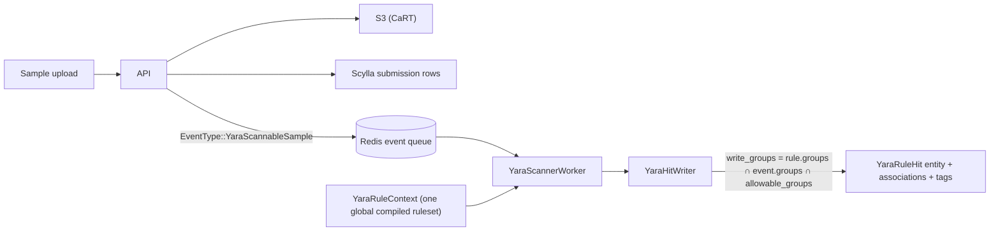

# Scalable YARA Scanning

---

**Status:** M0–M5 implemented

Make YARA rules first-class, group-scoped Thorium entities (`YaraRule`), scan every
sample's raw bytes event-driven in the event-handler against one globally compiled
ruleset, and partition the resulting hits at write time so that a user sees a hit if and
only if some group of theirs can see **both** the rule **and** the sample. Every hit is a
first-class `YaraRuleHit` entity attributed to the exact rule entity — and, via content
hash, the exact rule text — that fired.

## Motivation

### 1. Group-scoped rules instead of a baked-in ruleset

The only YARA in Thorium today is a legacy tool image that shells out to the yara CLI
against a `rules.bin` compiled into the image
(`tools/images/github.com/virustotal/yara/run_yara.py:31`). Changing one rule means
rebuilding and republishing the image; every pipeline that uses it scans with the same
ruleset. Rules as entities give per-group, self-service create/update/delete through the
API and UI, with compile validation at submission time instead of scan time.

### 2. "My rules ran on every sample I can see"

Samples are deduplicated by sha256 with per-group submission rows, so a user's corpus is
every sample some group of theirs can see — including samples **uploaded by other
groups**. Users reasonably expect their rules to have run against all of it; a pipeline
tool only runs where a pipeline happens to be wired. **This is the motivation that
justifies the work**: the event triggering (new submissions *and* group additions), the
single global scan pass, and the write-time intersection partitioning all exist to make
that expectation true (see [Cache Invalidation and Freshness](./cache.md)). The other
motivations below are real but secondary.

### 3. Hit-to-rule attribution

The legacy tool records a hit as a tag whose value is a rule name regex-parsed from CLI
stdout — rule names collide across groups, carry no match metadata, and leave no edge in
the association graph. First-class hits carry bounded match metadata plus `rule_hash` and
`engine_version`, an `AssociationKind::CreatedBy` edge from the rule, and a new
`AssociationKind::YaraRuleHit` edge to the sample, so triage can walk from a hit to the
exact rule and back (see [Hits and Attribution](./hits.md)).

### 4. Retiring unscoped `YaraRuleHits` tags

Legacy hits surface as `YaraRuleHits` tags
(`tools/images/github.com/virustotal/yara/run_yara.py:52`) written into whatever groups
the reaction ran in — unrelated to who can see the rule. The UI already styles these as
danger tags (`ui/src/components/tags/tag_groups.ts:36`), and its association-graph badge
scoring (`ui/src/components/associations/shared/scaling.ts:14`) keys on the singular
`YaraRuleHit`; this design keeps the convention but writes the tags only into the hit's
partitioned groups, with trigger depth propagated so hit tags cannot restart
reaction-trigger chains at depth zero.

## Non-Goals

- **Repo scanning.** `YaraRuleAppliesTo` ships with `Samples` only; repos are large
  bundles with a different download/caching path. The enum exists from day one so adding
  `Repos` later is additive (see [YaraRule Entity](./rule_entity.md)).
- **Rule sharing beyond groups.** Rule visibility is group membership, exactly like every
  other entity — no public rules, no cross-group grants.
- **Full rule version history.** Updates overwrite the rule in place; the `rule_hash`
  content hash recorded on every hit attributes the exact text that fired. Version rows
  are out of scope.
- **Elasticsearch indexing of hits.** Hits are queryable as entities and tags; wiring
  them into the search-streamer is deferred.
- **Replacing the legacy pipeline tool.** The tool image keeps working as an ordinary
  pipeline tool during and after rollout; this design replaces it only as the always-on
  scanning path.

## Scan Path at a Glance

## Reading Order

1. [Current State](./current_state.md) — the sigma scanning machinery this design extends,
   the legacy YARA tool, and the gaps in both, with code references.
2. [Design](./design.md) — the seven core decisions, with one page per subsystem below.
3. [YaraRule Entity](./rule_entity.md) — the `YaraRule` metadata model, validation,
   intrinsic tags, and API/UI surface.
4. [Engine Choice](./engine.md) — why `yara-x`, and what its compatibility limits cost.
5. [Ruleset Compilation and Caching](./ruleset.md) — the global `YaraRuleContext`,
   per-rule quarantine, and the serialized-ruleset cache.
6. [Scan Triggering](./triggering.md) — `EventType::YaraScannableSample`, its emission
   sites, and the `YaraScanTrigger` variants.
7. [Scan Execution](./execution.md) — where scans run: inside the event-handler,
   horizontally scaled with ownership-scoped reclaim at M3.
8. [Visibility and Partitioning](./visibility.md) — the write-groups intersection, the
   no-leak argument, and revocation.
9. [Hits and Attribution](./hits.md) — the `YaraRuleHit` entity, deterministic identity,
   associations, and tags.
10. [Hunts and Rule Sets](./hunts.md) — user-created hunts over bounded history: the
    generic chassis, frozen rule snapshots, finding attribution, and the engine plugs.
11. [Generic Hunt Trade-offs](./hunt_tradeoffs.md) — why hunts are a generic chassis
    with per-engine plugs, what stays engine-specific, and what that costs.
12. [Scaling and Performance](./performance.md) — the cost model, hot/slow-rule
    quarantine, and queue health.
13. [Cache Invalidation and Freshness](./cache.md) — per-component cache flags and the
    staleness bound.
14. [Risks and Open Questions](./risks.md) — what can go wrong and what is undecided.
15. [Whats Left To Do](./whats_left_to_do.md) — milestones M0-M4 and everything
    explicitly deferred.
